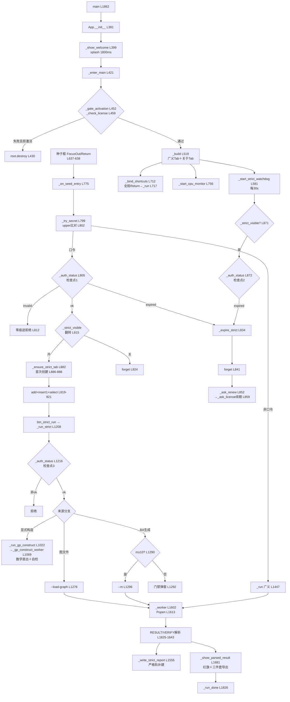

# v0.3 GUI 函数调用关系（G2-B 第一轮 · 审计件 2/4）

- **日期**：2026-11-10
- **对象**：`G2-B_实施工作区/01_源码副本/hamilton_ui_v2.py`（工作副本，与 tar 正源逐字节一致）
- **正源哈希**：SHA256 前缀 `ede0c6df6082`，95,562 B，1869 行（完整值见 `00_基线/G2-B_实施前资产基线.md` 与 `asset_baseline.json`）
- **方法**：1869 行整读（本会话链内完成）＋本轮 grep 逐锚点复核（def/class 全表、绑定行、定时器行、共享状态行均为本轮现跑取值，非记忆）
- **配套件**：`v0.3_GUI原始功能清单.md`（F01–F34 九字段清单＋N1–N9 壳层新发现）；本件行号均指工作副本

---

## 一、函数锚点总表（本轮 grep 实测）

模块级函数：

- L26 `parse_construct_params(fam, raw)` —— 13 族参数解析
- L63 `construct_seq_and_check(fam, params)` —— 13 族序列生成器＋is_real 判据（内含 13 组嵌套 `g()`/`real()`，L71–L240）
- L356 `resource_path(name)` —— PyInstaller 资源定位
- L364 `get_cpu_percent()` —— wmic CPU 采样
- L1862 `main()` —— 入口

`class App`（L380）方法全表：

| 行号 | 方法 | 行号 | 方法 |
|---|---|---|---|
| 381 | `__init__` | 1006 | `_toggle_strict_gen` |
| 399 | `_show_welcome` | 1012 | `_toggle_strict_gp` |
| 421 | `_enter_main` | 1022 | `_run_gp_construct` |
| 437 | `_load_saved_license` | 1069 | `_gp_construct_worker` |
| 444 | `_save_license` | 1208 | `_run_strict` |
| 452 | `_gate_activation` | 1335 | `_rewrite_edgelist_head` |
| 465 | `_ask_license`（内嵌 on_activate L487 / on_quit L503） | 1350 | `_read_report_status` |
| 519 | `_build` | 1372 | `_toggle_gen` |
| 583 | `_license_status_text` | 1378 | `_browse` |
| 593 | `_build_solve_tab` | 1387 | `_log` |
| 688 | `_build_about_tab` | 1392 | `_set_result` |
| 712 | `_bind_shortcuts` | 1399 | `_clear` |
| 720 | `_zoom` | 1405 | `_copy_result` |
| 731 | `_select_all` | 1416 | `_stage_cn` |
| 741 | `_show_help` | 1434 | `_start_memes`（内嵌 tick L1435） |
| 756 | `_start_cpu_monitor`（内嵌 tick L757） | 1441 | `_stop_memes` |
| 775 | `_on_seed_entry` | 1447 | `_run` |
| 781 | `_auth_status` | 1532 | `_continue` |
| 799 | `_try_secret` | 1555 | `_write_strict_report` |
| 828 | `_is_activated` | 1602 | `_worker` |
| 834 | `_expire_strict` | 1681 | `_show_parsed_result` |
| 852 | `_ask_renew` | 1794 | `_read_report_path` |
| 863 | `_start_strict_watchdog` | 1826 | `_run_done` |
| 868 | `_strict_auth_watchdog` | 1856 | `_stop` |
| 882 | `_ensure_strict_tab` | 890 | `_browse_strict` |
| 899 | `_build_strict_tab` | | |

---

## 二、十一条调用链（任务书 §4.3 要求项全覆盖）

### 链① 主窗口初始化

```
main() L1862
 └→ tk.Tk() ＋ App(root) L1864–1866（推断行段：main 体内）
     └→ App.__init__ L381
         ├→ self.proc = None L383（全局唯一进程句柄，两轨共用——见 §四风险 S1）
         ├→ 彩蛋会话状态字段初始化 L391–395（_strict_visible / _strict_tab_created / tab_strict / _strict_watch_job / _expired_notified）
         └→ _show_welcome() L399
             ├→ root.withdraw() L400 ＋ splash Toplevel L401–417
             └→ splash.after(1800, _enter_main) L419
                 └→ _enter_main() L421
                     ├→ splash.destroy L422 ／ root.deiconify L423 ／ title L424 ／ state('zoomed') L426
                     ├→ _gate_activation() L429（失败→root.destroy L430，程序终止）
                     ├→ _build() L432 → L519
                     │   ├→ ttk.Style 深色主题 L520–545
                     │   ├→ 品牌水印 L548–551
                     │   ├→ notebook L553–554
                     │   ├→ tab_solve（广义）L556–558 → _build_solve_tab L593
                     │   ├→ tab_about L560–562 → _build_about_tab L688
                     │   ├→ 状态栏（status/license/cpu/版本）L565–578
                     │   └→ _start_strict_watchdog() L581（链⑪）
                     ├→ _bind_shortcuts() L433 → L712（Ctrl±缩放 L713–715、F1 帮助 L716、全局 Return→_run L717、Ctrl-A L718）
                     └→ _start_cpu_monitor() L434 → L756（tick 每 2s，wmic L364）
```

要点：**激活门禁在 `_build` 之前**（L429 先于 L432）——未激活连主界面都不构建，这是冻结行为 8 的第一道闸；严格 Tab 零痕迹（冻结行为 2）由链③④的第二道闸保证。主窗口**没有** `WM_DELETE_WINDOW` 钩子（全文件仅激活对话框 L513 有 protocol）——关闭即进程退出，子进程清理缺失（N8）。

### 链② 激活入口

```
_enter_main L429
 └→ _gate_activation() L452
     ├→ _check_license is None → 报错退出 L455–457（auth 模块缺失兜底）
     ├→ _load_saved_license() L458 → L437（读 %APPDATA%\YS_HAMILTON\license.key，L284–285 定义）
     ├→ _check_license(saved or '', PRODUCT_ID) L459（auth.pyd 接口，返回 (ok, msg, state)）
     │   ├→ ok=True → _license_info 缓存 L461 → 放行 L462
     │   └→ ok=False → _ask_license(msg) L463 → L465
     │       ├→ 激活对话框（Toplevel，grab_set L514，wait_window L515）
     │       ├→ on_activate L487：取 key L488 → 空检查 L489–491
     │       │   → _check_license(key, PRODUCT_ID) L493（verify→首用自动 activate，一用一废）
     │       │   → ok：_save_license L495 → L444（写回 license.key）
     │       │        ＋ _license_info L496 ＋ _expired_notified=False L497（续期重置）
     │       │        ＋ result['ok']=True L498 → dlg.destroy L499
     │       │   → 失败：showerror L501（留在对话框可重试）
     │       └→ on_quit L503 / WM_DELETE_WINDOW L513 → result['ok']=False → 门禁拒绝 → 程序退出
```

要点：`_check_license` 即 L272 `from auth import check_license as _check_license`（sys.path 注入 server_v2 目录 L265–270）。**同一接口三处复用**：门禁 L459、激活 L493、状态复查 L789——v0.5 的 auth_bridge 只包这一个签名，三代产品（v0.3 正源／v0.4 融合壳／v0.4 换芯版）签名一致（证据见实施设计 §授权边界）。

### 链③ 彩蛋入口

```
广义页种子框 entry_seed（_build_solve_tab 内创建）
 ├→ bind("<FocusOut>", _on_seed_entry) L637
 └→ bind("<Return>", _on_seed_entry) L638
     └→ _on_seed_entry(event) L775
         └→ _try_secret() L777 → L799
             ├→ raw = var_seed.get().strip() L801
             ├→ raw.upper() != SECRET_PHRASE('/YUNSHAO-STRICT' L773) → return False L802–803
             │   （False 时 _on_seed_entry 返回 None → Return 事件继续冒泡到全局 L717 → _run；
             │     命中口令时返回 True → _on_seed_entry 返回 'break' L778 拦截全局 Return）
             ├→ 命中：var_seed.set('') L804（清空种子框）
             ├→ _auth_status() L805 → L781
             │   └→ _load_saved_license L788 → _check_license(saved, PRODUCT_ID) L789
             │       → ok：重置 _expired_notified L793，返回 'ok'
             │       → state=='expired'：返回 'expired' L795–796
             │       → 其余：返回 'invalid' L797
             ├→ 'expired' → _expire_strict(notify=True) L808（链⑤）
             ├→ 非 'ok'（未激活/无效）→ 状态栏"种子参数无效" L812（零痕迹：不创建任何严格对象）
             └→ 'ok' → _strict_visible 翻转 L815
                 ├→ True：链④（创建/显示）
                 └→ False：notebook.forget(tab_strict) L824 ＋ 状态栏"已隐藏" L825
```

要点：大小写不敏感＝`raw.upper()` L802；会话级＝`_strict_visible` 内存字段（不落盘）；再输隐藏＝L815 翻转。**口令检查点 1（三重复查之一）就在 L805**。

### 链④ 严格页创建

```
_try_secret L816–822（授权 ok 且翻转为显示）
 └→ _ensure_strict_tab() L817 → L882
     ├→ _strict_tab_created 已 True → 直接返回 L884–885（会话内只建一次）
     └→ 首次：tab_strict = ttk.Frame(notebook) L886
         → _build_strict_tab(tab_strict) L887 → L899
         │   （N=10000/m=10/seed=42 默认值、图文件框、13 族显式构造区、
         │     运行/停止按钮 L972 附近、独立日志/结果/进度控件）
         → _strict_tab_created = True L888
 └→ notebook.add(tab_strict, "严格求解") L819
 └→ notebook.insert(1, tab_strict) L820（插在广义与关于之间）
 └→ notebook.select(tab_strict) L821
 └→ 状态栏"严格模式已开启" L822
```

要点：**未激活时 `_ensure_strict_tab` 永远不会被调到**（链③在 L810–813 已截断）→ `winfo_children` 探测零痕迹（冻结行为 2，P1-1）。隐藏后再开不重建（L884 短路），控件状态保留——这是"会话级"的实现细节，v0.5 原样保留。

### 链⑤ 严格页销毁或隐藏

```
三个触发源：
 A. 再输口令（链③ L824）：notebook.forget —— 仅从 notebook 摘除，对象保留
 B. 口令时已过期（链③ L808）
 C. watchdog 发现过期（链⑪ L874）
 B/C 汇入：
 └→ _expire_strict(notify=True) L834
     ├→ _strict_visible = False L838（会话内严格许可立即失效）
     ├→ tab_strict 非 None → notebook.forget L839–843（try/except 兜底）
     ├→ 状态栏"授权已过期，请续期" L844
     └→ notify 且未提示过 → _expired_notified=True L846
         → root.after(0, _ask_renew) L848
             └→ _ask_renew() L852
                 ├→ root.winfo_exists 检查 L855
                 └→ askyesno"是否现在续期" L857–858
                     └→ 是 → _ask_license(title="产品续期") L859（复用链②对话框；
                            成功 → L497 重置 _expired_notified → 下次口令恢复）
```

要点：**过期只锁严格层**——`_expire_strict` 不碰 tab_solve、不碰广义引擎流程（L837 注释明示）；广义 walk 不受扰（冻结行为 3）。注意 v0.3 语义：过期后严格 Tab **对象仍在内存**（曾创建过），只是 forget＋许可失效；"零痕迹"只约束**未激活**态。v0.5 保持同语义，回归测试分两态断言。

### 链⑥ 广义求解入口

```
两个触发源：
 A. btn_run 按钮（_build_solve_tab L643 附近 command=_run）
 B. 全局 Return L717（root.bind → lambda: _run()）
 └→ _run() L1447
     ├→ solver = resource_path(SOLVER_NAME='solver_verify.exe' L280) L1448
     ├→ 引擎存在检查 L1449–1451
     ├→ 图文件分支（var_path 非空）：
     │   ├→ 文件存在检查 L1457–1459
     │   ├→ gf.detect_format L1463；非 edgelist/dimacs → gf.convert_to_edgelist L1467
     │   │   → 固定临时名 %TEMP%\ys_graph_input.edges L1466（N5：跨任务共享名）
     │   └→ args.append(actual_path) L1479
     ├→ BA 生成分支：int 校验 N/m/seed L1482–1486 → 正数检查 L1487–1489
     │   → args += ["--ba", n, m, seed] L1490
     ├→ 输出命名：ts 时间戳 L1494 → base 清理 L1495–1500
     │   → report_name / _path_file_name L1501–1502
     ├→ 桌面优先试写 L1504–1510 → 失败降级 TEMP L1511–1512
     │   → _output_dir / _output_path / _path_file_path L1513–1515
     ├→ BA 模式占位尾 L1517–1519（"__ba_placeholder__" ＋ 输出路径）
     ├→ UI 置运行态 L1522–1528（清日志/结果、禁 run、启 stop、进度条、_start_memes L1528）
     └→ threading.Thread(target=_worker, args=(args,), daemon=True).start() L1530（链⑧）
```

要点：**广义 `_run` 没有忙检查**（grep 证实 proc.poll 检查只在 L1026/L1219，不在 L1447–1530）——连点可并发起多个 worker，共抢 `self.proc` 与 `_output_path`（N6/S1/S2）。`_continue` L1532 是广义专属续跑（budget×2 或 +7200，L1536–1545），复用 `_last_args`。

### 链⑦ 严格求解入口

```
btn_strict_run（_build_strict_tab L972 附近 command=_run_strict）
 └→ _run_strict() L1208
     ├→ 【口令检查点 3：运行前】_auth_status L1216–1218 → 非 ok 拒绝
     ├→ 忙检查 L1219–1221（proc.poll）
     ├→ 显式构造分支（var_strict_gp 勾选）L1223–1224：
     │   └→ _run_gp_construct() L1022
     │       ├→ 忙检查 L1026
     │       ├→ parse_construct_params L26（族参数校验）
     │       ├→ construct_seq_and_check L63（取 seq_gen / is_real / N / E）
     │       └→ Thread(_gp_construct_worker) L1069（不走引擎，数学直出＋自检：
     │           N≤2M 全量检查 L1097–1111；>2M 抽样 首10000＋每10000取1 L1112–1125；
     │           status=complete/walk/partial L1129；报告/路径/图三件套自写）
     ├→ 图文件分支：存在检查 → gf 转换 L1244 附近（同固定 TEMP 名 N5）
     │   → _rewrite_edgelist_head L1335（补 "N E" 头行，strict load_edges 需要）
     │   → N 回填（var_strict_n 为空时读文件头）
     │   → args = [solver, n, seed, "--load-graph", path, "--budget", "3600"] L1276
     ├→ BA 生成分支：int 校验 → 正数检查 → 【m<10 门禁弹窗】L1290–1295（冻结行为 4）
     │   → args = [solver, n, seed, "--m", m, "--budget", "3600"] L1296
     ├→ 输出命名（strict 前缀）L1299–1315（桌面优先/TEMP 降级同链⑥）
     ├→ 【N1】占位尾 L1319–1321：无文件时 args.append("__ba_placeholder__")，
     │   然后 args.append(_output_path) —— G2-A 实测 CLI 无此协议，v0.5 适配器弃用，
     │   改 --dump 唯一任务目录（冻结行为 7 的导出语义由 GUI 层补建报告保留）
     └→ UI 置运行态 L1325–1332 → Thread(_worker, args=(args, ui_strict)) L1333（链⑧）
```

要点：严格引擎＝`STRICT_SOLVER_NAME='solver_strict_engine.exe'` L281；严格轨传独立 ui 字典（独立日志/结果/进度/按钮，memes=False），广义轨 ui=None 走默认控件——**两轨 UI 控件已隔离，但进程句柄与输出路径字段未隔离**（S1/S2）。

### 链⑧ 引擎调用函数（_worker，两轨共用）

```
Thread 启动（链⑥ L1530 + ui=None ／ 链⑦ L1333 + ui=严格控件字典）
 └→ _worker(args, ui) L1602
     ├→ ui 缺省补齐 L1604–1607
     ├→ env 注入 YS_AUTH_TOKEN L1611–1612（token 值不出现在任何新文件中）
     ├→ self.proc = subprocess.Popen(args, stdout=PIPE, stderr=PIPE, text, utf-8, bufsize=1, env) L1613–1615
     ├→ for line in proc.stderr: L1616
     │   └→ root.after(0, _log(line)) L1617 ＋ _stage_cn 阶段翻译 L1618–1620
     ├→ proc.wait() L1621
     ├→ out = proc.stdout.read() L1622（【N7】先 wait 后读 stdout：管道写满即死锁）
     ├→ 逐行解析 L1625–1643：
     │   ├→ "V=" 开头 → result_line（walk 引擎原生格式）
     │   ├→ "RESULT " 开头 → kv 解析 → 转 V= 格式 L1630–1639（严格引擎协议适配）
     │   └→ "VERIFY " 开头 → strict_line L1640–1641
     ├→ rc = proc.returncode L1644
     ├→ 严格轨：strict_line 非空 → _write_strict_report(result_line, strict_line, out) L1646–1650 → L1555
     │   （【N2】strict_ok 判定含 OR 自报分支 L1571；【N3】E=0/seed=0/[path]空 L1578–1600）
     ├→ result_line 非空 → root.after(0, _show_parsed_result, ...) L1652（链⑩）
     ├→ rc==0：unique<V → "求解超时…可继续" L1662–1666（btn_continue 启用）；否则"求解完成"
     ├→ rc!=0 → "求解异常（退出码 rc）" L1672
     ├→ except → 日志[错误]＋状态"发生错误" L1674–1676
     └→ finally → root.after(0, _run_done, ui) L1679
         └→ _run_done L1826：进度停/按钮复位 L1828–1844 → _stop_memes L1845
             → 删除 _converted_tmp L1848–1854
```

停止按钮：`_stop` L1856 → `proc.kill()` L1858（仅杀当前句柄；无任务目录清理、无句柄登记簿）。

### 链⑨ 验证函数（如实记录：v0.3 无独立裁判）

```
v0.3 现状三条"验证"路径，全部是 runner 自报或自检，无 runner≠judge 分离：
 A. 引擎报告读回：_read_report_status(report_file) L1350
    └→ 读 [summary] status: complete/walk L1355–1366（只翻译文案，不复算路径）
 B. 结果展示红旗：_show_parsed_result L1681
    └→ expansion≠1 或 real<1 → ⚠ 非严格解标红 L1698–1709（依据引擎自报数字）
 C. 显式构造自检：_gp_construct_worker L1090–1128
    └→ 用同一 is_real 判据自查自产序列（全量/抽样），自报 complete/walk/partial
外部裁判现状：G2-A 已建 07_独立验证/judge_strict_path.py（独立进程、重读图、
  查长度=N/无重复/全覆盖/步步真边），33 用例全由它复核——v0.5 经适配器接线（可新增项）。
```

要点：这是 v0.3 的**真实缺口**而非冻结行为——冻结行为 6 只要求"分账如实标注"，独立验证器接线属于 01 正本 §六"可新增"清单。v0.5 在 strict_adapter 内强制第四关（SOLVED 必须裁判 PASS），不改变 v0.3 任何既有显示语义。

### 链⑩ 导出函数

```
引擎轨（广义＋严格共用）：
 _worker L1652 → _show_parsed_result(line, output_path, result_widget) L1681
     ├→ kv 解析 L1682–1686；real 百分比显示 L1688–1691（【N4】float('True') 显示缺陷）
     ├→ 非严格解红旗 L1698–1709
     ├→ 结果面板拼装（状态/指标/验证/路径预览）L1711–1743
     ├→ 路径文件导出 L1745–1752：_read_report_path L1794 读报告 [path] 段
     │   → 每行 10 节点空格分隔写 _path_file_path（冻结行为 7）
     │   （严格轨报告 [path] 段为空 N3 → 路径文件实际拿不到序列，v0.5 用 --dump 补齐）
     ├→ 图文件导出 L1758 附近：BA 模式重生成边表／文件模式复制原图
     └→ 完成弹窗"已存到…" L1773–1790（桌面/TEMP 位置告知，冻结行为 7）
 严格报告补建：_write_strict_report L1555（[summary]/[verification]/[failed_edges]/[path]
     四段，version: v0.3-strict-engine L1575——段格式冻结，字段值 v0.5 填真）
 显式构造轨：_gp_construct_worker 内自写三件套 L1078–1171（同协议）
 辅助：_read_report_path L1794（[path] 段解析）；_copy_result L1405（剪贴板）
```

### 链⑪ 定时 watchdog

```
_build L581
 └→ _start_strict_watchdog() L863
     └→ _strict_watch_job 为 None 时：root.after(30000, _strict_auth_watchdog) L865–866
         └→ _strict_auth_watchdog() L868（每 30s）
             ├→ 仅当 _strict_visible L871：
             │   └→ _auth_status() L872（链③同一函数，_check_license 复查）
             │       └→ 'expired' → _expire_strict(notify=True) L874（链⑤）
             └→ 重新武装 root.after(30000, ...) L878（异常→job=None L880）
```

要点：**口令检查点 2**。watchdog 在主界面构建时就武装（L581），但只在严格 Tab 显示期间动作（L871）——广义不受扰。三重复查齐备：口令时 L805／watchdog L872／运行前 L1216。

---

## 三、Mermaid 生命周期流程图



---

## 四、共享状态与并发风险注记（v0.5 改造直接输入）

- **S1 单一进程句柄**：`self.proc` L383 全局唯一；广义 `_run` 无忙检查（链⑥），严格/构造有（L1219/L1026）。两轨并发或连点广义 → 句柄互相覆盖，`_stop` L1858 只杀最后一个。v0.5：eng_host 句柄登记簿＋每任务独立 Popen＋关闭时全杀（N8）。
- **S2 输出路径字段共享**：`_output_path`/`_path_file_path`/`_output_dir` 由链⑥⑦各自赋值，worker 与 `_write_strict_report`/`_show_parsed_result` 读同一字段 → 并发下报告写串。v0.5：每任务唯一目录，结果字典随任务走（缺陷③防污染）。
- **S3 固定 TEMP 转换名**：`ys_graph_input.edges` L1244/L1466 两轨共用同名 → 互相覆盖（N5）。v0.5：任务目录内唯一名。
- **S4 stdout 死锁**：先 `wait()` L1621 后 `stdout.read()` L1622，stderr 流虽在 drain 但 stdout 管道写满（约 4–64KB）即挂死（N7）。v0.5：eng_host 双流并行 drain 到文件＋硬超时（budget＋宽限）。
- **S5 跨线程 UI**：worker 一律 `root.after(0, ...)` 回主线程（L1617/L1652/L1679 等）——此纪律 v0.5 保留；窗口销毁后 after 回调需 winfo_exists 兜底（_ask_renew L855 已有样板）。
- **S6 关闭无清理**：主窗口无 WM_DELETE_WINDOW（仅激活对话框 L513 有）；daemon 线程＋无句柄登记 → 关窗后引擎子进程可能残留。v0.5：关闭钩子→登记簿全杀→临时目录策略（保留证据目录，只清转换临时件）。
- **S7 严格 Tab 对象生命周期**：创建一次（L884 短路）后会话内长存；过期=forget＋许可失效，对象不销毁；未激活=从不创建。三态语义 v0.5 原样保留，回归测试分别断言（冻结行为 2/3）。

---

## 五、§4.3 要求项覆盖核对

主窗口初始化＝链①；激活入口＝链②；彩蛋入口＝链③；严格页创建＝链④；严格页销毁或隐藏＝链⑤；广义求解入口＝链⑥；严格求解入口＝链⑦；引擎调用函数＝链⑧；验证函数＝链⑨；导出函数＝链⑩；定时 watchdog＝链⑪。**11/11 全覆盖，Mermaid 已附。**

---
*本件为只读审计产物；未修改工作副本任何字节（副本哈希与正源一致，见基线件）。行号本轮 grep/Read 现跑复核。*