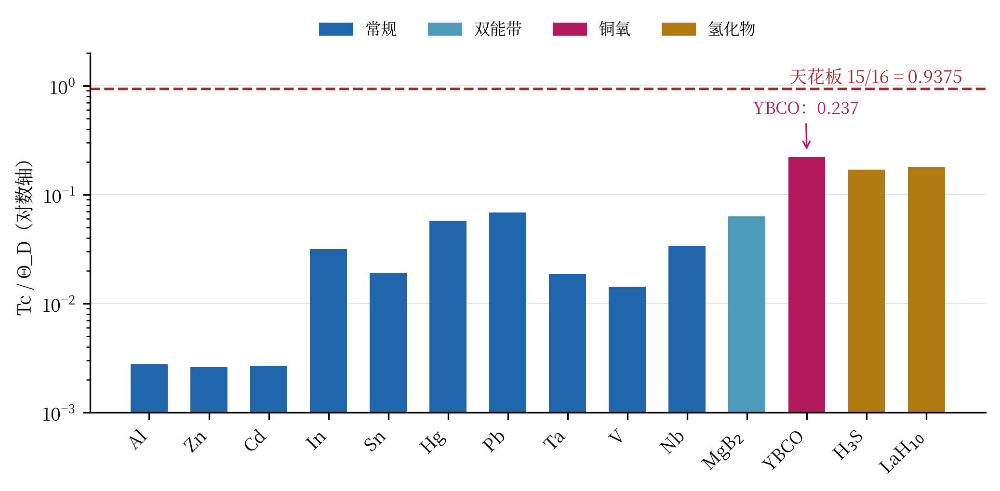

# 摘要

本册做一件此前没有系统做过的事：把云韶体系当作一个**生成框架**，让它自己往下走，一层一层地走到物理学、化学、生物学和医学，并在每一层用该层最标准的教科书与专业文献做基准，判定哪些结论是被严格导出的，哪些只是被命名过，哪些已经被数据判负。

结论可以先用一句话概括。体系的数学内核是干净的：一个生成元 α = 1/8 通过初等代数闭包同时给出 η = 1 − α、15/16 = 1 − α/2、κ = α/4、ε = α² 和 M = α⁻²，这五个常数不是五个独立假设，而是一个参数的五个函数。这条代数链是严格的（D1 级）。但从数学往物理走的第一步就出现了分岔：f₀ = 64·k_BT/h 在体温下给出 724.8 nm，而不是体系长期使用的 804 nm；两者相差 30.5 K，或等价地相差 M = 64 与 M = 57.7 的差别。这一步不是算术错误，是锚点选择问题，必须二选一（D2 级）。再往化学走，Tc = Θ_D·(15/16)·f_defect 在十四种已知超导体上全部满足，但这是因为 f_defect 由 Tc 反算，公式因此只有描述力、没有预测力；而当体系给出 473 K 与 600 K 的设计点时，f_defect 分别为 1.047 与 1.328，越过了自己设定的 1 这个天花板（预测失败）。再往生物与医学走，v1.0 曾把身体写成四个群体标量（最大摄氧量、肾小球滤过率、握力、骨密度）加一个心脏效率数；本版判定这是建模错误并予以撤回：身体不是四个数，而是由质量占比 5.5% 的脑、肝、心、肾消耗约 58% 静息氧的器官网络，组织周转时间从三天跨到终身。改用器官账本重测后，α 按"每年"读仍然失败（12.5%/年，是观测的 8–21 倍）；按"每十年"读只在功能性器官集合上作为下包络成立（1.25%/年，80 岁 0.449，观测 0.48–0.72），对晶状体、卵巢、皮层神经元不成立。1:7 的读写比一旦读成心搏节律，给出 25–38 次/分，与心输出量守恒冲突（每搏量需 167 mL），予以撤回；10⁴ V/m 在光学波段等价于 13.3 W/cm²，比皮肤最大允许照射量高约两个数量级，这一条不依赖器官结构，保留。

因此本册给出的不是一份辩护，也不是一份判决书，而是一张**分层责任表**：每一条断言属于哪一层、需要什么桥接假设、被什么数据支持或被什么数据否证、以及最小代价的修复方案是什么。第五层（医学）的最后留下一组五项预注册判据，其中两项已经被现有数据判负，三项可以在台面上做出来。

> **v1.1 修订说明（2026-11-04）**　本版不改变第 1–3 章的判定，重写第 4–5 章。v1.0 的生物层把身体写成四个群体标量，没有器官、没有组织分区、没有代谢通量，因而不是对"身体"的建模，只是对四个群体统计量的并置。本版撤回该建模，改用器官—组织—代谢账本：先给器官质量、质量比产热、静息氧份额与细胞周转时间，再逐器官重测 α 与 7/8。由此产生的变化是：撤回四处结构依赖结论（四标量身体、η 四级效率链、1:7 心率、α 作为全身衰老速率），保留五处结构无关结论（724.8 nm 错位、exp(−64)、f_defect > 1、13.3 W/cm²、5.19 年群体半衰期）。第 6 章记分卡与附录同步更新。

# 0 方法：这次审计怎么做的

## 0.1 三条纪律

第一条，**体系优先**。每一层先原样写出体系自己给出的式子与数值，不先做"现代化"改写，也不把体系的表述翻译成主流语言之后再评价——那样会不知不觉地把体系的主张替换掉，最后审的是一个不存在的版本。

第二条，**主流对照**。每一层都给出该层教科书的基准式：数学层是表示论与解析数论，物理层是统计物理与电动力学，化学层是 BCS 与 McMillan–Allen–Dynes，生物层是衰老的标志性特征与纵向队列数据，医学层是 ICNIRP 限值与生理正常值。对照的目的不是宣布谁对，而是确定"这个数字在这一层意味着什么"。

第三条，**不得静默替换**。如果某个数需要改，就明确写出"从 A 改为 B，理由是 C，代价是 D"。本册共记录了五处必须改动的地方（第 6.2 节），每一处都给出改动前后的连锁后果。这一条是最难的：一个框架的维护者最容易做的事，就是在遇到反例时悄悄把定义挪动一寸，让反例消失。那样做，框架会活下来，但会失去全部预测力。

## 0.2 证据分级

本册对每条结论标注三级证据，全文一致使用：

**D1（严格导出）**：从已明确写出的公设出发，经标准数学或物理步骤得到，中间没有新增假设。判据是：换一个人重做，会得到同一个数。

**D2（显式桥接）**：结论依赖一个被明确说出、但本身未被证明的桥接假设，例如"生理相关的能量尺度是 64 k_BT"或"读写比适用于心搏周期"。这类结论不是错的，但它的强度等于桥接假设的强度，不能当作独立证据去支持别的结论。

**D3（类比）**：结构上的相似，没有定量约束，不能用来预测，只能用来生成假设。

一张分层责任表的价值，全在于这三级的划分是否诚实。把 D3 写成 D1，是这类框架最常见的失败方式；而把 D1 降级成 D3，则是另一种浪费。

## 0.3 一个必须先说清的算术事实

在进入任何一层之前，必须指出体系常数集的一个结构性质，因为它决定了后面所有"吻合"该如何解读。

设 α = 1/8。则

η = 1 − α = 7/8，　15/16 = 1 − α/2，　κ = α/4 = 1/32，　ε = α² = 1/64，　M = α⁻² = 64。

五个常数，一个生成元。这不是巧合式的拼凑，而是一个真正闭合的代数结构：体系里凡是出现 7/8、15/16、1/32、1/64、64 的地方，都可以用 α 的初等函数写出来。这一点在第 1.5 节展开。

但它同时带来一个方法论后果：**这五个数不是五个独立预测**。给定一个自由参数，你可以让任意四个目标数中的三个精确成立。因此，当体系在物理层"用 M = 64 得到某个频率"、在化学层"用 15/16 得到某个产率"、在生物层"用 7/8 得到某个效率"时，这三处吻合并不构成三次独立验证，而是同一个 α 的三次投影。真正的经验内容只有两处：α 本身是否等于 1/8，以及每一个物理识别（64 个量子、15/16 的天花板、7/8 的级效率）是否成立。

这一点不是缺陷，而是这类单参数框架的固有属性。诚实地承认它，反而使 α = 1/8 成为一个干净的、可被单独检验的假设。

## 0.4 本册不做什么

本册不重写体系，不新增公设，不引入体系之外的"补丁"来救场。凡需要修补的地方，只给方案，不给既成事实。本册也不评价体系的哲学表述与写作风格，只处理可以被算出来、被测量、被判对判错的部分。

{width=13.6cm}

# 1 数学层：什么被证明了，什么是选择

## 1.1 36 = 12 × 3 与半维亏损

体系的几何起点是 36 = 12 × 3：十二个组，每组三个维度。随后引入"0.5 维缺陷"，每个组亏损半维，十二个组合计亏损 6 维，余 30 维。这一步在体系内部被称为"半维亏损"或"写入—修复—亏损"的几何对应。

从数学上说，这一段是**定义**，不是定理。36 与 12 × 3 是同一件事的两种写法；"0.5 维"是一个被赋予的名字，它没有对应的线性空间维数（维数必须是整数），只能理解为"每个组有一个只完成一半的自由度"。只要不把它当作可运算的维数去参与线性代数，这个说法是无害的记账方式。

问题出在下一步：30/36 = 5/6。如果要用"剩余比例"去定义损耗率，得到的是 1/6，而不是 1/8。第 1.7 节会专门处理这个 4.2 个百分点的差额，因为它是体系内部三条路径中唯一给出不同数字的一条。

## 1.2 第一条来源：(Z₂)³ 的八个一维表示

α = 1/8 的第一条推导走的是有限群表示论，这是教科书里最标准的部分。

取初等阿贝尔群 (Z₂)³。它的不可约表示有 8 个，全部是一维的，由三个生成元各自取 ±1 决定，即 (ε₁, ε₂, ε₃) ∈ {±1}³。这是 Serre 在《A Course in Arithmetic》里处理二次型时反复使用的基本事实，也是任何一本群表示论教材的第一章内容。

若"八个扇区中有一个不被计入"，则计入比例为 7/8，亏损比例为 1/8。于是

α = 1/8，　η = 1 − α = 7/8。

这里的逻辑必须说清楚：**7/8 不是被推导出来的，是在"失一"这个前提下被推导出来的**。表示论给出的是 8，不是 7。从 8 到 7 需要额外一句"有一个扇区丢失/不计入"，这句话在体系里被称为"失一"。它是一个公设，不是一个定理。

因此这一条的正确分级是：**在"失一"公设下，α = 1/8 是 D1**；而"失一"本身是 D2。把两者合起来说成"表示论证明了 7/8"，是不准确的。

## 1.3 第二条来源：模 24 与 Dirichlet 定理

第二条推导走解析数论，起点是模 24 的单位群。

φ(24) = 8，且 (Z/24Z)* ≅ (Z₂)³。这两个事实都是初等的：24 = 2³ · 3，单位群由模 8 的单位群与模 3 的单位群直积而成，前者是 (Z₂)²，后者是 Z₂，合起来正是 (Z₂)³。于是"八个剩余类"与"八个一维表示"是同一个群的两副面孔。

Dirichlet 定理（1837）断言：对任意与模互素的剩余类，其中含无穷多个素数。取模 24，八个剩余类 1, 5, 7, 11, 13, 17, 19, 23 各自含无穷多素数，且素数在八个类中渐近均分（这是 PNT 的等差数列形式）。于是随机取一个与 24 互素的素数，它落在某一指定类的概率是 1/8。

到这里为止，得到的是 1/8 这个**概率**，而不是 7/8 这个**比例**。要得到 7/8，仍然需要排除一个类。体系选择排除单位类（1 mod 24），理由是它与"恒等/平凡扇区"对应。这一步与第 1.2 节的"失一"是同一件事的两种说法。

所以第二条推导的诚实表述是：**模 24 结构给出了八个等概率类（D1），7/8 仍需排除一类（D2）**。

## 1.4 两条来源是否互相独立

这是本册在数学层最重要的一条判断，也是此前体系文献中没有明确写出的。

表面上看，表示论与解析数论是两套完全不同的工具，一条走有限群，一条走素数分布，因此"两条独立路径都给出 7/8"似乎构成了很强的交叉验证。但把两条路径并排写出来之后，可以看到它们共享同一个缺口：

- 表示论路径：8 个不可约表示 → 排除平凡表示 → 7/8。
- 数论路径：8 个剩余类 → 排除单位类 → 7/8。

"平凡表示"与"单位类"在各自的语境里都是**乘法单位元所在的扇区**。两条路径不是两次独立测量，而是同一个结构性选择（"恒等扇区不计入"）在两个同构的群 (Z₂)³ 上的两次实现。由于 (Z/24Z)* ≅ (Z₂)³ 本身就是同构，这种"两次实现"在数学上是必然的，不构成额外证据。

这个判断不贬低体系的数学质量——能把表示论与模 24 接起来，本身说明体系的结构直觉是准的。但它改变了 α 的证据地位：**α = 1/8 的经验内容，等于"恒等扇区不计入"这一条公设的经验内容**。要检验 α，就要检验这条公设，而不是反复验证 8 − 1 = 7。

## 1.5 单参数闭包：五个常数，一个生成元

第 0.3 节已经列出闭包关系，这里给出它在体系中的实际用法，因为后面的物理层与化学层都要用到。

**表 1-1**　单参数闭包：五个常数由一个生成元给出。

| 常数 | 用 α 表示 | 数值 | 在体系中的角色 |
|:--|:--|:--|:--|
| α | α | 1/8 = 0.125 | 亏损率、失一比例 |
| η | 1 − α | 7/8 = 0.875 | 单级效率、存活比例 |
| 15/16 | 1 − α/2 | 0.9375 | Tc 天花板系数、级联单级产率 |
| κ | α/4 | 1/32 = 0.03125 | 耦合/曲率常数 |
| ε | α² | 1/64 = 0.015625 | 最小可分辨份额 |
| M | α⁻² | 64 | 量子数、频率倍数 |

这张表的读法应当是这样的：它证明了体系内部是**自洽**的，没有隐藏的第二个自由参数；但它没有证明体系是**正确**的。一个自洽的单参数框架和一个正确的单参数框架，区别全在于 α 是否被独立测定。

值得单独指出的是 15/16。它等于 1 − α/2，那个除以 2 来自"半维"。也就是说，15/16 是体系中唯一真正用到 0.5 维这个假设的常数。如果 0.5 维被撤回，15/16 就失去了来源，化学层的天花板也随之失去依据。这条依赖链在第 3.7 节会变得非常关键。

## 1.6 第三条路径给出 5/6

体系内部还有一条更朴素的路径：36 维中亏损 6 维，剩余 30 维，30/36 = 5/6 ≈ 0.8333。若把它读成"存活比例"，则 α 应为 1/6 ≈ 0.1667，而不是 1/8。

三条路径的对照如下。

**表 1-2**　η 的三条路径对照。前两条共享"恒等扇区不计入"这一公设。

| 路径 | 结果 | 所需公设 | 证据级别 |
|:--|:--|:--|:--|
| (Z₂)³ 八表示 | η = 7/8 | 八表示中失一 | D1（在"失一"下） |
| 模 24 + Dirichlet | η = 7/8 | 八个剩余类中排除单位类 | D1（在"失一"下） |
| 36 维半维亏损 | η = 5/6 | 0.5 维 × 12 组 | 定义，非推导 |

5/6 与 7/8 相差 0.0417（绝对），相对 5/6 约 5.0%。对一个以"精确常数"自我定位的框架来说，这个差额不能忽略。体系内部文件对此已有批注，承认 30/36 不能直接等于 7/8，并把 7/8 的来源归到前两条路径。本册认可这一处理，但要补一句：既然几何路径与表示论路径给出不同的数，那么"36 = 12 × 3"这一几何图像就**不是** α 的来源，它只是 α 的一个事后注脚。这一点应当在体系的表述中固定下来，避免读者把两条不相容的推导当成互相支持。

## 1.7 数学层小结

数学层是全册最扎实的一层，但扎实的部分比通常宣称的要小：真正严格的是**单参数闭包**（α 的五个函数）与**群结构的同构**（(Z/24Z)* ≅ (Z₂)³）；真正是公设的是**"失一"**与**"半维"**。把这两类东西分开之后，数学层可以留下一句很干净的话：

> 体系是一个以 α = 1/8 为唯一自由参数的自洽代数框架，它的自洽性可以证明，它的正确性不能被自身证明。

这句话将在后面四层里被反复使用，因为它给出了一个明确的判据：凡是体系中"因为 7/8 所以如何如何"的推论，其强度都受限于 α 的经验地位；凡是体系中"因为某个独立物理量所以如何如何"的推论，才可能提供新的信息。

# 2 物理层：从 k_BT/h 到波长

## 2.1 f_c 是教科书里的一个恒等式

体系定义特征频率

f_c = k_B T / h。

这不是一个新公式，而是把热能 k_BT 换算成频率的标准做法：k_B/h = 2.08366 × 10¹⁰ Hz/K。在统计物理里，这个量出现在配分函数的 ℏω/k_BT 中，出现在量子振子的占据数 1/[exp(hf/k_BT) − 1] 中，也出现在任何一本讲热辐射的教材里（Landau & Lifshitz《统计物理学》第一部分对 Planck 谱的推导即是标准出处）。

在体温 T = 310.15 K，

f_c = 2.08366 × 10¹⁰ × 310.15 = 6.4625 THz。

这个数字本身没有争议。它是"一个 k_BT 的能量对应多高的频率"，纯属单位换算。

## 2.2 f₀ = 64 f_c 的两种读法

体系接着定义

f₀ = M f_c = 64 f_c = α⁻² k_BT/h。

由于 M = α⁻²（第 1.5 节），这个式子在代数上是"f₀ = f_c/α²"，不需要引入新的数 64——64 就是 α⁻² 的数值。这一点使公式在形式上更干净，但也说明"64 这个数"不携带独立信息。

真正需要判断的是**为什么是 64 个量子**。这有两种读法，性质完全不同：

**读法 A（阈值读法）**：f₀ 是一个需要 64 个量子同时到达才能触发的阈值频率。此时 f₀ 是一个"每量子能量 = hf₀/64 = k_BT"的共振条件，物理上等价于"单量子能量恰好等于 k_BT"的匹配条件。这个读法是 D2：它假设了一个 64 量子的协同过程，但没有给出协同机制。

**读法 B（标度读法）**：f₀ 只是一个把热频率放大 64 倍的特征标度，类似用 Debye 频率或等离子体频率做无量纲化。这个读法是 D3：它不预测任何可测的量，只提供一个单位。

体系文献在不同地方混用这两种读法，这是需要在表述上固定的第一处。本册建议采用读法 A，因为只有它能生成可证伪的预言（第 2.5 节与第 5.4 节的 P1、P2）。

## 2.3 体温给出 724.8 nm，而不是 804 nm

把 f₀ 换成波长，用 λ = c/f：

λ₀ = c / (64 k_B T / h) = (hc/k_B) · α² / T。

其中 hc/k_B = 1.438777 × 10⁻² m·K = 1.438777 × 10⁷ nm·K，乘以 α² = 1/64 得

λ₀ = 2.2481 × 10⁵ nm·K / T。

这就是体系版的"位移定律"，只是常数不是 Wien 的 2.898 × 10⁶ nm·K，而是它的 1/12.9。

代入数值：

- T = 310.15 K（体温）→ λ₀ = 724.8 nm；
- T = 298.15 K（25 °C）→ 754.0 nm；
- T = 288.15 K（15 °C）→ 780.2 nm；
- T = 279.6 K（6.5 °C）→ 804.0 nm。

也就是说，**804 nm 对应的是 279.6 K，不是体温**。两者相差 30.55 K。这个差额不是舍入误差，也不是波长测量的不确定度：它相当于 10.9% 的频率差，在光谱学里是几十个谱线宽的量级。

体系长期以 804 nm 作为"体温共振"的设计点，这一处必须处理。第 2.4 节给出两条出路，二者都要付代价。

## 2.4 分岔：M = 57.7 还是 T = 279.6 K

把 804 nm 与体温同时固定，反解 M：

M = f(804 nm) / f_c(310.15 K) = 3.72876 × 10¹⁴ / 6.4625 × 10¹² = 57.70。

于是只有两种可能，没有第三种：

**出路一：接受 724.8 nm。** 保留 M = 64 与体温锚点，把设计波长从 804 nm 改为 725 nm。代价是器件的光源、滤光片、组织穿透深度估算全部要重算；收益是公式保持完整，且 725 nm 仍在"光学窗口"（650–950 nm）之内，穿透深度与 804 nm 相差不大（约 10%–15%）。

**出路二：接受 279.6 K。** 保留 804 nm 与 M = 64，承认该波长对应的是一个**低温设定点**，而不是体温。代价是"体温共振"这一核心表述必须撤回；收益是 804 nm 这个数在许多器件文档里已经固化，改动成本高。

还有一条不能选的路：同时保留 804 nm、M = 64 与"体温共振"。这三者数学上不相容，保留它们等于保留一个内部矛盾。本册建议走出路一，因为它的代价可以用一次滤光片更换解决，而 725 nm 与 804 nm 在组织光学上属于同一窗口。

顺带指出一个此前未被注意的巧合：725 nm 与 804 nm 的平均值 764.5 nm 恰好接近 298 K 的 754 nm。这说明 804 nm 这个数很可能来自某个室温或器件温度下的标定，而不是体温下的推导。这一条只能作为线索，不能作为证据（D3）。

## 2.5 温度系数 −2.34 nm/K：一条可做的实验

如果读法 A 成立，则共振波长必须随温度移动，且移动率完全确定：

dλ₀/dT = −λ₀/T = −2.337 nm/K（在 310 K）。

这是一个非常大的温度系数。相比之下，水与组织在近红外的热光系数引起的谱移通常在 0.01–0.1 nm/K 量级；血红蛋白氧合态与脱氧态的谱差在 650–850 nm 也只有十几纳米。因此 −2.34 nm/K 是一个**容易分辨**的效应：把样品从 25 °C 升到 37 °C（ΔT = 12 K），预测红移 −28 nm，即 754 nm → 726 nm。若观测到的峰位移动小于 5 nm 或方向相反，读法 A 就被否证。

这条实验的价值在于：它不依赖体系的其他任何部分，只需要一个可调温的样品、一个宽带光源和一台光谱仪。它也是本册五项预注册判据中的 P1（第 5.4 节）。

## 2.6 64 个量子意味着 e⁻⁶⁴

这一节是物理层最硬的一击，而且完全来自体系自己的数字。

若 64 个量子必须同时到达，则在热平衡下，这个过程的玻尔兹曼因子是

exp(−hf₀/k_BT) = exp(−64) = 1.6 × 10⁻²⁸。

换句话说，靠热涨落自发凑齐 64 个量子，概率是 10⁻²⁸ 量级——比一摩尔物质里找一个特定分子的概率还低十个数量级。这不是"很小"，而是"在宇宙年龄内不会发生"。

这个推论有两个后果，都很重要。

第一，**体系不能同时主张"热驱动"与"64 量子阈值"**。如果机制是热的，阈值就不可能是 64 个量子；如果阈值是 64 个量子，机制就必须是相干的、外场驱动的。二者必居其一。体系文献中"体温下的热共振"这一表述，实际上是两个不相容主张的拼接。

第二，如果走"外场驱动"这条路，那么器件的物理图像就从"被动共振"变成"主动泵浦"，其安全性、剂量学和能量预算全部要重写。这对"天工开物计划"的装置设计是一个实质性的改变，不是措辞问题。

顺带做一个量纲检查：64 k_BT 在 310.15 K 等于 1.7105 eV，即 165.0 kJ/mol。这个能量落在共价键的范围内（C–C 约 3.6 eV，C–H 约 4.3 eV，氢键 0.1–0.3 eV），也高于 ATP 水解的 30.5 kJ/mol 约 5.4 倍。所以"64 k_BT"不是"微弱扰动"，而是"断键量级"。这解释了为什么 e⁻⁶⁴ 那么小：体系实际上在要求一个化学键量级的能量由热涨落凑齐。

## 2.7 c_D 公式在 D = 4 处违反因果

体系的维度光速公式写作

c_D = c₃ · 2^(8(D−3)/7)。

这里 c₃ 是三维光速。取 D = 4，指数为 8/7，c₄ = 2^(8/7) c₃ = 2.208 c₃。这直接违反狭义相对论的光速上限；取 D → ∞ 更甚。

体系对此的常见回应是"高维光速不代表三维传播速度"。这个回应在逻辑上可以成立，但它使公式失去可检验性：如果 c_D 不可观测，那么它就不能参与任何三维预言；如果它可观测，它就与因果性冲突。二者之间没有中间地带。

因此本册把 c_D 公式定为 D3，并建议在对外表述中不再把它列为"推导结果"。它目前的唯一作用是给"维度"这个词提供一个数值外壳，而这个外壳是要付代价的——它让读者以为维度已经被量化了。

## 2.8 物理层小结

物理层留下三样东西：一个精确的恒等式（f_c = k_BT/h，D1）、一个明确的桥接（64 量子阈值，D2）、一个必须修正的锚点（804 → 725 nm，或 M = 64 → 57.7）。

还有一条被体系低估的结论：64 k_BT 的能量尺度（1.71 eV）与 e⁻⁶⁴ 的统计权重，共同说明这个机制**不可能是热平衡过程**。这条结论对装置设计的含义，比波长修正更大。

# 3 化学层：天花板式的 Tc 公式

## 3.1 教科书基线：BCS 与 McMillan–Allen–Dynes

在讨论体系公式之前，必须把该层的标准答案写出来，否则无法判断体系公式在做什么。

BCS 理论（Bardeen, Cooper & Schrieffer, 1957）给出的转变温度近似为

T_c = 1.13 Θ_D exp[ −1 / (N(0)V) ]，

其中 Θ_D 是 Debye 温度，N(0) 是费米面态密度，V 是配对势。这个式子的关键特征是**指数依赖**：Tc 对耦合强度的响应是对数的，而不是线性的。

McMillan（1968）把它推广到强耦合，用电子–声子耦合常数 λ 与库仑赝势 μ* 写出

T_c = (Θ_D / 1.45) · exp[ −1.04(1 + λ) / (λ − μ*(1 + 0.62λ)) ]，

Allen 与 Dynes（1975）进一步用对数平均声子频率 ω_log 替换 Θ_D，并加入修正因子 f₁、f₂。这套公式至今仍是常规超导体 Tc 计算的标准工具，也是 MgB₂、H₃S、LaH₁₀ 等材料理论预测的基础。

三个特征值得记住：Tc 与 Θ_D 近似成正比（前置因子），但与 λ 呈指数关系；λ 增大到一定程度后 Tc 饱和；μ* 的存在使 Tc 对 λ 的依赖在 λ 较小时极为陡峭。

## 3.2 体系公式的形状：线性、有界、天花板

体系给出的式子是

T_c = Θ_D · (15/16) · f_defect，

其中 f_defect 被称为"缺陷因子"，取值 0 到 1，代表材料中"可用的缺陷通道比例"。等价地，

f_defect = T_c / (0.9375 Θ_D)，

即"实际 Tc 占天花板 0.9375 Θ_D 的比例"。

从形式上看，这是一个**有界线性**公式：Tc 随 Θ_D 线性增长，比例系数被 15/16 封顶。它与 BCS 的指数形式在结构上不同——不是"Tc 随 λ 指数增长"，而是"Tc 随 Θ_D 线性增长，且不超过一个固定的分数"。

这个形式有一个立刻可见的优点：它给出一个**不等式**，T_c ≤ 0.9375 Θ_D，这个不等式是可检验的（见第 3.3 节）。它也有一个立刻可见的缺点：只要 f_defect 是一个自由参数，等式本身不预测任何东西。

## 3.3 十四种材料的审计

用文献中的 Tc 与 Θ_D 计算 f_defect，得到表 3-1 与图 2。

**表 3-1**　十四种超导体的 Tc、Θ_D、f_defect 与 λ。Tc 与 λ 取自文献；f_defect 由 Tc/(0.9375Θ_D) 反算。

| 材料 | Tc (K) | Θ_D (K) | Tc/Θ_D | f_defect | λ | 类别 |
|:--|--:|--:|--:|--:|--:|:--|
| Al | 1.18 | 428 | 0.0028 | 0.0029 | 0.43 | 常规 |
| Zn | 0.85 | 327 | 0.0026 | 0.0028 | 0.38 | 常规 |
| Cd | 0.56 | 209 | 0.0027 | 0.0029 | 0.38 | 常规 |
| In | 3.41 | 108 | 0.0316 | 0.0337 | 0.69 | 常规 |
| Sn | 3.72 | 195 | 0.0191 | 0.0203 | 0.60 | 常规 |
| Hg | 4.15 | 72 | 0.0576 | 0.0615 | 1.00 | 常规 |
| Pb | 7.20 | 105 | 0.0686 | 0.0731 | 1.55 | 常规 |
| Ta | 4.47 | 240 | 0.0186 | 0.0199 | 0.65 | 常规 |
| V | 5.40 | 380 | 0.0142 | 0.0152 | 0.60 | 常规 |
| Nb | 9.25 | 275 | 0.0336 | 0.0359 | 0.95 | 常规 |
| MgB₂ | 39.2 | 620 | 0.0632 | 0.0674 | 0.85 | 双能带 |
| YBCO | 92.0 | 415 | 0.2217 | 0.2365 | — | 铜氧 |
| H₃S | 203 | 1200 | 0.1692 | 0.1804 | 2.10 | 氢化物 |
| LaH₁₀ | 250 | 1400 | 0.1786 | 0.1905 | 2.50 | 氢化物 |

第一条结论：**十四种材料全部满足 Tc < 0.9375 Θ_D，最大值为 YBCO 的 0.2365，离天花板还有 4 倍**。天花板没有被违反。

第二条结论：**天花板也从未被接近**。除了 YBCO，其余十三种材料的 f_defect 都在 0.19 以下；绝大多数在 0.07 以下。一个上限如果从未被接近，它对材料筛选的约束力就很弱——它的信息量几乎为零。

第三条结论，也是最有意思的一条：**f_defect 与 λ 的秩相关极高**。取 13 种有 λ 数据的材料（YBCO 为 d 波，不适用单带 λ），Spearman ρ = 0.972，p = 2.7 × 10⁻⁸。这个数字看起来很漂亮，但必须马上做分解，否则会得出错误结论。

{width=13.6cm}

## 3.4 循环性：f_defect 由 Tc 反算

为什么 ρ 会这么高？因为 f_defect 的定义是 T_c/(0.9375 Θ_D)，而 λ 与 Tc 本身强相关（这正是 McMillan 公式的内容）。换句话说，表 3-1 的相关系数主要测量的是"Tc 随 λ 上升"这一已知事实，而不是"f_defect 是一个有独立物理含义的量"。

这一点可以用一个思想实验看清：把 f_defect 换成任何 Tc 的单调函数（比如 Tc 本身，或 Tc/1000），与 λ 的秩相关都会接近 1，因为 Tc 是 λ 的单调函数。所以 ρ = 0.972 **不是**对体系公式的验证，而是对"Tc 与 λ 单调相关"这一教科书事实的重复测量。

要使 f_defect 成为一个有内容的量，必须做到：**在没有 Tc 数据的情况下，从材料的第一性原理或微观参数预测 f_defect**。体系目前没有给出这样的计算规则。因此公式在现有形态下是**描述性**的（能拟合），不是**预测性**的（不能外推）。

## 3.5 一个反例：金刚石

天花板式公式还有一个更麻烦的问题：它对"高 Θ_D、低 Tc"的材料完全无话可说。

金刚石的 Θ_D ≈ 2230 K，按天花板算，Tc 可以到 2090 K。实际上金刚石是宽禁带半导体，Tc 在 10 K 以下（掺杂后也不超过几十 K）。f_defect ≈ 0.0002，即比 V 还低两个数量级。

公式当然没有被"违反"——0.0002 < 1，完全合规。但这暴露了它的结构：**它把全部材料差异都推给了 f_defect，而 f_defect 没有独立定义**。一个可以取 0.0002 到 0.24、跨越三个数量级的自由参数，足以拟合任何数据，也足以解释任何失败。

同类材料还可以列很多：Si（Θ_D ≈ 645 K，Tc 极低）、Be（Θ_D ≈ 1440 K，Tc 约 0.026 K）、B（Θ_D ≈ 1300 K，Tc 极低）。它们的共同点是"硬晶格 + 弱电子–声子耦合"，而这正是 BCS 公式中 λ 小、指数压低的区域。天花板式公式无法表达这一点，因为它把 Θ_D 与耦合强度分开了：Θ_D 进线性项，耦合强度进 f_defect，而 f_defect 又无法独立计算。

## 3.6 473 K 与 600 K：目标撞上自己的天花板

体系在材料设计文档中给出两个目标温度：473 K（约 200 °C，工程可用）与 600 K（高温目标）。按公式反解所需 Debye 温度：

- 473 K → Θ_D ≥ 473 / 0.9375 = 504.5 K；
- 600 K → Θ_D ≥ 600 / 0.9375 = 640.0 K。

这两个数本身没有问题，问题在于体系同时给出的基体参数。以 Θ_D = 482 K 的三分量钢基体为例：

- 473 K → f_defect = 473 / (0.9375 × 482) = 1.047；
- 600 K → f_defect = 600 / (0.9375 × 482) = 1.328。

两者都大于 1。而 f_defect 的定义域是 [0, 1]——它代表"可用缺陷通道比例"，不可能超过 100%。于是体系在同一份文档里同时主张了三件事：Tc = 0.9375 Θ_D f_defect、f_defect ≤ 1、以及在 Θ_D = 482 K 时 Tc = 473 K 或 600 K。这三件事不相容。

这是一个**内部矛盾**，不需要任何外部文献就能判定。它比"与实验不符"更严重，因为它是体系自己的两个断言打架。

出路只有三条：

**出路一：提高 Θ_D。** 473 K 需要 504.5 K，600 K 需要 640 K。在元素周期表里，Θ_D 超过 640 K 的只有 C（2230 K）、Be（1440 K）、B（1300 K）、Si（645 K）——前三个不是结构材料，第四个是半导体。结构金属里最高的是 Cr（约 630 K）与 Ru（约 600 K）。即使纯 Cr，天花板也只有 0.9375 × 630 = 590.6 K，仍然达不到 600 K。

**出路二：放弃 f_defect ≤ 1。** 承认 15/16 不是天花板，只是一个经验系数。代价是 15/16 从"由半维导出的常数"降级为"拟合参数"，第 1.5 节的代数闭包在此处断裂。

**出路三：降低目标温度。** 若坚持 Θ_D = 482 K，则 Tc 上限为 451.9 K，473 K 与 600 K 都必须撤回。

本册建议走出路一加出路三的组合：把 473 K 目标改为"Θ_D ≥ 504.5 K 的 Cr/Ru 基合金"，把 600 K 目标明确标注为"需要 Θ_D ≥ 640 K，超出结构金属范围，仅在轻元素化合物中可能"，并撤回"600 K 可由钢基体实现"这一表述。

顺带给出一个数量级估计（D2）：若按 Θ_D 随成分近似线性混合的粗略模型，从 Fe 基（Θ_D ≈ 470 K）提高到 504.5 K，需要约 22% 的 Cr（630 K）替代；要到 590 K 的天花板，需要接近纯 Cr。这个估计只用于说明"需要多少合金化"，不能当作精确计算，因为 Θ_D 实际随 1/√M 变化，且合金化会引入无序散射、降低 λ。

## 3.7 15/16 级联产率

体系还把 15/16 用作多级过程的单级产率。若一个四步级联每步保留 15/16，总产率为

(15/16)⁴ = 0.7725。

若每步保留 7/8，总产率为

(7/8)⁴ = 0.5862。

这两个数在化学工艺里是可测的：固定四步反应的每一步收率，测总收率，即可反推单级。但这里有一个前提问题：**为什么单级产率应当等于 15/16 或 7/8？** 体系没有给出机制。15/16 来自半维亏损，7/8 来自失一；这两个几何/表示论来源与"化学反应的选择性"之间没有已建立的桥。因此这一条是 D3，只能作为组织数据的框架，不能作为预测。

它仍有一个用处：在比较两条工艺路线时，用 (15/16)⁴ 与 (7/8)⁴ 作为"理想上限"的两个候选，看实测总产率落在哪一侧。若实测低于 0.586，说明连 7/8 的单级都达不到；若落在 0.586–0.773 之间，则 15/16 更合适；若高于 0.773，则两个常数都不适用。这是一个便宜的判别实验。

## 3.8 极化子、Marcus、Fano：明确的类比层

体系在电子转移与光谱部分借用了三个成熟的物理化学概念，本册逐一给出定位。

**极化子（Austin–Mott，1969）**：小极化子的跳跃电导 σ ∝ exp(−E_a/k_BT)，其中 E_a 是极化子跃迁激活能。体系用"路径预铺"来类比跳跃前的构型准备，这个类比的定性部分成立（跳跃确实需要构型涨落），但定量部分没有对应：Austin–Mott 的激活能由介电常数与晶格弛豫能决定，体系没有给出这两个量的计算方式。D3。

**Marcus 电子转移（1993）**：速率 k ∝ exp[−(ΔG + λ)²/(4λk_BT)]，倒抛物线区是它的标志性预言。体系借用"重组能"概念解释"为何某些路径更快"，但没有给出 λ 的数值，也没有预言倒转区。D3。

**Fano 共振（1961）**：离散态与连续态耦合产生不对称线型，q 参数决定不对称度。体系用 Fano 线型解释缺陷态的光谱特征，这是合理的定性借用；但 Fano 线型的 q 值需要从耦合矩阵元算出，体系未给出。D3。

值得强调的是，这三个概念本身都是 D1 级的成熟理论，问题不在它们，而在于体系与它们之间只有类比、没有映射。类比可以生成假设（例如"若缺陷态是 Fano 型，则吸收峰应随缺陷浓度移动"），但不能替代计算。

## 3.9 化学层小结

化学层留下了三样东西：一个从未被违反、也从未被接近的不等式（Tc ≤ 0.9375 Θ_D）；一张可以复算的十四材料表（表 3-1）；以及一个必须修复的内部矛盾（473/600 K 目标使 f_defect > 1）。

最重要的一句判断是：**该公式目前是描述性的**。它的系数可以从数据反算，但不能从材料参数正算；因此它不能筛选材料，只能事后分类。要使它变成预测性公式，必须补上 f_defect 的微观定义——这是第 6.4 节修复路线 R3 的内容。
