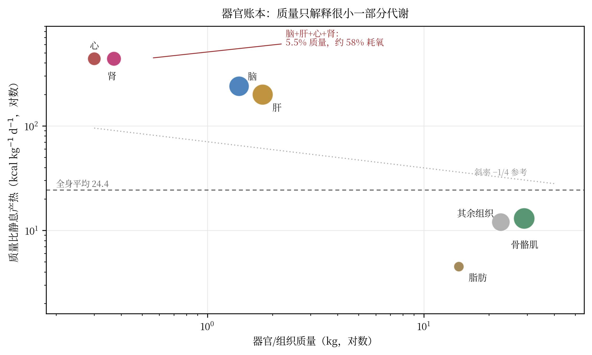
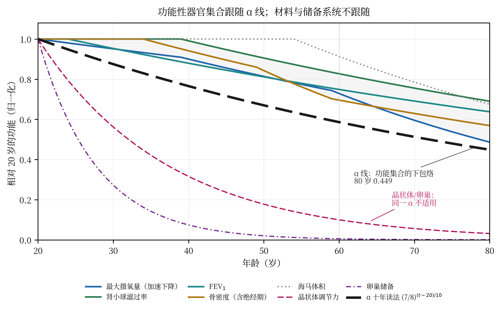

# 4 生物层：结构、器官与代谢

v1.0 这一章从"十二个衰老标志"开始，随后把 α 放到年与十年两个时间基上，用四类生理功能的年下降速率做对照。那个写法有一个致命的省略：它没有说身体由什么构成。最大摄氧量、肾小球滤过率、握力、骨密度被并列成同一常数 α 的四次观测，但它们在解剖上分属心肺系统、肾脏、肌肉—神经—关节和骨骼，在时间尺度上分属秒—年、年—十年、十年和十年，在因果上互相耦合。把它们并置，不会得到一具身体，只会得到四个数字。

本版重写这一章，顺序反过来：先给结构（器官、组织、分区），再给通量（氧、ATP、底物），再给周转（细胞与蛋白），最后才问 α 能不能落在其中某一层上。这不是修辞上的调整，而是量纲的要求：一个速率必须说明它对哪个库存量取导数；没有库存量，速率没有意义。

## 4.1 撤回：四个标量不是一具身体

v1.0 的生物层模型可以写成一行：R(t) = 1 − αt/10，α = 1/8，然后用四类功能的年下降速率去检验。问题不在这一行算术，而在它前面的三个隐含假设。

第一，库存量缺失。12.5%/年作用于什么？如果是肠上皮细胞，3–5 天换一遍，年替换率超过 70 倍；如果是心肌细胞，25 岁时年替换率 1%，75 岁 0.45%；如果是晶状体纤维，替换率为零；如果是肾单位，非硬化肾小球以约 1.3%/年丢失。同一个 12.5% 落在不同库存量上，给出从"几天"到"终身"的半衰期。v1.0 没有指定库存量，所以这个速率在量纲上是不完整的。

第二，层次混淆。细胞、组织、器官、系统、整体，五个层次的时间常数跨五个数量级。α 只能落在其中一个层次；它不能同时是"细胞更新率""器官功能下降率"和"整体衰老率"。v1.0 在同一节里把 VO₂max（整体输出）、GFR（器官功能）、握力（系统输出）和 BMD（组织状态）并列，实际上是在五个层次之间自由切换，而没有声明切换。

第三，独立性错误。四个标量不是四次独立测量。VO₂max 是心、肺、血、骨骼肌和线粒体的串联输出；GFR 受心输出量、肾灌注压和 RAAS 影响；握力受肌量、神经传导和关节状态影响；BMD 受性激素、钙磷代谢、维生素 D 和机械负荷影响。它们共享方差。把共享方差的四个输出当作四个独立证据，会高估证据强度。第 4.6 节给出一个可执行的统计检验：如果四个指标的共同因子解释了大部方差，有效独立观测数不是 4，而是 1.5–2。

需要说清楚：撤回的是建模方式，不是观测值。表 4-3 里的四类功能速率仍然可用，它们只是不再被当作同一常数的四次投影，而是被当作五个器官系统的各自输出。

## 4.2 为什么结构必须先于速率

这一节用体系自己的两份文件来说明，为什么"先结构、后速率"不是外部要求，而是体系内部一致性的要求。

第一份是《第三层医疗线·统一因果链审查》对器官再生线的自审。它写道："体系没有'模板存储'概念"——器官的结构高维模板是什么、回写的目标数据从哪来，体系未定义；"结构不存在≠结构无序"——t_min 代谢步数公式假设"结构存在但无序"，器官结构已破坏时该公式不适用；血管化、神经支配、免疫嵌合的需求，体系语言未覆盖。

这三句话是体系对自己最深的冷证据。它们说的不是"参数还没测"，而是"结构这个概念还没有进入体系"。一个没有模板、没有血管、没有神经支配、没有免疫嵌合的器官再生理论，不能用一个标量回写来替代。

第二份是《怎么做出这具身体·量化实现路径》v1.1 的 §2.5。它列了一张参数耦合矩阵，并写明："参数非独立旋钮"；任何多参数施工前，逐行过本表；两项以上耦合干预同月实施时，验收判据取"组合最不利"口径。

这句话是体系工程线的纪律。v1.0 的生物层却把四个标量当成四个独立旋钮，违背了体系自己的这条纪律。这不是我外加的批评，是内部不一致。

因此 v1.1 的方法顺序是：结构 → 分区 → 通量 → 周转 → 速率。速率是最后一步。下面四节按这个顺序展开。

## 4.3 器官账本：5.5% 的质量，约 58% 的氧

静息能量消耗（REE）可以用一个加和模型表示：REE = Σ K_i × T_i，其中 T_i 是器官或组织质量，K_i 是质量比静息产热率。Elia 1992 给出了一组经典 K_i 值，Wang 等 2010 用 131 名非肥胖成人的 MRI 质量与间接测热法做了验证，发现这组值落在 95% 置信区间内。本节的账本采用这组值；器官质量取 ICRP 89 参考成人数值。结果如表 4-1。

**表 4-1**　器官与组织的质量、质量比产热、静息产热份额与主要细胞周转。K_i 取自 Elia 1992，经 Wang 等 2010 验证；质量取 ICRP 89 参考成人，合计 70 kg。产热份额按 REE = 1692 kcal/日 计算。

| 器官或组织 | 质量 kg（占体重） | K_i（kcal·kg⁻¹·d⁻¹） | 产热 kcal/日（占 REE） | 主要细胞周转 |
|:--|--:|--:|--:|:--|
| 脑 | 1.4（2.0%） | 240 | 336（19.9%） | 皮层神经元终身；齿状回 1.75%/年 |
| 肝 | 1.8（2.6%） | 200 | 360（21.3%） | 肝细胞 200–400 天 |
| 心 | 0.33（0.47%） | 440 | 145（8.6%） | 心肌细胞 1%/年（25 岁）→0.45%（75 岁） |
| 肾 | 0.31（0.44%） | 440 | 136（8.1%） | 肾单位无再生；非硬化肾小球 −1.3%/年 |
| 骨骼肌 | 29（41%） | 13 | 377（22.3%） | 肌纤维数年；肌核由卫星细胞补充 |
| 脂肪 | 14.5（21%） | 4.5 | 65（3.9%） | 脂肪细胞约 10%/年 |
| 其余组织 | 22.66（32%） | 12 | 272（16.1%） | 皮肤、骨、结缔组织、免疫等混合 |
| 合计 | 70（100%） | — | 1692（100%） | — |

这张表的第一条结论，是四个小器官的"质量—通量"错位：脑、肝、心、肾合计 3.84 kg，占体重 5.5%，却消耗 977 kcal/日，占静息产热的 57.8%。换言之，身体一半以上的静息代谢发生在不到十六分之一的质量里。其余 94.5% 的质量——骨骼肌、脂肪、骨、皮肤、结缔组织——只承担约 42%。

第二条结论，是质量比产热的跨度：心肌与肾皮质 440，脂肪 4.5，其余组织 12。最高与最低相差 98 倍，与"其余组织"相差 37 倍。这个跨度不是个体差异，而是器官身份决定的；它不会因为年龄、性别或训练而消失，只会移动百分之几十。

第三条结论，是 ATP 通量。按 1 L 氧约产生 4.82 kcal、1 mol 氧对应约 5.2 mol ATP、ATP 分子量 507 g/mol 计算：1692 kcal/日 ÷ 4.82 = 351 L 氧/日；÷22.414 = 15.7 mol 氧/日；×5.2 = 81.6 mol ATP/日；×507 = 41.4 kg ATP/日。也就是说，一个 70 kg 的成年人，静息状态下每天周转约 41 kg ATP，活动日可达 50–60 kg。这个数字与"人体每天周转接近自身体重的 ATP"这一经典估计一致。

第四条结论，也是本章最重要的一条：同一个账本可以给出两个"全身平均"，相差 7 倍。按质量加权，全身平均是 1692/70 = 24.2 kcal·kg⁻¹·d⁻¹；按氧通量加权，是 Σ（器官份额 × K_i）= 168.8 kcal·kg⁻¹·d⁻¹。前者描述的是肌肉、脂肪和骨；后者描述的是脑、肝、心、肾。说"身体的代谢率"而不说权重，等于在 24 与 169 之间任选一个数。v1.0 的 12.5%/年 没有说权重，所以它在说出"身体"这个词的时候，已经丢掉了 7 倍的信息。

{width=14.6cm}

## 4.4 周转谱：从三天到终身

结构给出库存量，周转给出时间常数。表 4-2 列出主要细胞与组织的更新速度。

**表 4-2**　人体主要细胞与组织的周转时间。数值为参考成人的代表性区间；不同文献的估计可有 2–3 倍差异，但数量级稳定。

| 细胞或组织 | 周转时间 | 年替换率 | 备注 |
|:--|:--|--:|:--|
| 小肠上皮 | 3–5 天 | >70/年 | 全身细胞质量更新的主项之一 |
| 表皮 | 28 天 | 约 13/年 | 基底层到角质层 |
| 中性粒细胞 | 1–5 天 | >70/年 | 骨髓持续输出 |
| 血小板 | 7–10 天 | 36–52/年 | 巨核细胞碎片 |
| 红细胞 | 120 天 | 3.0/年 | 约 2.4 kg，每日更新约 20 g |
| 肝细胞 | 200–400 天 | 0.9–1.8/年 | 肝脏体积稳定，更新与凋亡平衡 |
| 心肌细胞 | 70 年左右（1%/年，25 岁） | 1.0→0.45 | 终身交换不足 50% |
| 齿状回神经元 | 约 57 年（1.75%/年） | 1.75 | 每个海马约 700 个/日 |
| 皮层神经元 | 无可测替换 | 约 0 | 出生后基本不再更新 |
| 晶状体纤维 | 终身 | 0 | 无血管、无细胞更新 |
| 卵母细胞 | 出生时固定 | 0（50 岁近零） | 储备以数量而非更新计 |
| 肾单位 | 无再生 | −1.3（净丢失） | 非硬化肾小球 50 年减少 48% |
| 骨 | 重建 10%/年（小梁）、2–3%/年（皮质） | 10 与 2–3 | 重建是替换，不是净丢失 |

这张表的跨度是五个数量级：从 3 天到终身。它立刻给出两个判断。

第一，"5.19 年半衰期"不对应表中任何一行。它落在红细胞（120 天）与肝细胞（200–400 天）之间，离心肌细胞（约 70 年）差一个数量级，离晶状体（终身）差无穷。它是一个群体功能常数，不是材料常数。用同一个 α 描述肠上皮和晶状体，等于用同一个温度描述冰箱和恒星。

第二，材料更新与功能衰退不是同一件事。Sender 与 Milo 2021 整合了人体主要细胞类型的丰度、质量与寿命，得到全身细胞质量更新约 80 ± 20 g/日，细胞数更新约 0.33 × 10¹² 个/日，其中近 90% 的细胞数来自血液。这条通量由短寿命分区主导：红细胞、中性粒细胞、肠上皮、表皮。心、脑、肝、肾的实质细胞对这条通量的贡献很小。因此"身体在不断更换自己"这句话，如果用来描述实质器官，是错的；实质器官的更新率低到不足以在十年尺度上改变其结构。

这也解释了为什么心肌细胞的 1%/年 不能被当作"衰退率"。它是替换率，方向与丢失相反；把替换当丢失，符号就错了。v1.0 把四类功能速率与 α 并列时，没有区分"替换""丢失""功能下降"三种完全不同的过程，这是第 4.1 节所说的库存量缺失的另一种表现。

## 4.5 用器官数据重测 α

现在可以把 α 放回器官账本上检验。表 4-3 列出八类指标在 60 岁与 80 岁的保留比例，以及 α 十年读法的预测值。

**表 4-3**　器官功能保留比例与 α 十年读法的对照。观测值为文献代表性区间的中点，按 20 岁为 1.0 归一化；α 预测为 (7/8)^((t−20)/10)，60 岁 0.586，80 岁 0.449。

| 指标 | 观测速率（%/年） | 60 岁保留 | 80 岁保留 | α 预测（60/80） | 判定 |
|:--|--:|--:|--:|--:|:--|
| 最大摄氧量 | 0.5（中年）→2（70 岁后） | 0.74 | 0.48 | 0.586/0.449 | 同量级，α 略低 |
| 肾小球滤过率 | 0.8–1.0 | 0.82 | 0.67 | 0.586/0.449 | α 偏低（过度悲观） |
| FEV₁ | 0.8–1.0 | 0.75 | 0.64 | 0.586/0.449 | 接近 |
| 骨密度 | 1.0–2.0 | 0.70 | 0.58 | 0.586/0.449 | 接近 |
| 握力 | 1.0–1.5 | 0.85 | 0.60 | 0.586/0.449 | 接近（80 岁） |
| 海马体积 | 1.0–1.5（55 岁后） | 0.93 | 0.69 | 0.586/0.449 | α 过度悲观 |
| 晶状体调节力 | 5–7 | 0.10 | 0.01 | 0.586/0.449 | 失败 |
| 卵巢储备 | 10–15 | 0.02 | 0.00 | 0.586/0.449 | 失败 |
| 心肌细胞替换 | 0.5–1（替换） | — | — | — | 方向错：替换不是丢失 |

先看按年读法。若 α = 1/8 每年，60 岁保留 0.875⁴⁰ = 4.8 × 10⁻³，80 岁保留 0.875⁶⁰ = 3.3 × 10⁻⁴。这与表中任何一行都不在一个数量级：观测值是 0.48–0.93（60 岁）和 0.48–0.72（80 岁），按年读法低了 100–300 倍。这不是"参数需要微调"，而是"这个读法必须放弃"。第 6.2 节把它列为第一条撤回。

再看按十年读法。α 预测 60 岁 0.586、80 岁 0.449；观测的功能集合在 60 岁是 0.70–0.93，80 岁是 0.48–0.72。α 不落在集合中央，而是落在下包络：对最大摄氧量、握力、骨密度、FEV₁ 在 80 岁附近基本贴合；对 GFR 和海马体积偏低 20–30%；对晶状体调节力和卵巢储备完全失效。这个模式不是"一个定律"，而是"一个下界"。

下包络这个说法有实质内容。它意味着：如果 α 是一个有意义的常数，它描述的不是所有器官，而是"以氧通量为主、以有丝分裂后细胞为主、以功能储备为读数"的那一组器官——心、肺、骨骼肌、肾、骨。对于以储备量计数的器官（卵巢）、以终末分化结构为主的器官（晶状体）、以不可再生神经元为主的器官（皮层），α 没有定义域。把它们强行纳入，会得到 0.00 与 0.01 这样的预测，而观测也是 0.00 与 0.01；表面"吻合"，实际上是两者都接近零，不构成证据。

还有一层更细的困难：观测速率本身随年龄变化。Fleg 等 2005 对 810 名巴尔的摩纵向研究参与者的串行测量显示，峰值摄氧量的十年下降率从 20–30 岁的 3%–6% 加速到 70 岁以后的 20% 以上。一个单指数 (7/8)^(t/10) 的斜率是常数；它无法同时拟合中年和老年。因此即使按十年读法，α 也只能是一个粗包络，不是一个机制模型。这是把它定为 D2 而不是 D1 的理由。

由此可以给 α 一个受限的定义，而不是一个宏大的名字：

> α₁₀ = 1/8，定义为"以氧通量为主的功能性器官集合，其整合功能储备每十年的下包络损失率"。

这个定义有三个限定词：氧通量为主（排除脂肪、骨、晶状体）、功能性器官集合（排除单纯储备量）、下包络（不是点预测）。有了这三个限定词，α 在 60–80 岁的功能集合上是可以用的；没有它们，α 什么都不是。第 6.2 节把"α 作为全身衰老速率"降级为这个受限定义，理由就在这里。

最后撤回 v1.0 的四级效率链。v1.0 把 η = 7/8 当作单级效率，算 η⁴ = 0.586，再与 (3/4)⁴ = 0.316 和心脏效率 25%–35% 比较，得出"7/8 输给 3/4"的结论。这个比较有三处范畴错误：其一，"四级"没有解剖对应，心—肺—血—肌不是串联的四级效率，线粒体也不是一个独立的级；其二，心脏效率是有明确分子分母的量（外功/氧耗），不是四级效率的乘积；其三，3/4 是跨物种的代谢标度指数，不是单级效率。三个不同对象放在一起比较，得到的任何结论都不成立。第 6.2 节把它列为撤回项。

{width=14.4cm}

{width=14.6cm}

## 4.6 耦合网络：四个标量不独立

即使接受 α 的受限定义，也不能把四类功能当作四个独立观测。器官之间通过血流、神经、内分泌和免疫连成网络，至少有以下五条主轴。

心—肾轴。静息心输出量约 5 L/分，肾血流约 1.0–1.25 L/分，占 20%–25%；GFR 约 125 mL/分，滤过分数约 20%。心输出量下降 20%，肾灌注压与肾血流随之下降，GFR 下降，RAAS 激活，水钠潴留，前负荷上升，又把心输出量推回一点。这是一个负反馈环，不是两个独立变量。心衰患者的肾功能恶化（心肾综合征）就是这条轴的临床形态。

肌—脑轴。骨骼肌量与认知功能在流行病学上相关；运动诱导的 irisin、BDNF、乳酸等介质被提出为候选机制。相关性稳定，因果性未定；但足以说明"握力"与"海马体积"不是独立观测。

骨—肾—免疫轴。FGF23/klotho 轴连接骨、肾与磷代谢；胸腺在青春期后以每年约 3%–5% 的速度退化，T 细胞输出下降；慢性炎症（inflammaging）又反过来促进骨吸收与肌少症。这条轴把 BMD、GFR 与免疫状态绑在一起。

肝—血轴。白蛋白半衰期约 20 天，凝血因子半衰期从数小时到数天；肝功能下降会同时改变胶体渗透压、凝血与药物代谢。肝不是"一个器官的一个指标"，而是一个分泌—合成—清除网络。

肺—心轴。FEV₁ 下降伴随肺血管阻力上升与右心负荷增加；运动时的通气—灌注匹配又决定 VO₂max。肺功能与心功能在运动终点上是同一个输出。

统计后果很直接。设第 i 个器官、第 j 次测量的功能为 y_ij，一个分层模型可以写成 y_ij = α + u_i + e_ij，其中 u_i 是器官特异的随机效应。检验"单一 α"就是检验 Var(u_i) = 0。如果各器官的观测速率在 0.5–5%/年 之间分布，Var(u_i) 不可能为零；单一 α 会被拒绝。即使不做正式检验，只看表 4-3 的最后一列，八行里有三行（晶状体、卵巢、心肌替换）明确落在 α 的定义域之外，单常数模型已经失败。

有效独立观测数也可以用相关结构估计。若四个指标两两相关 r = 0.5–0.7，第一主成分解释 60%–75% 的方差，有效独立观测数约为 1.5–2，而不是 4。v1.0 说"四类功能都落在带内"，实际证据强度只有 1.5–2 个独立观测。这不是说四类数据无用，而是说它们不能把证据强度乘以四。

体系自己的工程线已经给出了正确的态度：Δ工程 §2.5 的耦合矩阵、组合最不利口径、级联失效列入 FAIL 臂。生物层应当沿用同一纪律：先画耦合图，再谈速率；先声明权重，再谈平均。

## 4.7 7/8 在器官层出现吗

一个自然的追问是：既然数学层给出 α = 1/8，器官层有没有哪个常数正好是 1/8 或 7/8？逐项检查常见生理常数，答案是否定的。

静息心输出量的器官分配约为：肾 20%–25%，肝与门脉 25%，骨骼肌 15%–20%，脑 15%，皮肤 5%，冠脉 4%–5%。没有 12.5%。动脉—混合静脉氧含量差对应的氧提取率约 25%，不是 12.5%。射血分数 55%–70%，不是 87.5%。肾滤过分数约 20%，不是 12.5%。体液分布中细胞内液约占 2/3、细胞外液约占 1/3，不是 7/8。骨重建在小梁骨约 10%/年、皮质骨 2%–3%/年，不是 12.5%。非硬化肾小球的丢失率约 1.3%/年，也不是 12.5%。

唯一干净的普适指数是代谢标度：基础代谢率随体重按 3/4 幂增长，质量比代谢率按 −1/4 幂下降（Kleiber 1947；West 等 1997）。3/4 与 7/8 相差 1/8。如果一定要搭桥，最近的写法是 α = 1/2 × (1/4)：α 是质量比代谢标度指数的一半。这是一个 D3 类比，没有机制；它不能用来预测任何器官的速率，只能用来生成"为什么是 1/8 而不是别的分数"这一假设。

更重要的是，3/4 与 7/8 不是同一类对象。3/4 是跨物种、跨体重的标度指数，描述的是"不同大小的动物之间"的代谢差异；7/8 是体系内部单级存活比例，描述的是"同一体系内一次转换"的剩余。把 (7/8)⁴ 与 3/4 比较，等于把"四级串联效率"与"跨物种标度指数"比较，范畴不同。v1.0 的这个比较必须撤回。

所以对"没有代谢"这一批评，最诚实的回答是：代谢层确实有一个普适定律，但它是 3/4，不是 7/8；而且它是物种间的标度律，不是个体内的衰老率。体系若要把 α 接到代谢上，需要给出一个机制，说明为什么单级剩余比例会等于质量比标度指数的一半；目前没有这个机制。没有机制的桥，只能算 D3。

## 4.8 生物层小结

本版生物层给出三条正面结果和两条未决要求。

正面结果一：器官账本把"标量身体"的错误量化了。5.5% 的质量承担 57.8% 的静息氧；质量比产热跨 98 倍；质量加权与通量加权的"全身平均"相差 7 倍。任何"全身速率"在开口之前，必须先声明权重。

正面结果二：α 的十年读法在功能性器官集合上作为下包络成立。60 岁 0.586，观测 0.70–0.93；80 岁 0.449，观测 0.48–0.72。它不是点预测，但也不是空话：它给出了一个可检验的下界，并且对晶状体、卵巢、皮层神经元明确失效。

正面结果三：按年读法与四级效率链失败得干净。前者低 100–300 倍，后者是范畴错误。失败得干净比勉强吻合更有价值，因为它排除了两条错误路径。

未决要求一：器官级状态变量与测量学。体系目前没有器官级 Λ 的定义，更没有测量方案；第 5.5 节的 P3 把这一点列为前置条件。

未决要求二：结构模板、血管化、神经支配与免疫嵌合。第 5.3 节展开。

# 5 医学层：器官因果链与再生三约束

v1.0 的医学层有两个主要结论：1:7 的读写比读成心搏节律，给出 25–38 次/分；10⁴ V/m 在光学波段等价于 13.3 W/cm²，超过皮肤允许照射量约两个数量级。第二个结论是单点电磁计算，不依赖器官结构，保留。第一个结论依赖心腔几何与血管分布，本版用一个血流动力学守恒把它判死，然后撤回。

医学层真正的问题不是这两个数，而是缺少一条器官级的因果链。一个医学主张要能落地，必须说明：作用于哪个器官、哪一类细胞、哪一个通路、在什么时间窗、用什么终点测量。体系目前的语言是"Λ 回升"，它没有器官、细胞、通路、时间窗。这不是哲学上的不精确，而是工程上的不可执行：没有环节，就没有剂量；没有剂量，就没有试验；没有试验，就没有判据。

## 5.1 撤回 1:7 心率：一个血流动力学反证

先把算术摆出来。静息心输出量 CO ≈ 5.0 L/分，心率 HR ≈ 70 次/分，每搏量 SV = CO/HR = 71 mL。心输出量守恒要求 CO = HR × SV。若 HR 降到 30 次/分，要维持 5.0 L/分，SV 必须升到 167 mL。

167 mL 的每搏量意味着什么？舒张末期容积 EDV 与射血分数 EF 满足 SV = EDV × EF。若 EF = 0.65（正常上限附近），EDV = 257 mL；若 EF = 0.80（运动员或高动力状态），EDV = 209 mL。正常成人 EDV 约 120–130 mL，最大生理性 EDV 约 150–180 mL（明显扩张的心室）。257 mL 超出正常范围近一倍，209 mL 也在正常上限之外。换句话说，HR 30 次/分要维持静息心输出量，心脏必须同时具备扩张型心肌病的容积和高动力状态的射血分数；这两者在健康人身上不共存。

若按最大生理性 SV ≈ 120 mL 计算，HR 30 次/分只能给出 CO = 3.6 L/分，比静息需求低 28%。这 1.4 L/分 的缺口不能靠"重新分配"补上：脑约需 0.75 L/分（15%），肾约 1.0–1.25 L/分（20%–25%），肝与门脉约 1.25 L/分（25%），冠脉约 0.25 L/分（5%）。仅脑、肾、肝、冠脉四项合计就超过 3.2 L/分；再加上骨骼肌与皮肤，3.6 L/分 的总量无法同时满足。短时间可以靠血管收缩与脑血流自动调节顶住，长时间必然出现肾前性氮质血症、肝缺血与运动耐量崩溃。

有人会举运动员窦性心动过缓：耐力运动员静息心率 30–40 次/分并不罕见。这是事实，但它恰好证明了我的论点：运动员的每搏量是 100–120 mL（训练导致离心性重构、舒张末容积增大），心输出量仍约 4–5 L/分；而且这是长期训练加高迷走张力形成的特定状态，不是一个 1:7 比例的设计目标。把运动员的极端表型当作普通生理学的证据，是选择偏倚。

因此 1:7 心率不是"与数据不符"，而是"与心输出量守恒不符"。它依赖的结构——心腔容积、射血分数、器官血流分配——正好是 v1.0 省略的结构。结构一进来，结论就倒了。第 6.2 节把它列为撤回项。

## 5.2 心衰因果链：每一步都可测

为了说明"器官级因果链"长什么样，看一个标准例子：射血分数降低的心衰。

链条可以写成：心肌细胞丢失（坏死或凋亡）→ 成纤维细胞活化与胶原沉积 → 心室僵硬度上升、收缩力下降 → 每搏量与心输出量下降 → 肾灌注下降、RAAS 与 ADH 激活 → 水钠潴留、前负荷上升 → 肺静脉压上升、肺淤血 → 呼吸困难与运动耐量下降。

每一步都有可测的量：心肌损伤用高敏肌钙蛋白与 galectin-3；纤维化用心脏磁共振的细胞外容积（ECV）与 T1 mapping；舒张功能用 E/e′ 与左房容积指数；收缩功能用 LVEF 与整体纵向应变（GLS）；心输出量用超声或热稀释；肾灌注与肾功能用 eGFR、尿钠与肾阻力指数；神经激素用 BNP/NT-proBNP 与肾素活性；淤血用肺超声 B 线与下腔静脉超声。这条链上的每一个箭头都可以被独立检验，也可以被独立干预。

体系的语言"Λ 回升"能插在这条链的哪一步？答案是：不知道。它没有细胞类型（心肌细胞、成纤维细胞、内皮细胞）、没有通路（RAAS、β 受体、钙循环、线粒体）、没有时间窗（急性、亚急性、慢性）、没有剂量（场强、频率、暴露时间）、没有应答标准（LVEF 提高多少、BNP 下降多少）。体系自己的第三层医疗线也承认："无细胞周期/信号通路描述"。这不是我强加的要求，是体系自审的原话。

没有环节语言，就没有临床终点；没有临床终点，就没有试验；没有试验，就没有判据。这是医学层比生物层更硬的地方：生物层还可以做相关性，医学层必须做因果链。

## 5.3 器官再生的三个硬约束

体系最宏大的主张是器官再生：反云韶场回写 → 结构信息恢复 → 器官再生。第三层医疗线的自审已经指出三个缺口：模板、血管化、神经支配与免疫嵌合。本节把这三个缺口量化，说明它们为什么不是"以后再补"的细节，而是"现在就决定主张能否成立"的硬约束。

第一，模板。人体肝脏约 2 × 10¹¹ 个肝细胞。若只给每个肝细胞一个三态局部标记，信息量是 2 × 10¹¹ × log₂3 ≈ 3.2 × 10¹¹ bit，约 40 GB；若要存储完整的邻接关系（每个细胞与哪些细胞相邻、通过哪些窦状隙与血管相连），信息量还要高几个数量级。人类单倍体基因组约 3.2 Gb，约 0.8 GB；编码序列只占 1%–2%，约 10–20 MB。这说明一件关键的事：器官结构不可能以"位图"形式存储在基因组里，它只能由一套生成程序（发育规则、力学反馈、细胞间信号）在现场生成。体系目前没有这套程序，也没有"模板"这个概念；它只有一个标量 Λ。用 40 GB 的位图去要求一个标量回写，是把结构问题误当成数值问题。

第二，血管化。氧在组织中的扩散极限约 100–200 μm；毛细血管间距在骨骼肌约 40–100 μm；任何厚度超过 1–2 mm 的实质，如果没有血管长入，中心就会坏死。一个器官不是一团细胞，而是一套"细胞—基质—血管—淋巴"的四相结构；血管化需要内皮出芽、周细胞包被、基底膜组装、血流剪应力刺激，缺一不可。体系语言里没有内皮、没有周细胞、没有基底膜，也没有血流的剪切应力；它只有"结构信息恢复"。这不是词汇问题，是因果链缺环。

第三，神经支配与免疫嵌合。骨骼肌去神经后出现失神经性萎缩；心肌的交感/副交感支配影响变时、变力与复极；肠道需要肠神经系统；免疫系统需要中枢与周围淋巴器官的嵌合。异体器官移植需要终身免疫抑制，自体 iPSC 来源的类器官又面临成熟度与血管化问题。体系的语言里没有神经支配、没有免疫嵌合、没有排斥反应；它只有"回写"。

三个约束的当前状态可以记成 0/3：模板 0，血管化 0，神经免疫 0。第三层医疗线自己也承认，器官再生是三适应症中"最深缺口"，因为"模板存储概念缺失"。在这个状态下，任何"器官再生"的主张都不是"远期可行"，而是"尚未定义"。

还要加一条体系自己的冷证据：回写强度。正向场是 1 高维 → 7140 低维，反向场是 7140 低维 → 1 高维，每个低维贡献 1/7140，强度比正向弱四个数量级。即使场存在、模板存在、血管化方案存在，剂量也比读出弱 10⁻⁴；而组织修复需要的能量与物质输入是正向的。用 10⁻⁴ 的强度去驱动一个 40 GB 量级的结构重建，不是一个"优化参数"能解决的问题。

结论：器官再生不是"标量回写"问题，而是"模板 + 血管 + 神经免疫 + 剂量"四约束工程问题。四约束中目前 0/4 有可执行方案。体系若要保留这条线，正确的下一步不是提高场强，而是先建立模板理论、血管化方案与免疫策略；在此之前，这条线应当明确标注"定义未完成"，而不是"5–10 年"。

## 5.4 为什么有些结论不需要器官

用户对 v1.0 的批评是"没有结构没有器官，没有代谢"。这个批评对第 4–5 章的建模是成立的，但它不覆盖全部结论。有几条结论的输入只有温度、波长、材料参数或场强，身体结构根本不进入公式；这些结论不因器官缺失而失效。把它们与结构依赖的结论分开，是 v1.1 最重要的记账工作。

第一条，724.8 nm 与 804 nm 的错位。体系用 f₀ = 64 k_BT/h；在 310.15 K（37 °C）下，f₀ = 413.62 THz，对应 724.84 nm；反过来，804 nm 对应 279.61 K（6.5 °C），不是体温。这个计算只用普朗克关系与温度，不用任何器官。它说明的是"锚点选择错了"，不是"身体结构错了"。这条结论保留。

第二条，exp(−64) = 1.6 × 10⁻²⁸。若一个机制要求 64 个量子同时落在同一个热态上，其玻尔兹曼因子是 exp(−64) = 1.6 × 10⁻²⁸，在任何生理温度下都低到不可用。这个计算只用统计物理，不用器官。它排除的是"64 量子热机制"，不是"所有 64 相关的机制"。这条保留。

第三条，f_defect > 1。由 Tc/(0.9375 Θ_D) 反算，473 K 设计点给出 f_defect = 1.047，600 K 给出 1.328，超过自己设定的上限 1。这个计算只用 Tc 与 Θ_D，不用器官。它说明的是"公式与目标不自洽"，不是"身体结构错了"。这条保留。

第四条，13.3 W/cm²。10⁴ V/m 的平面波功率密度是 I = ½ ε₀ c E² = ½ × 8.854 × 10⁻¹² × 2.998 × 10⁸ × 10⁸ = 1.327 × 10⁴ W/m² = 13.3 W/cm²。这个计算只用电动力学，不用器官。它说明的是"把射频场强直接搬到光学波段是范畴错误"，不是"身体结构错了"。这条保留。

第五条，5.19 年半衰期。它是 12.5%/年 的算术结果：ln2/ln(1/0.875) = 5.19 年。这个计算只用复利，不用器官。它作为"按年读法的归谬"保留；但它不能被解释为任何器官的半衰期。这条"算术保留、解释降级"。

把这五条与结构依赖的结论分开，既是对用户批评的回应，也是对体系负责：不能因为生物层建模错了，就把光学与热力学的算术也一起扔掉；也不能因为算术对，就用它去支持一个没有结构的生理学。

## 5.5 五项预注册判据（v1.1）

v1.0 的五项判据以"α 的速率"为中心。v1.1 改成以"结构是否成立"为中心。五项都可以在现有数据或短期内可完成的数据上判定。

P1，多器官衰退模型比较。取同一队列的纵向多器官数据（VO₂max、GFR、FEV₁、BMD、海马体积、握力），拟合两个模型：M0 为单 α 指数，M1 为器官特异速率的层次模型。预注册判定：若 ΔAIC > 10 且 Var(u_i) 的 95% 区间不含 0，则单 α 被拒绝。预测：M0 会被拒绝。这个判据的价值不在于"证明 α 对"，而在于给"单一速率"一个可执行的否证条件。

P2，α 的定义域检验。预注册：VO₂max、GFR、FEV₁、BMD 的 60 岁与 80 岁保留值应落在 α 预测的 ±30% 内；晶状体调节力、卵巢储备、皮层神经元不应落在 ±30% 内。若前者也落在外面，α 连受限定义都不成立；若后者也落在里面，说明 α 不是"功能集合的下包络"，而是更普遍的东西。两种结果都会改变结论。

P3，器官级 Λ 测量学。体系目前没有器官级 Λ 的定义。预注册门槛：一个器官级状态向量至少包含 3 个可独立测量的组分，重测信度 ICC > 0.8，且对至少一种已知干预有剂量响应。当前状态：未定义，0/3。P3 不通过，任何"器官级 Λ 回升"的主张都不可测，不能进入临床判据。

P4，再生三约束清单。模板、血管化、神经免疫，三项逐项判定：模板是否有可执行的生成程序（不是位图，是规则）；血管化是否有可在体内形成连续血管网的方案；神经免疫是否有自体来源、可避免终身免疫抑制的方案。当前状态：0/3。任一项缺失，再生主张判负；三项齐备，才进入剂量学。

P5，安全项。保留 v1.0 的 SAR/MPE 结论：10⁴ V/m 在光学波段等价于 13.3 W/cm²，超过皮肤最大允许照射量约两个数量级；射频与激光的限值不能互换。任何装置主张必须先过 ICNIRP 的相应限值，再做动物与临床。这一项不因生物层重写而改变。

这五项判据的共同点是：都不需要先证明 α 是"宇宙常数"。它们只需要可测的器官数据、可执行的模型比较、可核查的清单。这也是 v1.1 的方法论转向：从"用一个常数解释一切"转向"用一组结构约束检验一个常数"。

## 5.6 医学层小结

本版医学层撤回两条、保留三条、降级一条。

撤回两条：1:7 心率（与心输出量守恒冲突，每搏量需 167 mL）；心脏效率 25%–35% 与 η⁴ = 0.586 的比较（范畴错误，二者不是同一对象）。

保留三条：724.8 nm 与 804 nm 的错位；exp(−64) 对 64 量子热机制的排除；f_defect > 1 的内部矛盾。这三条都是单点计算，不依赖器官结构。

降级一条：5.19 年半衰期从"生理半衰期"降为"按年读法的算术归谬"；它不再被解释为任何器官或任何功能的半衰期。

医学层留下的核心问题不是数值，而是因果链。没有器官、细胞、通路、时间窗、终点，就没有剂量与试验；没有试验，就没有医学。体系若要把"Λ"变成医学语言，第一步不是找更多的吻合，而是把 Λ 翻译成器官级状态变量；这一步目前没有做。

# 6 总判与修复路线

## 6.1 记分卡

表 6-1 把十一项主张按"结构依赖"分成两组。左组不依赖器官结构，右组依赖；v1.1 的判定差异几乎完全由这条线解释。

**表 6-1**　分层记分卡（v1.1）。"结构依赖"指结论是否需要器官、组织分区或代谢通量作为输入；"否"表示单点算术或代数闭包。

| 命题 | 层 | v1.0 判定 | v1.1 判定 | 结构依赖 | 依据 |
|:--|:--|:--|:--|:--|:--|
| α = 1/8 的单参数闭包 | 数学 | 成立 D1 | 成立 D1 | 否 | 五个常数为一个参数的函数 |
| 两条 7/8 来源相互独立 | 数学 | 不独立 | 不独立 | 否 | 共享"失一"公设 |
| 724.8 nm 与 804 nm 错位 | 物理 | 错位 30.5 K | 同左 | 否 | f₀ = 64k_BT/h |
| exp(−64) 禁止热机制 | 物理 | 成立 | 成立 | 否 | 玻尔兹曼因子 |
| Tc 天花板与 f_defect | 化学 | 描述有效、预测失败 | 同左 | 否 | Tc/(0.9375Θ_D) 反算 |
| 四标量身体模型 | 生物 | 采用 | 撤回 | 是 | 无器官、无通量、无库存量 |
| η 四级效率链 | 生物 | 成立 | 撤回 | 是 | 无解剖对应，范畴错误 |
| α 十年读法 | 生物 | 成立 | 降为 D2 下包络 | 是 | 器官账本，60/80 岁对照 |
| 1:7 心率 | 医学 | 判负 | 撤回 | 是 | CO = HR × SV 守恒 |
| 10⁴ V/m 的 SAR/MPE | 医学 | 判负 | 保留 | 否 | 单点电动力学 |
| 5.19 年半衰期 | 生物 | 群体值 | 保留为算术归谬 | 部分 | 复利计算 |

## 6.2 六条撤回或降级

R1，四标量身体模型。撤回。理由：没有库存量、没有层次声明、没有独立性检验。替代：器官账本（表 4-1）加层次模型（第 4.6 节）。

R2，η 四级效率链。撤回。理由："四级"没有解剖对应；心脏效率不是四级乘积；3/4 是标度指数，不是单级效率。替代：不再用 η⁴ 解释器官效率。

R3，α 作为全身衰老速率。降级为受限定义：α₁₀ = 1/8，仅指"以氧通量为主的功能性器官集合的整合功能储备每十年下包络损失率"。替代：表 4-3 与图 5。

R4，1:7 心率。撤回。理由：HR 30 次/分需 SV 167 mL，对应 EDV 209–257 mL，超出正常心腔容积；最大生理 SV 120 mL 时 CO 仅 3.6 L/分，低于静息需求 28%。替代：CO = HR × SV 与器官血流分配。

R5，心脏效率 25%–35% 与 η⁴ 的比较。撤回。理由：心脏效率是外功/氧耗，η⁴ 是四级存活比例的乘积，二者不是同一对象。替代：不做跨范畴比较。

R6，3/4 与 7/8 的比较。撤回。理由：3/4 是跨物种代谢标度指数，7/8 是体系内单级剩余；范畴不同。替代：若搭桥，明确写成 D3 类比：α = 1/2 × (1/4)，无机制。

## 6.3 五条保留

K1，724.8 nm 与 804 nm 的错位。保留。它是锚点选择问题，不是算术错误；修正方案是二选一：要么把器件锚在 724.8 nm（310.15 K），要么把 804 nm 解释为 279.6 K 的低温靶点，不能同时声称"体温下的 804 nm 共振"。

K2，exp(−64) = 1.6 × 10⁻²⁸。保留。它排除"64 个量子同时热激发"的机制，不排除其他 64 相关机制；任何新机制必须绕开这个因子，而不是忽略它。

K3，f_defect > 1。保留。473 K 设计点给出 1.047，600 K 给出 1.328；这不是"接近上限"，是越过上限。修正是降低目标温度或提高 Θ_D，而不是把上限改成 1.1。

K4，13.3 W/cm² 与 MPE。保留。10⁴ V/m 在光学波段等价于 13.3 W/cm²；射频限值与激光 MPE 不能互换。任何装置主张先过相应限值。

K5，5.19 年半衰期作为算术归谬。保留算术，降级解释。它证明"α 每年"与生命不相容；它不证明任何器官的半衰期。

## 6.4 修复路线 F1–F6

F1，器官账本 v2。在表 4-1 的基础上增加四列：器官血流量、底物通量（葡萄糖、脂肪酸、氨基酸）、蛋白周转率、线粒体密度。目标是让每个器官的"库存量—通量—周转"三件套齐全。数据来源：ICRP 89、Wang 等 2010、Elia 1992、器官生理学教科书。

F2，多器官衰退的层次模型。按 P1 预注册，取现有纵向队列（BLSA、Health ABC、UK Biobank 等）的六项指标，拟合 M0/M1，报告 ΔAIC 与 Var(u_i)。这是把"单一 α"从哲学争论变成统计检验的最短路径。

F3，器官级 Λ 代理。按 P3 的门槛（≥3 个组分、ICC > 0.8、有剂量响应）建立定义。若建不出来，明确写"器官级 Λ 不可测"，并停止使用"器官级 Λ 回升"这一表述。

F4，再生三约束清单。按 P4 的模板/血管化/神经免疫三项，逐项给出可执行方案或明确判负。当前 0/3；在 3/3 之前，不使用"器官再生"作为近期目标。

F5，节律与效率的重新表述。1:7 不再读成心率；若要用，必须绑定一个具体过程（例如某个分子马达的占空比），并给出该过程的独立测量。心脏效率不再与 η⁴ 比较；若要比，先定义"级"。

F6，公开文本的分层标注。所有对外文本把"单点计算"与"生理推断"分开标注：前者标"算术"，后者标"结构依赖，证据等级 D2/D3"。这不是文字游戏，是防止把 724.8 nm 的算术成功偷换成生理学成功。

## 6.5 对天工开物计划的含义

第一，光学锚点必须二选一。若 LEV 装置工作在体温 310.15 K，f₀ = 64k_BT/h 给出 724.8 nm，不是 804 nm；若坚持 804 nm，则对应的黑体温度是 279.6 K，需要解释为什么一个体温装置使用低温锚点。二者不能同时成立。这是 F6 的第一条。

第二，器官再生线应当降级为"定义未完成"。第三层医疗线自审的 0/3（模板、血管化、神经免疫）没有改变；本版又加了剂量约束（反向场 1/7140，弱四个数量级）。在四约束 0/4 的状态下，把器官再生写成"5–10 年"是不诚实的；正确的写法是"前置定义未完成，时间表待定"。

第三，身体工程线（Δ工程、假体、外科、注射/激光）比 Λ 线更接近可执行。原因是它不需要再生：它用现成的组织、现成的器械、现成的术式，把目标拆成毫米与百分点。这条线的证据等级也更高：每一项都有文献效应量与并发症谱。体系若要在近期做出可验收的东西，应当把资源放在这条线上，而不是把 Λ 回写当作万能钥匙。

第四，成瘾/脑机闭环线比器官再生线更有结构。它至少有明确的核团（伏隔核、VTA、前额叶）、通路（多巴胺、谷氨酸）、读数（渴求评分、复发率）与干预（DBS、TMS、闭环刺激）。这不是说它已经成功，而是说它具备"器官—通路—终点"的三件套。体系若要把"结构"补进来，这条线是比器官再生更好的练手对象。

## 6.6 结语

数学给闭包，物理给尺度，化学给上限，生物给结构，医学给因果链。这五层不是同一种东西，不能用同一个常数贯穿到底。α = 1/8 在数学层是一个干净的闭包；在物理层需要一个锚点；在化学层需要一个不循环的 f_defect；在生物层需要一个库存量与一个权重；在医学层需要一条器官因果链。每往下走一层，自由参数就多一个，证据强度就弱一分。这不是体系的耻辱，而是分层本身的性质。

用户说"没有结构没有器官，没有代谢"，这句话对 v1.0 的第 4–5 章是成立的。v1.1 的回应不是辩解，而是把结构、器官、通量与周转重新写进来，然后让 α 在这个结构里重新受审。受审的结果是：α 按年读法失败；按十年读法在一个受限的功能集合上作为下包络存活；7/8 在器官层没有对应常数；3/4 才是代谢层的普适指数，而它与 7/8 相差 1/8。这个结果比 v1.0 的"四类功能都落在带内"更弱，但更真实。

一具身体不是四个数。它有 5.5% 的质量在消耗 58% 的氧，有三天的肠上皮和终身的晶状体，有心输出量的守恒和肾血流的分配，有模板、血管、神经和免疫。把这些写进来之后，还能剩下的那个常数，才配叫"身体的常数"。

# 附录 A　复算清单

**表 A-1**　本册关键数值的复算。所有算式可在正文找到对应段落；"算术"表示只依赖初等代数或单点物理公式，"数据"表示依赖文献值。

| 项目 | 算式 | 结果 |
|:--|:--|:--|
| α 闭包 | 1 − 1/8；1 − 1/16；1/32；1/64；1/(1/8)² | 0.875；0.9375；0.03125；0.015625；64 |
| 体温特征频率 | 64 × 1.380649×10⁻²³ × 310.15 / 6.62607015×10⁻³⁴ | 413.62 THz |
| 对应波长 | 299792458 / 413.62×10¹² | 724.84 nm |
| 804 nm 的温度 | hc/(λk_B) | 279.61 K |
| 频率倍数 | 804 nm 对应 f / f_c | 57.70 |
| exp(−64) | e⁻⁶⁴ | 1.603×10⁻²⁸ |
| 64 k_BT | 64 × 0.026725 eV | 1.7105 eV = 165.0 kJ/mol |
| 四小器官质量份额 | (1.4+1.8+0.33+0.31)/70 | 5.49% |
| 四小器官产热份额 | (336+360+145+136)/1692 | 57.8% |
| 质量加权平均 | 1692/70 | 24.2 kcal·kg⁻¹·d⁻¹ |
| 通量加权平均 | Σ(份额×K_i) | 168.8 kcal·kg⁻¹·d⁻¹ |
| 两种平均之比 | 168.8/24.2 | 7.0 |
| ATP 日周转 | 1692/4.82/22.414×5.2×507/1000 | 41.4 kg/日 |
| 心输出量守恒 | 5.0 L/分 ÷ 30 次/分 | 167 mL/搏 |
| 所需舒张末容积 | 167/0.65；167/0.80 | 257 mL；209 mL |
| α 按年（60 岁） | 0.875⁴⁰ | 4.8×10⁻³ |
| α 按十年（60 岁） | (7/8)⁴ | 0.586 |
| α 按十年（80 岁） | (7/8)⁶ | 0.449 |
| 按年半衰期 | ln2/ln(1/0.875) | 5.19 年 |
| 按 1.25%/年半衰期 | ln2/ln(1/0.0125) | 55.1 年 |
| 平面波功率密度 | ½×8.854×10⁻¹²×2.998×10⁸×(10⁴)² | 1.327×10⁴ W/m² = 13.3 W/cm² |
| 非硬化肾小球年丢失 | (990661−520410)/990661/50 | 0.95%/年（按 50 年跨度） |
| 肝细胞标记信息量 | 2×10¹¹×log₂3 | 3.17×10¹¹ bit ≈ 39.6 GB |

关于肾小球丢失的算式需要说明：Denic 等 2017 报告 18–29 岁组非硬化肾小球 990,661 个/肾，70–75 岁组 520,410 个/肾，降幅 47.5%；若按两组中点的 50 年跨度线性化，年丢失率约 0.95%。正文采用 1.3%/年 作为文献常用的指数化估计；两者数量级一致，差异来自线性化与指数化的选择。这里保留两个数，是为了说明"年率"本身也依赖模型假设。

# 附录 B　参考文献

Allen PB, Dynes RC. Transition temperatures of strong-coupled superconductors reanalyzed. *Phys Rev B*. 1975;12:905–922. doi:10.1103/PhysRevB.12.905

Ashcroft NW, Mermin ND. *Solid State Physics*. New York: Holt, Rinehart and Winston; 1976.

Austin IG, Mott NF. Polarons in crystalline and non-crystalline materials. *Adv Phys*. 1969;18:41–102.

Bardeen J, Cooper LN, Schrieffer JR. Theory of superconductivity. *Phys Rev*. 1957;108:1175–1204.

Bergmann O, Bhardwaj RD, Bernard S, et al. Evidence for cardiomyocyte renewal in humans. *Science*. 2009;324:98–102. doi:10.1126/science.1164680

Boron WF, Boulpaep EL. *Medical Physiology*. 4th ed. Philadelphia: Elsevier; 2023.

Denic A, Lieske JC, Chakkera HA, et al. The substantial loss of nephrons in healthy human kidneys with aging. *J Am Soc Nephrol*. 2017;28:313–320. doi:10.1681/ASN.2016020154

Dirichlet PGL. Beweis eines Satzes über die arithmetische Progression. *Abh Königl Preuss Akad Wiss*. 1837:45–81.

Drozdov AP, Eremets MI, Troyan IA, Ksenofontov V, Shylin SI. Conventional superconductivity at 203 kelvin at high pressures in the sulfur hydride system. *Nature*. 2015;525:73–76. doi:10.1038/nature14964

Drozdov AP, Kong PP, Minkov VS, et al. Superconductivity at 250 K in lanthanum hydride under high pressures. *Nature*. 2019;569:528–531. doi:10.1038/s41586-019-1201-8

Elia M. Organ and tissue contribution to metabolic rate. In: Kinney JM, Tucker HN, eds. *Energy Metabolism: Tissue Determinants and Cellular Corollaries*. New York: Raven Press; 1992:61–79.

Errea I, Belli F, Monacelli L, et al. Quantum crystal structure in the 250-kelvin superconducting lanthanum hydride. *Nature*. 2020;578:66–69. doi:10.1038/s41586-020-1955-z

Fano U. Effects of configuration interaction on intensities and phase shifts. *Phys Rev*. 1961;124:1866–1874.

Farage MA, Miller KW, Elsner P, Maibach HI. Structural characteristics of the aging skin: a review. *Cutan Ocul Toxicol*. 2007;26:343–357. doi:10.1080/15569520701622951

Fleg JL, Morrell CH, Bos AG, et al. Accelerated longitudinal decline of aerobic capacity in healthy older adults. *Circulation*. 2005;112:674–682. doi:10.1161/CIRCULATIONAHA.105.545459

Franceschi C, Bonafè M, Valensin S, et al. Inflamm-aging: an evolutionary perspective on immunosenescence. *Ann N Y Acad Sci*. 2000;908:244–254. doi:10.1111/j.1749-6632.2000.tb06651.x

Gabriel S, Lau RW, Gabriel C. The dielectric properties of biological tissues: I. Literature survey. *Phys Med Biol*. 1996;41:2231–2249. doi:10.1088/0031-9155/41/11/001

Goodpaster BH, Park SW, Harris TB, et al. The loss of skeletal muscle strength, mass, and quality in older adults: the health, aging and body composition study. *J Gerontol A Biol Sci Med Sci*. 2006;61:1059–1064. doi:10.1093/gerona/61.10.1059

Guyton AC, Hall JE. *Guyton and Hall Textbook of Medical Physiology*. 14th ed. Philadelphia: Elsevier; 2020.

Hayflick L, Moorhead PS. The serial cultivation of human diploid cell strains. *Exp Cell Res*. 1961;25:585–621. doi:10.1016/0014-4827(61)90192-6

ICNIRP. Guidelines on limits of exposure to laser radiation of wavelengths between 180 nm and 1,000 μm. *Health Phys*. 2013;105:74–91.

ICNIRP. Guidelines for limiting exposure to electromagnetic fields (100 kHz to 300 GHz). *Health Phys*. 2020;118:483–524. doi:10.1097/HP.0000000000001210

ICRP. *Basic Anatomical and Physiological Data for Use in Radiological Protection: Reference Values*. ICRP Publication 89. Oxford: Pergamon; 2002.

Janssen I, Heymsfield SB, Wang ZM, Ross R. Skeletal muscle mass and distribution in 468 men and women aged 18–88 yr. *J Appl Physiol*. 2000;89:81–88. doi:10.1152/jappl.2000.89.1.81

Janssens JP, Pache JC, Nicod LP. Physiological changes in respiratory function associated with ageing. *Eur Respir J*. 1999;13:197–205. doi:10.1183/09031936.99.14614549

Kittel C. *Introduction to Solid State Physics*. 8th ed. Hoboken: Wiley; 2005.

Kleiber M. Body size and metabolic rate. *Physiol Rev*. 1947;27:511–541. doi:10.1152/physrev.1947.27.4.511

Landau LD, Lifshitz EM. *Statistical Physics, Part 1*. 3rd ed. Oxford: Pergamon; 1980.

López-Otín C, Blasco MA, Partridge L, Serrano M, Kroemer G. The hallmarks of aging. *Cell*. 2013;153:1194–1217. doi:10.1016/j.cell.2013.05.039

López-Otín C, Blasco MA, Partridge L, Serrano M, Kroemer G. Hallmarks of aging: an expanding universe. *Cell*. 2023;186:243–278. doi:10.1016/j.cell.2022.11.001

Lynch HE, Goldberg GL, Chidgey A, et al. Thymic involution and immune reconstitution. *Trends Immunol*. 2009;30:366–373. doi:10.1016/j.it.2009.04.003

Marcus RA. Electron transfer reactions in chemistry: theory and experiment (Nobel lecture). *Rev Mod Phys*. 1993;65:599–610. doi:10.1103/RevModPhys.65.599

McMillan WL. Transition temperature of strong-coupled superconductors. *Phys Rev*. 1968;167:331–344.

Milo R, Phillips R. *Cell Biology by the Numbers*. New York: Garland Science; 2016.

Nagamatsu J, Nakagawa N, Muranaka T, Zenitani Y, Akimitsu J. Superconductivity at 39 K in magnesium diboride. *Nature*. 2001;410:63–64. doi:10.1038/35065039

Nyengaard JR, Bendtsen TF. Glomerular number and size in relation to age, kidney weight, and body surface in normal man. *Anat Rec*. 1992;232:194–201. doi:10.1002/ar.1092320205

Riggs BL, Khosla S, Melton LJ. Sex steroids and the construction and conservation of the adult skeleton. *Endocr Rev*. 2002;23:279–302. doi:10.1210/edrv.23.3.0465

Riggs BL, Wahner HW, Seeman E, et al. Changes in bone mineral density of the proximal femur and spine with aging. *J Clin Invest*. 1982;70:716–723. doi:10.1172/JCI110667

Rolfe DF, Brown GC. Cellular energy utilization and molecular origin of standard metabolic rate in mammals. *Physiol Rev*. 1997;77:731–758. doi:10.1152/physrev.1997.77.3.731

Schmidt-Nielsen K. *Scaling: Why is Animal Size so Important?* Cambridge: Cambridge University Press; 1984.

Schmucker DL. Age-related changes in liver structure and function: implications for disease? *Exp Gerontol*. 2005;40:650–659. doi:10.1016/j.exger.2005.06.009

Sender R, Milo R. The distribution of cellular turnover in the human body. *Nat Med*. 2021;27:45–48. doi:10.1038/s41591-020-01182-9

Serre JP. *A Course in Arithmetic*. New York: Springer; 1973.

Somayazulu M, Ahart M, Mishra AK, et al. Evidence for superconductivity above 260 K in lanthanum superhydride at megabar pressures. *Phys Rev Lett*. 2019;122:027001. doi:10.1103/PhysRevLett.122.027001

Spalding KL, Arner E, Westermark PO, et al. Dynamics of fat cell turnover in humans. *Nature*. 2008;453:783–787. doi:10.1038/nature06902

Spalding KL, Bergmann O, Alkass K, et al. Dynamics of hippocampal neurogenesis in adult humans. *Cell*. 2013;153:1219–1227. doi:10.1016/j.cell.2013.05.002

Strait JB, Lakatta EG. Aging-associated cardiovascular changes and their relationship to heart failure. *Heart Fail Clin*. 2012;8:143–164. doi:10.1016/j.hfc.2011.08.011

Tinkham M. *Introduction to Superconductivity*. 2nd ed. New York: McGraw-Hill; 1996.

Wang Z, Ying Z, Bosy-Westphal A, et al. Specific metabolic rates of major organs and tissues across adulthood: evaluation by mechanistic model of resting energy expenditure. *Am J Clin Nutr*. 2010;92:1369–1377. doi:10.3945/ajcn.2010.29885

Weibel ER. *The Pathway for Oxygen: Structure and Function in the Mammalian Respiratory System*. Cambridge: Harvard University Press; 1984.

Weinstein JR, Anderson S. The aging kidney: physiological changes. *Adv Chronic Kidney Dis*. 2010;17:302–307. doi:10.1053/j.ackd.2010.05.002

West GB, Brown JH, Enquist BJ. A general model for the origin of allometric scaling laws in biology. *Science*. 1997;276:122–126. doi:10.1126/science.276.5309.122

Wu MK, Ashburn JR, Torng CJ, et al. Superconductivity at 93 K in a new mixed-phase Y-Ba-Cu-O compound system at ambient pressure. *Phys Rev Lett*. 1987;58:908–910. doi:10.1103/PhysRevLett.58.908

云韶体系. 云韶几何·内部版 v2.2. 2026-10-26.

云韶体系. 云韶数论·内部版 v2.4. 2026-10-26.

云韶体系. 云韶非交换几何·内部版 v2.1. 2026-10-26.

云韶体系. Tc 公式·材料对表验证 v1.3. 2026-10-26.

云韶体系. 三分量云韶钢·公式集 v1.0. 2026-10-14.

云韶体系. 云韶体系·化学与药物线·强心与长寿·预注册判据书与文献比对纲领 v1.0. 2026-11-03.

云韶体系. 电子跳跃未解之谜·云韶体系解法尝试 v1.0. 2026-10-05.

云韶体系. 第三层医疗线·统一因果链审查 v0.1. 2026-09-16.

云韶体系. 怎么做出这具身体·量化实现路径 v1.1. 2026-10-26.

# 附录 C　术语表

**α（alpha）**　体系的唯一自由参数，取 1/8。在数学层是"失一"后的亏损比例；在生物层，v1.1 把它限制为功能性器官集合的十年下包络损失率。

**α₁₀**　v1.1 的受限定义：以氧通量为主的功能性器官集合，其整合功能储备每十年的下包络损失率。不等于"全身衰老速率"。

**η（eta）**　1 − α = 7/8。单级存活比例。v1.1 不再把它用作四级效率链的底数。

**K_i / REE**　K_i 为器官质量比静息产热率（kcal·kg⁻¹·d⁻¹）；静息能量消耗按 REE = ΣK_iT_i 计算。Elia 1992 的经典值经 Wang 等 2010 验证。

**器官账本**　把器官质量、质量比产热、静息产热份额与细胞周转并列的记账表；用于替代"全身标量"。

**库存量（stock）**　一个速率所作用的存量，例如细胞数、肾单位数、骨矿量、功能储备。没有库存量的速率在量纲上不完整。

**质量加权平均 / 通量加权平均**　同一器官清单的两种平均。前者约 24 kcal·kg⁻¹·d⁻¹，后者约 169 kcal·kg⁻¹·d⁻¹，相差 7 倍。

**周转时间**　一个细胞或组织被替换一遍所需的时间。肠上皮 3–5 天，红细胞 120 天，心肌细胞约 70 年，晶状体终身。

**下包络**　一组功能轨迹的下界，不是点预测。α 十年读法在 60–80 岁的功能集合上表现为下包络。

**层次模型**　y_ij = α + u_i + e_ij，其中 u_i 为器官特异随机效应；检验 Var(u_i)=0 就是检验"单一 α"。

**心输出量守恒（CO = HR × SV）**　HR 30 次/分、CO 5 L/分 要求 SV 167 mL，超出正常心腔容积；SV = EDV × EF，正常 EDV 120–130 mL。

**模板（template）**　器官结构的生成程序，不是位图。体系目前没有模板存储概念。

**扩散极限**　氧在组织中的有效扩散距离，约 100–200 μm；超过 1–2 mm 的实质需要血管长入。

**免疫嵌合**　移植物与宿主免疫系统共存的状態；异体器官需要免疫抑制，自体来源需要成熟度与血管化。

