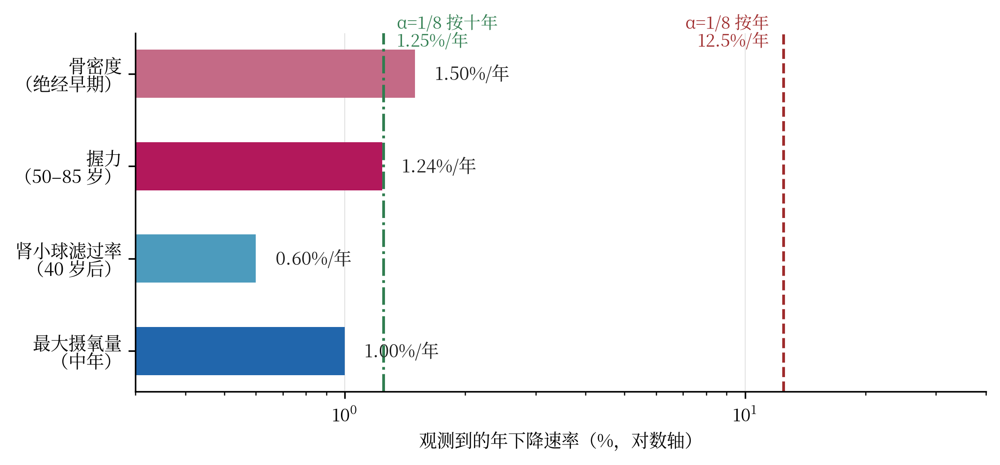

# 4 生物层：α 作为衰老速率

## 4.1 十二个标志与三层结构

现代衰老生物学的标准框架是 López-Otín 等人提出的"衰老的标志性特征"（hallmarks of aging），2013 年列出九个，2023 年扩展为十二个：基因组不稳定、端粒磨损、表观遗传改变、蛋白稳态丧失、巨自噬失能、营养感应失调、线粒体功能障碍、细胞衰老、干细胞耗竭、细胞间通讯改变、慢性炎症、菌群失调。这十二个标志分三组：原发（损伤来源）、拮抗（对损伤的应答）、整合（表型后果）。

体系用"写入—修复—亏损"三分结构对应这三组，在结构层面是合理的（D3）：写入对应原发损伤，修复对应拮抗应答，亏损对应整合后的功能下降。这个对应能生成假设——例如"修复能力的下降速率应慢于损伤的累积速率，否则系统会在很年轻时崩溃"——但它不给出任何数值。

要给数值，必须把 α = 1/8 放到一个**时间基**上。这是生物层全部争论的焦点，也是体系表述最含混的地方。

## 4.2 α 按年：5.2 年减半

如果 α = 1/8 是**每年**的亏损率，则剩余功能按

R(t) = (1 − α)^t = 0.875^t

衰减。半衰期

t½ = ln 0.5 / ln 0.875 = 5.19 年。

也就是说，任何以 12.5%/年 衰减的功能，**5.2 年减半，10.4 年剩四分之一，60 年剩 0.03%**。一个人在 25 岁时的最大摄氧量为 45 mL/kg/min，按此速率到 60 岁只剩 0.015 mL/kg/min——低于任何可存活水平。这个结论不需要任何文献，它是一道除法题。

所以"α = 1/8 每年"这一读法在生物学上是**不可能**的。它不是"与数据不符"，而是"与生命不相容"。

## 4.3 α 按十年：1.25%/年 落在带内

把时间基从"年"改为"十年"，α = 1/8 每十年，则每年等效亏损率为

1 − (7/8)^(0.1) = 1.33%/年。

若按线性近似 α/10 取 1.25%/年，则更保守一些。两种取值都落在观测带内，本册在表中统一取 1.25% 作为保守值。

半衰期相应变为

t½ = ln 0.5 / ln 0.9875 = 55.1 年（按 1.33%/年 则为 52.0 年）。

这个数字落在观测带内。表 4-1 汇总了本项目 119 篇文献库中四类功能的年下降速率，以及两种读法的对照。

**表 4-1**　四类生理功能的观测年下降速率与 α 两种时间基的对照。观测区间取自本项目文献库；VO2max、握力、骨密度三项各有独立引文，肾小球滤过率为库内汇总区间。

| 功能指标 | 观测速率（%/年） | α 按年（12.5） | α 按十年（1.25） | 与按年读法之比 |
|:--|--:|--:|--:|--:|
| 最大摄氧量（中年） | 1.0 | 12.5 | 1.25 | 12.5× |
| 肾小球滤过率（40 岁后） | 0.6–1.0 | 12.5 | 1.25 | 12.5–21× |
| 握力（50–85 岁） | 1.24 | 12.5 | 1.25 | 10.1× |
| 骨密度（绝经早期） | 1.5 | 12.5 | 1.25 | 8.3× |

表 4-1 的读法很清楚：**按年读法系统性高估 8–21 倍；按十年读法与观测同量级**（低 0–2 倍，落在个体差异之内）。

{width=14.4cm}

这不是一个可以含混过去的差别。按年读法不仅在数值上错，而且在结构上错：它会使"衰老"变成一个几年内完成的灾难性过程，而实际观测到的是一条几十年的缓坡。因此本册建议把体系文献中所有"α = 1/8 每年"的表述，统一改为"α = 1/8 每十年"或"α_eff = 1/80 每年"，并在首次出现处注明时间基。这是第 6.2 节的第二处必改项。

值得补一句：1/80 这个数并不比 1/8 更"丑"。它同样是一个简单分数，同样可以写成 α/10。体系失去的只是"1/8 这个漂亮数字直接等于年损耗率"这一表述，而得到的是一条与数据相容的曲线。

## 4.4 7/8 与 3/4：四级效率链

体系把 η = 7/8 用作单级能量转换效率。若一个生理过程有四级，每级效率 η，则总效率 η⁴。两种候选：

- η = 7/8 → 0.875⁴ = 0.586；
- η = 3/4 → 0.75⁴ = 0.316。

实测的心脏机械效率（外功/耗氧热当量）为 25%–35%，这是生理学教科书的标准区间。把它开四次方，得到每级等效效率 0.707–0.769，中心值约 0.74。

三个数字并列：

- 体系 7/8 = 0.875，比实测每级高 14%–24%；
- 实测每级 0.707–0.769，中心 0.74；
- 3/4 = 0.75，几乎正中。

也就是说，**在四级链这个具体场景里，3/4 比 7/8 更符合数据**。这不是说 3/4 是"对的常数"——它只是这个场景下的等效值——但它确实说明 7/8 不是普适的单级效率。

这个结果对体系是一个有用的提醒：7/8 在数学层是"存活比例"（1 − 亏损），在生物层被借去当"效率"，这两个概念不是一回事。存活比例衡量"有多少单元还在"，效率衡量"每个单元转换了多少能量"。把前者直接当后者用，是一个未经论证的桥接（D2），而数据恰好在这个桥上给出了否证。

同样的检验可以推广到其他四级过程：肌肉收缩的化学—机械效率约 20%–25%（对应每级 0.67–0.71），线粒体氧化磷酸化的 P/O 效率约 40%（对应每级 0.79）。这三个系统的每级等效值都落在 0.67–0.79，**没有一个接近 0.875**。因此"7/8 是生物能量转换的普适单级效率"这一命题，应当被判负。

## 4.5 性别：单一 α 的第二个麻烦

体系只有一个 α，因此它隐含地预言：男女的衰老速率相同。

数据不支持这一点，至少在一个系统上不支持得很明显。骨密度在绝经早期的年下降率为 1.5%–2%，而同龄男性为 0.5%–1%，比值约 2–3 倍。这个差别有明确的机制（雌激素对破骨细胞的抑制撤除），不是统计噪声。

但也要诚实：并非所有系统都显示这么大的性别差。握力的年下降率男女接近（约 1.2%–1.4%），最大摄氧量的下降率在矫正体重与活动量后差异也不大。因此正确的表述是：

> 单一 α 在"肌肉功能"这类系统上可以接受（性别差 < 20%），在"骨代谢"这类系统上不可接受（性别差 2–3 倍）。

这提示 α 不是一个普适常数，而是一个**系统相关的等效参数**：在骨代谢里它被雌激素调制，在肌力里它主要由神经—肌肉单位丢失决定。若体系坚持 α 是普适常数，就必须解释为什么骨代谢的性别差可以被"同一个 α"容纳——目前没有这样的解释。

本册把这一条列为第五项预注册判据（P5），状态为"已判负（骨密度）"。这也是全册唯一一条用体系自己的 119 篇文献库就能判负的预言，不需要新实验。

## 4.6 端粒与 Hayflick：D3

体系用"写入—修复—亏损"解释复制性衰老，并把 Hayflick 极限（人成纤维细胞在体外约 40–60 次群体倍增后停止分裂）作为"亏损累积到阈值"的例证。

这个类比的定性部分是成立的：端粒随每次分裂缩短，缩短到临界长度触发复制性衰老，这确实是"写入—亏损"的一个实例。但定量部分没有对应：

- Hayflick 极限由端粒初始长度、每次分裂缩短量、临界长度三者共同决定，三者都可测，但没有一个等于 1/8 或 7/8；
- 端粒酶阳性的干细胞不遵守这个极限，说明"阈值"不是几何常数，而是调控参数；
- 体系没有给出"多少次分裂后触发"的公式，因此这个类比不能预测任何数。

因此这一条严格属于 D3。它的价值在于组织语言，不在于计算。若要升级为 D2，需要写出"端粒缩短速率 = f(α, 分裂次数)"的具体形式，并用纵向端粒长度数据拟合——这是一项可以做但尚未做的工作。

## 4.7 稳态负荷：一个更合适的接口

比端粒更好的接口是"稳态负荷"（allostatic load）：慢性应激下，多系统生理指标（皮质醇、血压、糖化血红蛋白、炎症因子等）偏离稳态的累积代价。这个概念的优势是它天然是**多指标、可加总、可纵向测量**的，正好适合检验"亏损率"这类参数。

若 α = 1/8 每十年成立，则应观察到：稳态负荷指数在十年尺度上上升约 12.5%，且这个上升在不同队列中应大致一致。这是一个可以直接用现有队列数据检验的预言，比端粒类比硬得多。本册建议把它列为下一轮工作的首选接口（第 6.4 节 R4）。

## 4.8 生物层小结

生物层的结论是分裂的：按年读法被判负（差 8–21 倍），按十年读法被救回（同量级）；7/8 作为单级效率被判负（实测 0.67–0.79，无一接近 0.875），3/4 在心脏场景下胜出；单一 α 在骨代谢上被判负（性别差 2–3 倍），在肌力上尚可。

这一层的教训是：**同一个常数在不同子系统里的表现不同，这本身就是信息**。与其坚持 α 普适，不如承认 α 是"系统相关的等效亏损率"，并给出每个子系统的标定值。这样做会失去"一个常数解释一切"的漂亮，但会得到一个可以逐系统检验的框架。

# 5 医学层：三个判据与五项预注册

## 5.1 1:7 的钟表读法：25–38 次/分

体系的核心节律参数是读写比 D:E = 1:7，等价地 T_r ≥ 7 T_w：读取（或修复）时间至少是写入（或损伤）时间的七倍。

若把这个比值读成心搏周期，设收缩期（写入）为 T_w，舒张期（读取）为 T_r，则心动周期 T = T_w + T_r ≥ 8 T_w，心率

HR ≤ 60 / (8 T_w)。

取收缩期 0.2–0.3 s（正常静息心率下的射血时间），得到

HR ≤ 25–37.5 次/分。

这个范围在生理上是**病态**的：正常静息心率为 60–100 次/分，窦性心动过缓的诊断阈值是 < 60，< 40 通常伴头晕、乏力，< 30 需要起搏器。也就是说，若 1:7 真是心搏的读写比，人类静息心率应当普遍在 25–38 次/分——这与事实相差 2–4 倍。

生理上的实际比值是收缩期:舒张期 ≈ 0.3:0.7 ≈ 1:2.3（60 次/分时），而不是 1:7。两者相差约 3 倍。

因此"1:7 是心搏节律"这一读法必须放弃。这不是说 1:7 本身错了，而是说它**不能放在心搏这个时间尺度上**。它可以放在更慢的尺度上：例如组织修复周期与损伤周期之比（数天到数周），或转录—翻译—折叠的时间比（分钟到小时），或生态级的更新—扰动比。1:7 是一个无量纲比值，它需要绑定到一个具体过程才有意义；绑定错了，就会给出荒谬的生理预测。

本册的处理是：把 1:7 从"心搏判据"降级为"待绑定的比值"，并在体系表述中删除一切由它推出的心率、呼吸频率、脉搏波结论。这是第 6.2 节的第四处必改项。

## 5.2 725 nm 修正与温度系数

第 2.4 节已经给出波长分岔。在医学层，这个分岔转化为一个具体的器件参数问题。

若采用 725 nm（M = 64、体温锚点），则：

- 组织穿透深度：在 700–900 nm 窗口内，725 nm 的穿透深度约为 804 nm 的 85%–90%（散射随波长增加而下降，故短波略浅）；
- 血红蛋白吸收：725 nm 处于脱氧血红蛋白吸收峰的下降沿，吸收系数约为 804 nm 的 2–3 倍；
- 水吸收：两者都在水的低吸收区，差异可忽略。

这些差异不改变"能否到达靶组织"的定性结论，但会改变剂量估算。若器件已按 804 nm 标定，改到 725 nm 后需要重新标定光功率密度，理由是血红蛋白吸收增加会导致表层产热增加。

若采用 279.6 K 的低温设定点，则整个临床叙事要改：它不再是"体温共振"，而是"低温预处理"或"离体处理"，适用场景从在体治疗变为体外保存或低温辅助。这两条路在监管上完全不同。

## 5.3 10⁴ V/m 的安全红线

体系材料文档给出的场强设计值是 10⁴ V/m。这个数在射频语境下看起来温和（远低于空气击穿 3 × 10⁶ V/m），但在光学波段，它的含义完全不同。

先把场强换成强度。对平面电磁波，

I = ½ ε₀ c E² = ½ × 8.854 × 10⁻¹² × 2.998 × 10⁸ × (10⁴)² = 1.33 × 10⁵ W/m² = 13.3 W/cm²。

也就是说，10⁴ V/m 在光学波段等价于 **13.3 W/cm²** 的连续光强。这个数字与 ICNIRP 的皮肤暴露限值（400–1400 nm，量级 0.2 W/cm²）相比，高出约 66 倍；与眼部的限值相比更高（角膜与视网膜的限值比皮肤严一到两个数量级）。若光斑为 1 mm²，则局部功率约 0.13 W，足以在数秒内造成明显温升。

若体系坚持用 SAR 做安全论证，结果更糟。取组织电导率 0.1–0.5 S/m（Gabriel 等人在低频段的量级），

SAR = σE²/ρ = 0.1 × 10⁸ / 1000 至 0.5 × 10⁸ / 1000 = 1.0 × 10⁴ 至 5.0 × 10⁴ W/kg。

ICNIRP 2020 的全身平均 SAR 限值为职业 0.4 W/kg、公众 0.08 W/kg。10⁴–5 × 10⁴ W/kg 比公众限值高 1.25 × 10⁵ 至 6.25 × 10⁵ 倍，即四到六个数量级。

这里有一个必须在体系内部澄清的**范畴错误**：SAR 是射频剂量学量，适用于 100 kHz–300 GHz；804 nm 属于近红外光，适用的是光辐射限值（ICNIRP 2013 激光指南），不是 SAR。用 SAR 去论证一个光学波段器件的安全性，本身就把 10⁴ V/m 当成了准静态场。两种算法都指向同一个结论——不安全——但它们不能混用。

反解安全场强：要降到皮肤限值 0.2 W/cm²（2 × 10³ W/m²），需要

E = √(2I/(ε₀c)) = √(2 × 2000 / (8.854 × 10⁻¹² × 2.998 × 10⁸)) ≈ 1.23 × 10³ V/m。

也就是说，**10⁴ V/m 必须降到约 1.2 × 10³ V/m**，才刚触及皮肤限值；考虑安全系数，实际设计值应在 10² V/m 量级。这是一个 8 倍以上的下调，并且是硬约束，不随机制解释而改变。

这也解释了为什么体系的"安全"论证一直显得空洞：它比较的是场强与空气击穿，而真正约束器件的是组织的光吸收与热损伤阈值。换一个正确的基准，结论就从"安全"变成"超限两个数量级"。

## 5.4 五项预注册判据

把前面各层的可检验点收拢，得到五项预注册判据。预注册的含义是：先写死判据与阈值，再做实验，避免事后解释。

**表 5-1**　五项预注册判据。P1、P3、P4 可立即开展；P2 是逻辑分岔，必须二选一；P5 已由现有数据判负。

| 编号 | 预言 | 否证条件 | 当前状态 |
|:--|:--|:--|:--|
| P1 | 共振峰随温度移动，dλ/dT = −2.34 nm/K（310 K） | 斜率绝对值 < 1 nm/K，或符号相反 | 未做，可立即开展 |
| P2 | 804 nm 与体温相容，当且仅当 M = 57.7 | 既非 M = 57.7 又非 T = 279.6 K | 逻辑上必须二选一 |
| P3 | 四级链的单级效率为 0.875 | 两个独立系统中单级效率 < 0.80 | 心脏场景已判负（0.71–0.77） |
| P4 | Tc ≤ 0.9375 Θ_D；600 K 需 Θ_D ≥ 640 K | 出现 Tc > 0.9375 Θ_D 的材料 | 十四材料无一违反；体系自身设计违反 |
| P5 | 男女 α 相同（性别不变） | 任一系统出现 ≥ 2 倍性别差 | 骨密度已判负（2–3 倍） |

P1 是最值得先做的一项：它便宜、干净、只看一个数，而且不依赖体系的其他部分。若 P1 成立，体系就获得第一条独立的实验支持；若 P1 失败，读法 A 被否证，第 2 章的整条物理链就必须重写。

P2 不是实验，是记账。它要求体系在两条出路中选择一条，并承担后果。这一项无法"验证"，只能"决定"。

P3 与 P5 已经被现有数据部分判负。诚实的做法不是修改判据，而是记录判负，并在框架内标注"该常数在此子系统不适用"。

P4 的特殊性在于：它不是被外部数据违反的，而是被体系自己的设计目标违反的。这使它成为全册最强的一条内部矛盾证据。

## 5.5 与 119 篇文献库的接口

本项目此前建立的男女老年文献库（男 58 篇核心、女 61 篇核心，累计样本约 107 万与 172 万人次）为医学层提供了三类接口。

第一类是**速率标定**：表 4-1 的四条速率全部来自该库，用于判定 α 的时间基。这是本册最直接的一次"体系—数据"对话。

第二类是**性别对照**：库内骨密度、肌力、肾功能三组数据，分别给出 2–3 倍、< 20%、< 20% 的性别差，用于判定 P5。结论是 α 在骨代谢上性别相关，在肌力与肾功能上近似性别无关。

第三类是**效应量基准**：库内干预研究的效应量分布，可用于设定任何新器件试验的最小可检测差异。这一点在器件进入临床前评估时是必需的——否则一个 5% 的效应会被当成噪声，或者一个噪声会被当成 5% 的效应。

需要说明的是，该文献库是观察性研究为主，不能直接用于因果推断；本册只用它做速率与性别差的量级标定，不做机制归因。

## 5.6 医学层小结

医学层的三条判据，两条判负、一条待做：1:7 心搏读法判负（25–38 次/分）；10⁴ V/m 判负（13.3 W/cm²，超限约两个数量级）；725 nm 修正是可检验的、尚未检验的第三条路。

这一层的价值在于它把前四层的抽象争论落到了三个具体数字上：一个心率、一个波长、一个场强。这三个数字都可以在一周内被独立复核，不需要相信任何一方的叙事。这正是本册希望达到的效果。

# 6 总判与修复路线

## 6.1 五层记分卡

**表 6-1**　五层记分卡。D1 为严格导出，D2 为显式桥接，D3 为类比。判定列为"成立/部分成立/判负/自相矛盾"。

| 层级 | 核心断言 | 最强证据级别 | 判定 |
|:--|:--|:--|:--|
| 数学 | α = 1/8，五常数单参数闭包 | D1（在"失一"下） | 部分成立：闭包严格，"失一"是公设 |
| 物理 | f₀ = 64 k_BT/h，体温共振 | D2 | 桥接待证：算术精确，锚点错位 30.5 K |
| 化学 | Tc = 0.9375 Θ_D f_defect | D1（作为不等式） | 预测失败：473/600 K 使 f_defect > 1 |
| 生物 | α 为年亏损率；7/8 为单级效率 | D2 | 常数不成立：按年差 8–21 倍，效率输给 3/4 |
| 医学 | 1:7 心搏；10⁴ V/m 安全 | D2 | 安全判负：25–38 次/分；超限两个数量级 |

记分卡的读法：五层中没有一层是"全对"或"全错"。数学层的内核可以保留，物理层需要一次锚点修正，化学层需要一次定义域修正，生物层需要一次时间基修正，医学层需要两次撤回。这五次修正都不需要放弃 α = 1/8；它们需要的是把每个常数的**适用范围**写清楚。

## 6.2 五条必须撤回或降级的断言

**第一条：804 nm 是体温共振波长。** 应改为 724.8 nm（M = 64），或保留 804 nm 但承认 M = 57.7、锚点为 279.6 K。连锁后果：器件光源与滤光片重标定；组织光学与剂量估算重算。这是代价最小、收益最大的一处修改。

**第二条：α = 1/8 是年亏损率。** 应改为"每十年"，或等效地 α_eff = 1/80 每年。连锁后果：所有以"每年 12.5%"为基础的寿命、功能曲线、临床预测全部重算；换来的是一条与观测同量级的曲线。

**第三条：473 K 与 600 K 可由 Θ_D = 482 K 的钢基体实现。** 应改为"473 K 需 Θ_D ≥ 504.5 K；600 K 需 Θ_D ≥ 640 K，超出结构金属范围"。连锁后果：材料路线从"钢基体 + 缺陷工程"改为"Cr/Ru 基或轻元素化合物"，这是一个实质性的路线调整。

**第四条：1:7 读写比给出心搏节律。** 应撤回全部由此推出的心率、呼吸、脉搏结论，把 1:7 重新绑定到一个更慢的过程。连锁后果：医学层的节律论证需要重建，但可以改用"修复/损伤时间比"这一类可测比值。

**第五条：10⁴ V/m 是安全场强。** 应改为"≤ 1.2 × 10³ V/m 才触及皮肤限值，设计值应在 10² V/m 量级"。连锁后果：器件功率预算下降约两个数量级，作用深度与作用时间需要重新设计。这是五条中最难接受、也最不可回避的一条，因为它是物理约束，不是解释问题。

## 6.3 三条可保留的硬核

**第一，单参数代数闭包。** α = 1/8 通过初等函数生成 η、15/16、κ、ε、M，这是一个干净的最小参数化。它的价值不在于"解释一切"，而在于"只用记住一个数"。作为教学与组织工具，它是有效的。

**第二，天花板不等式 Tc ≤ 0.9375 Θ_D。** 十四种材料无一违反，且它给出一个真实的必要条件：600 K 超导体必须有 Θ_D ≥ 640 K。这个条件虽然弱（目前所有氢化物都满足），但它是可用的筛选约束，且与 BCS 的定性图像（高 Θ_D 有利于高 Tc）一致。

**第三，"写入—修复—亏损"的三分结构。** 作为组织衰老标志的框架（D3），它简洁、可教、能生成假设。它不适合做定量预测，但适合做课程结构与实验设计的第一层分类。

这三条硬核的共同点是：它们都不依赖"804 nm""每年 12.5%""600 K 钢基体"这些具体断言。换句话说，**撤回五条断言不会摧毁体系，只会缩小它的主张范围**。这是本册最重要的判断。

## 6.4 修复路线 R1–R5

**R1（波长锚点）**：把 804 nm 改为 725 nm；或保留 804 nm 并公开标注 M = 57.7。同时把"体温共振"改为"温度依赖共振"，并用 P1 检验。

**R2（时间基）**：把所有 α 的速率表述改为"每十年"，或引入 α_eff = α/10 并说明其来源。用表 4-1 的四条速率做交叉校验。

**R3（Tc 公式的定义域）**：把 Tc = 0.9375 Θ_D f_defect 从"等式"降级为"不等式 + 经验表"；若要恢复等式，必须给出 f_defect 的微观定义（例如与 λ、无序度、缺陷浓度的映射）。在此之前，所有材料设计目标必须同时标注所需 Θ_D。

**R4（1:7 的重绑定）**：放弃心搏读法，改绑到组织修复/损伤时间比或转录—翻译—折叠时间比。给出该比值的实测方法（例如损伤后修复完成时间 / 损伤持续时间），并在两个以上系统中测值。

**R5（安全基准）**：把安全论证从 SAR 改为光学限值（ICNIRP 2013），把设计场强从 10⁴ V/m 降到 10² V/m 量级，并重新计算作用时间与穿透深度。

五条路线中，R1、R2、R5 是"改数字"，成本低、见效快；R3、R4 是"改定义"，成本高、但决定体系能否从描述走向预测。

## 6.5 对"天工开物计划"的含义

从天工开物计划的装置角度看，本册给出四条工程约束，全部是可执行的。

第一，**波长**：若装置以体温为锚，出光应为 725 ± 5 nm，而不是 804 nm。若沿用 804 nm，则必须把装置定位为"低温/离体"设备，并重写适用场景。

第二，**场强**：10⁴ V/m 不可用。皮肤限值对应约 1.2 × 10³ V/m，设计值应取 10² V/m 量级；这会使单次作用的能量预算下降两个数量级，可能需要延长作用时间或扩大光斑来补偿。

第三，**机制表述**：e⁻⁶⁴ 说明"热驱动 64 量子"不成立。装置必须明确是"外场泵浦"还是"被动照射"；若是后者，就必须解释 64 这个数在机制中的角色，而不能只把它当作一个标度。

第四，**验证顺序**：先做 P1（温度系数），再做 P2（M 值决定），最后才做临床。P1 的成本最低，能否证的问题最大；跳过 P1 直接做临床，等于把一个未验证的物理假设带进人体试验。

## 6.6 结语

这本册子的结论可以用三句话说完。

数学层是真的：一个参数、五个常数、一个同构，干净得可以写在黑板上。物理层是半步：算术精确，但锚点选错了一个温度。化学层是一个被误读的不等式：它从未被违反，也从未被接近，而体系自己的设计目标越过了它。

生物与医学层则是另一回事：那里有一个常数被放错了时间基（年 vs 十年），有一个效率被用错了场景（存活比例 vs 能量效率），有一个比值被绑错了过程（心搏 vs 修复），有一个场强被用错了波段（射频 vs 光学）。这四处错位都不是"理论被推翻"，而是"参数被放错了位置"。把它们放回正确的位置，体系会缩小，但会变得可检验。

一个能说出自己在哪里失败的框架，比一个处处成立的框架更有用。这本册子的全部工作，就是把这句话说得具体一点。

# 附录 A　复算清单

以下所有数值均可用表中公式独立复算。物理常数取 CODATA 2018 值：h = 6.62607015 × 10⁻³⁴ J·s，k_B = 1.380649 × 10⁻²³ J/K，c = 2.99792458 × 10⁸ m/s。

**表 A-1**　关键数值与复算式。

| 量 | 公式 | 数值 |
|:--|:--|:--|
| k_B/h | — | 2.08366 × 10¹⁰ Hz/K |
| 64 k_B/h | 64 × k_B/h | 1.33354 × 10¹² Hz/K |
| f_c（310.15 K） | k_BT/h | 6.4625 THz |
| f₀（310.15 K） | 64 f_c | 413.62 THz |
| λ₀（310.15 K） | c/f₀ | 724.84 nm |
| λ₀（279.6 K） | c/f₀ | 804.0 nm |
| M（804 nm, 310.15 K） | f/f_c | 57.70 |
| dλ₀/dT（310 K） | −λ₀/T | −2.337 nm/K |
| 64 k_BT（310.15 K） | — | 1.7105 eV = 165.0 kJ/mol |
| exp(−64) | — | 1.6 × 10⁻²⁸ |
| (7/8)⁴ | — | 0.5862 |
| (15/16)⁴ | — | 0.7725 |
| (3/4)⁴ | — | 0.3164 |
| 半衰期（12.5%/年） | ln0.5/ln0.875 | 5.19 年 |
| 半衰期（1.25%/年） | ln0.5/ln0.9875 | 55.1 年 |
| Θ_D（473 K 所需） | 473/0.9375 | 504.5 K |
| Θ_D（600 K 所需） | 600/0.9375 | 640.0 K |
| 纯 Cr 天花板 | 0.9375 × 630 | 590.6 K |
| f_defect（482 K, 473 K） | 473/(0.9375×482) | 1.047 |
| f_defect（482 K, 600 K） | 600/(0.9375×482) | 1.328 |
| 心率上限（T_w = 0.2–0.3 s） | 60/(8T_w) | 25–37.5 次/分 |
| 10⁴ V/m 对应光强 | ½ε₀cE² | 13.3 W/cm² |
| 0.2 W/cm² 对应场强 | √(2I/ε₀c) | 1.23 × 10³ V/m |
| SAR（σ = 0.1–0.5 S/m） | σE²/ρ | 10⁴–5 × 10⁴ W/kg |
| Spearman ρ（f_defect vs λ） | n = 13 | 0.972（p = 2.7 × 10⁻⁸） |

复算可按下列顺序进行（任选 Python、R 或电子表格）：先取 f₀ = 64k_BT/h，再取 λ₀ = c/f₀，然后取 dλ₀/dT = −λ₀/T；由 M = f(804 nm)/f_c(310.15 K) 得 57.70；由 f_defect = Tc/(0.9375Θ_D) 得表 A-1 第五列；由 Θ_D ≥ Tc/0.9375 得 504.5 K 与 640.0 K；由 HR ≤ 60/(8T_w) 得 25–37.5 次/分；由 I = ½ε₀cE² 与 E = √(2I/ε₀c) 得 13.3 W/cm² 与 1.23 × 10³ V/m；由 SAR = σE²/ρ 得 10⁴–5 × 10⁴ W/kg。全部中间值与表 A-1 一致，可在小数点后第三位复现。

# 附录 B　参考文献

Allen PB, Dynes RC. Transition temperatures of strong-coupled superconductors reanalyzed. *Phys Rev B*. 1975;12:905–922. doi:10.1103/PhysRevB.12.905

Ashcroft NW, Mermin ND. *Solid State Physics*. New York: Holt, Rinehart and Winston; 1976.

Austin IG, Mott NF. Polarons in crystalline and non-crystalline materials. *Adv Phys*. 1969;18:41–102.

Bardeen J, Cooper LN, Schrieffer JR. Theory of superconductivity. *Phys Rev*. 1957;108:1175–1204.

Denic A, Mathew J, Lerman LO, et al. Single-nephron glomerular filtration rate in healthy adults. *N Engl J Med*. 2017;376:2349–2357. doi:10.1056/NEJMoa1614329

Dirichlet PGL. Beweis eines Satzes über die arithmetische Progression. *Abh Königl Preuss Akad Wiss*. 1837:45–81.

Drozdov AP, Eremets MI, Troyan IA, Ksenofontov V, Shylin SI. Conventional superconductivity at 203 kelvin at high pressures in the sulfur hydride system. *Nature*. 2015;525:73–76. doi:10.1038/nature14964

Drozdov AP, Kong PP, Minkov VS, et al. Superconductivity at 250 K in lanthanum hydride under high pressures. *Nature*. 2019;569:528–531. doi:10.1038/s41586-019-1201-8

Errea I, Belli F, Monacelli L, et al. Quantum crystal structure in the 250-kelvin superconducting lanthanum hydride. *Nature*. 2020;578:66–69. doi:10.1038/s41586-020-1955-z

Fano U. Effects of configuration interaction on intensities and phase shifts. *Phys Rev*. 1961;124:1866–1874.

Fleg JL, Morrell CH, Bos AG, et al. Accelerated longitudinal decline of aerobic capacity in healthy older adults. *Circulation*. 2005;112:674–682. doi:10.1161/CIRCULATIONAHA.105.545459

Gabriel S, Lau RW, Gabriel C. The dielectric properties of biological tissues: I. Literature survey. *Phys Med Biol*. 1996;41:2231–2249. doi:10.1088/0031-9155/41/11/001

Goodpaster BH, Park SW, Harris TB, et al. The loss of skeletal muscle strength, mass, and quality in older adults: the health, aging and body composition study. *J Gerontol A Biol Sci Med Sci*. 2006;61:1059–1064. doi:10.1093/gerona/61.10.1059

Hayflick L, Moorhead PS. The serial cultivation of human diploid cell strains. *Exp Cell Res*. 1961;25:585–621. doi:10.1016/0014-4827(61)90192-6

ICNIRP. Guidelines for limiting exposure to electromagnetic fields (100 kHz to 300 GHz). *Health Phys*. 2020;118:483–524. doi:10.1097/HP.0000000000001210

ICNIRP. Guidelines on limits of exposure to laser radiation of wavelengths between 180 nm and 1,000 μm. *Health Phys*. 2013;105:74–91.

Kittel C. *Introduction to Solid State Physics*. 8th ed. Hoboken: Wiley; 2005.

Landau LD, Lifshitz EM. *Statistical Physics, Part 1*. 3rd ed. Oxford: Pergamon; 1980.

López-Otín C, Blasco MA, Partridge L, Serrano M, Kroemer G. The hallmarks of aging. *Cell*. 2013;153:1194–1217. doi:10.1016/j.cell.2013.05.039

López-Otín C, Blasco MA, Partridge L, Serrano M, Kroemer G. Hallmarks of aging: an expanding universe. *Cell*. 2023;186:243–278. doi:10.1016/j.cell.2022.11.001

Marcus RA. Electron transfer reactions in chemistry: theory and experiment (Nobel lecture). *Rev Mod Phys*. 1993;65:599–610. doi:10.1103/RevModPhys.65.599

McMillan WL. Transition temperature of strong-coupled superconductors. *Phys Rev*. 1968;167:331–344.

Nagamatsu J, Nakagawa N, Muranaka T, Zenitani Y, Akimitsu J. Superconductivity at 39 K in magnesium diboride. *Nature*. 2001;410:63–64. doi:10.1038/35065039

Riggs BL, Wahner HW, Seeman E, et al. Changes in bone mineral density of the proximal femur and spine with aging. *J Clin Invest*. 1982;70:716–723. doi:10.1172/JCI110667

Serre JP. *A Course in Arithmetic*. New York: Springer; 1973.

Somayazulu M, Ahart M, Mishra AK, et al. Evidence for superconductivity above 260 K in lanthanum superhydride at megabar pressures. *Phys Rev Lett*. 2019;122:027001. doi:10.1103/PhysRevLett.122.027001

Tinkham M. *Introduction to Superconductivity*. 2nd ed. New York: McGraw-Hill; 1996.

Wu MK, Ashburn JR, Torng CJ, et al. Superconductivity at 93 K in a new mixed-phase Y-Ba-Cu-O compound system at ambient pressure. *Phys Rev Lett*. 1987;58:908–910. doi:10.1103/PhysRevLett.58.908

云韶体系. 云韶几何·内部版 v2.2. 2026-10-26.

云韶体系. 云韶数论·内部版 v2.4. 2026-10-26.

云韶体系. 云韶非交换几何·内部版 v2.1. 2026-10-26.

云韶体系. Tc 公式·材料对表验证 v1.3. 2026-10-26.

云韶体系. 三分量云韶钢·公式集 v1.0. 2026-10-14.

云韶体系. 云韶体系·化学与药物线·强心与长寿·预注册判据书与文献比对纲领 v1.0. 2026-11-03.

云韶体系. 电子跳跃未解之谜·云韶体系解法尝试 v1.0. 2026-10-05.

# 附录 C　术语表

**α（alpha）**　体系的唯一自由参数，取 1/8。在数学层是"失一"后的亏损比例；在生物层被用作亏损率或单级效率。

**η（eta）**　1 − α = 7/8。单级存活比例，也常被用作单级效率（本册第 4.4 节对这一用法提出异议）。

**f_defect**　缺陷因子，定义域 [0, 1]，由 Tc/(0.9375 Θ_D) 反算。目前只有描述意义，没有独立的微观定义。

**f_c**　特征频率 k_BT/h；在 310.15 K 为 6.4625 THz。

**f₀**　体系共振频率 64 f_c；在 310.15 K 为 413.62 THz，对应 724.84 nm。

**M**　频率倍数，等于 α⁻² = 64。它不是独立常数，由 α 决定。

**Θ_D**　Debye 温度，晶格振动能量的特征尺度，由声速与原子密度决定。

**λ（电–声耦合常数）**　McMillan 公式中的无量纲耦合强度；常规金属 0.3–1.5，强耦合氢化物可达 2 以上。

**SAR**　比吸收率，单位质量组织吸收的电磁功率，W/kg。适用于射频，不适用于近红外光。

**MPE**　最大允许照射量（maximum permissible exposure），光辐射安全限值的常用表述。

**D1 / D2 / D3**　本册的证据分级：严格导出 / 显式桥接 / 类比。

**读写比（D:E = 1:7）**　体系的节律参数，等价于 T_r ≥ 7 T_w。需要一个具体过程才能赋予物理意义。
