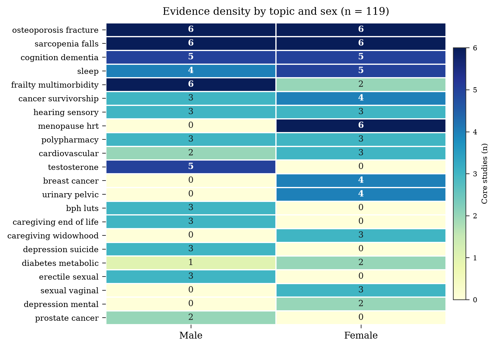

# Sex-Specific Ageing in Older Adults: An Evidence Map of 119 Studies and a Hypothesis-Generating Loss–Repair Framework

**Manuscript draft — for internal review and journal submission preparation**

Prepared by the Yunshao System Literature Working Group. Author list, affiliations, and corresponding-author details are to be completed before submission. This draft was compiled on 4 November 2026 from the Europe PMC corpus described in the Methods. It is not a clinical guideline and must not be used to justify any intervention in humans.

**Keywords:** ageing; sex differences; evidence map; frailty; menopause; testosterone; osteoporosis; social isolation; loss–repair; scoping review

---

## Abstract

**Background.** Older men and women differ not only in life expectancy but in the organs, functions, and social roles through which ageing-related loss becomes visible. Research is fragmented across specialty silos, and sex-specific evidence is rarely mapped side by side. We therefore constructed a structured evidence map of studies dealing specifically with older men and older women, and used it to test whether a project-internal “loss–repair” framework could generate useful, falsifiable hypotheses.

**Methods.** We searched Europe PMC on 4 November 2026 with 64 pre-specified queries covering 16 health topics in each sex, restricted to English-language MEDLINE records published between 2012 and 2026 with abstracts. Every concept was restricted to title/abstract fields; eligible records required a sex marker and an age marker in the title and a topic term in the title or MeSH. Records were de-duplicated, screened at abstract level, and sampled to ensure at least three studies per topic and a maximum of six per topic. We extracted design, population, and reported sample size, and summarised the corpus descriptively. No meta-analysis was performed. The loss–repair framework was translated into operational proxies and graded as consistent, partially consistent, unsupported, or untestable.

**Results.** The searches returned 227,382 hits; 2,560 top-ranked records were retrieved, yielding 1,962 unique PMIDs. After screening, 124 records were indexed and 119 formed the core analytic set (58 male, 61 female). The corpus spanned 2014–2026, with 24 randomised trials, 66 cohort or longitudinal studies, 12 reviews or meta-analyses, and 17 cross-sectional or other designs. Eighty-two studies reported an extractable sample size; their cumulative reported sample was 2,792,052 participants, but this figure double-counts overlapping cohorts and must not be interpreted as unique individuals. Median reported sample sizes were 1,321 (IQR 149.75–4,412) in male-focused studies and 779.5 (IQR 109.5–5,249.25) in female-focused studies. The evidence map was asymmetric: male studies concentrated on testosterone, prostate disease, bone, and frailty, whereas female studies concentrated on menopause, osteoporosis, breast cancer, urinary and pelvic health, and social relationships. Shared topics—cognition, sleep, hearing, polypharmacy, and cancer survivorship—were represented in both sexes but rarely analysed with formal sex comparisons. Cross-sex contrasts were most consistent for social isolation and widowhood (greater functional and psychological vulnerability in women, greater post-bereavement mortality and support loss in men), bone geometry and fracture patterns, and reproductive-hormone-related hearing and metabolic phenotypes. The loss–repair framework generated several testable hypotheses but none of its quantitative constants were supported by the corpus; internal audits in the source project already record negative results for two of its numerical predictions.

**Conclusions.** A reproducible, sex-specific evidence map can be built from a modest number of carefully screened records, but the literature remains siloed and predominantly observational. The most defensible conclusion is methodological: ageing research needs harmonised, sex-stratified, multidomain cohorts rather than more single-topic association studies. The loss–repair framework is best treated as a hypothesis-generating metaphor, not as evidence.

---

## 1. Introduction

Ageing is routinely described as a decline in physiological reserve, yet the shape of that decline is not the same in men and women. Women live longer but spend more years with disability; men have higher mortality at every age but accumulate fewer years of diagnosed morbidity before death. These patterns are produced by interacting biological, behavioural, and social processes, and they cannot be recovered by treating sex as a covariate in an otherwise sex-neutral analysis.

Three problems motivated this work. First, the literature is organised by disease rather than by sex. A reader can find thousands of papers on osteoporosis in women and thousands on testosterone in men, but far fewer studies that place the two trajectories on the same measurement grid. Second, systematic reviews often exclude older adults with multimorbidity, precisely the population in which sex differences are most consequential. Third, the fastest-growing body of evidence is observational and highly heterogeneous in design, exposure definition, and adjustment set, which makes simple vote-counting misleading.

We therefore built an evidence map rather than a systematic review of a single question. An evidence map is appropriate when the goal is to describe the distribution of evidence across topics and designs, identify gaps, and generate hypotheses, not to estimate a pooled effect. The map was constructed from Europe PMC using explicit, reproducible queries and abstract-level screening. It was designed to answer four questions: (i) how much literature exists for each of 16 topics in older men and older women; (ii) what designs and sample sizes dominate; (iii) which sex-specific findings are robust enough to inform clinical thinking; and (iv) whether a project-internal theoretical framework can be operationalised and tested against the map.

The fourth question requires explanation. The owner of the underlying repository has developed a mathematical and engineering framework, referred to here as the Yunshao system, which describes ageing and repair in terms of a 36-dimensional accounting space, 0.5-dimensional defects, a loss rate α = 1/8, a retention rate η = 7/8, a repair quota of 1:7, and a family of field- and material-based engineering proposals, including the so-called LEV device. These terms are defined in the project’s internal mathematical editions and engineering documents. They are not established biomedical constructs. The present paper uses them in only one way: as a source of explicit, falsifiable hypotheses that can be placed next to the empirical literature. We state at the outset that the framework’s quantitative constants are not validated by the corpus, and that several of its internal numerical claims have already been recorded as negative by the project’s own audits. The value of the exercise is therefore heuristic and methodological, not confirmatory.

The specific aims were: (1) to assemble at least 50 distinct studies for each sex, with a target of 62 per sex; (2) to index every record with a real PMID and DOI; (3) to describe the distribution of topics, designs, years, and sample sizes; (4) to synthesise the strongest sex-specific findings; and (5) to translate the loss–repair framework into operational proxies and state, construct by construct, whether the evidence supports it, contradicts it, or cannot test it.

---

## 2. Methods

### 2.1 Design and reporting

This is a scoping evidence map with a pre-specified search and selection algorithm. It follows the spirit of PRISMA-ScR (identification, screening, eligibility, inclusion, charting) but does not claim formal PRISMA-ScR compliance because full-text screening and risk-of-bias assessment were not performed for every record. The unit of analysis is the indexed study, not the participant. No pooled effect estimate was calculated.

### 2.2 Search strategy

Europe PMC was searched through its REST API on 4 November 2026. Sixteen topics were defined for each sex (Table 2). For each topic, two queries were run—one sorted by citation count and one sorted by most recent publication date—to capture both landmark and contemporary work. Each query requested up to 40 records. This produced 64 queries in total.

Every query applied the same bibliographic filter:

`(PUB_YEAR:[2012 TO 2026]) AND (SRC:MED) AND (HAS_ABSTRACT:Y) AND (LANG:"eng")`

The sex and age concepts were restricted to the title/abstract field. For men, the concept combined phrases such as “older men”, “elderly men”, “men aged”, “aging men”, “aged men”, “male veterans”, and “older male”. For women, it combined “older women”, “elderly women”, “women aged”, “aging women”, “aged women”, “postmenopausal women”, and “postmenopausal”. Topic terms were also restricted to title/abstract. The full query strings and raw API responses are archived with the corpus so that the search can be reproduced exactly.

### 2.3 Eligibility and screening

A record was eligible for indexing if it met all of the following criteria: (i) the title contained both a sex marker and an age marker; (ii) the topic term appeared in the title or in the MeSH terms; (iii) the abstract was at least 250 characters long; (iv) the publication type was not an editorial, comment, letter, news item, or retraction; and (v) the record had a PMID and a DOI. The title requirement was deliberately strict. Preliminary searches that allowed the sex and age terms to match anywhere in the full text returned large numbers of off-topic reviews and guidelines; restricting to the title removed most of this noise.

Screening was performed at abstract level. Full texts were not retrieved for all records, and no attempt was made to verify that the abstract’s stated sample size referred only to the sex of interest. This is a material limitation and is discussed below.

### 2.4 Selection and corpus construction

Selection proceeded in two phases. In phase 1, at least three records were selected for every topic and sex, prioritising records whose titles explicitly addressed the topic and whose abstracts reported a sample size. In phase 2, the corpus was filled to a target of 62 records per sex, with a maximum of six records per topic. This quota design prevents a single high-volume topic from dominating the map. After selection, five records were reclassified as contextual rather than core because their population or exposure did not match the intended sex-specific older-adult question. The final corpus contained 124 indexed records, of which 119 were core (58 male, 61 female). The five contextual records remain in the index for transparency but are excluded from the descriptive statistics.

### 2.5 Data extraction

For each record we extracted PMID, DOI, title, authors, journal, year, publication types, design, population (male, female, or mixed), reported sample size, citation count, and the full abstract. Design was classified from publication types and abstract wording into four groups: randomised trial, cohort/longitudinal, cross-sectional/other, and review/meta-analysis. Sample size was extracted from the abstract with regular expressions and then checked manually; values that could not be attributed to the study population were left missing. No individual participant data were accessed.

### 2.6 Descriptive analysis

We computed counts by sex, topic, year, and design; median and interquartile range of reported sample sizes; and the cumulative sum of reported sample sizes. The cumulative sum is presented only as a measure of the volume of evidence, not as a count of unique people. Overlapping cohorts (for example, UK Biobank, the Women’s Health Initiative, the Health and Retirement Study, and MrOS) and meta-analyses of overlapping trials make the sum non-additive. We also computed the same sum after excluding reviews and meta-analyses; this reduces but does not eliminate double-counting.

Figures were generated with Matplotlib. Figure 1 shows the identification and selection flow. Figure 2 is a topic-by-sex heatmap of core-study counts. Figure 3 shows publication year and design composition. Figure 4 shows the distribution of reported sample sizes on a logarithmic scale.

### 2.7 Conceptual framework mapping and evidence grading

The loss–repair framework was reconstructed from the project’s latest internal mathematical editions: *Yunshao Geometry, internal edition v2.2* (26 October 2026), *Yunshao Number Theory, internal edition v2.4* (26 October 2026), and *Yunshao Noncommutative Geometry, internal edition v2.1* (26 October 2026). The relevant definitions are: a 36-dimensional space formed by 12 groups of three dimensions; a 0.5-dimensional defect in each group, giving 12 × 0.5 = 6 lost dimensions; a loss rate α = 1/8 derived from the eight irreducible representations of (Z₂)³, one of which is lost; a retention rate η = 1 − α = 7/8; a topological capacity κ = α/4 = 1/32; a metric degeneration factor ε = α² = 1/64; and a characteristic spacing d = √ε = 1/8 = 0.125 nm. The framework also specifies a repair quota of 1:7 (α:η), operationalised in project documents as a repair window T_r ≥ 7 T_w, and a conception of life as a self-sustaining oscillation across eight accounting sectors.

For each construct we defined an operational proxy that could, in principle, be measured in a human cohort. We then assigned one of four grades: *consistent* (the direction of the empirical literature matches the construct, with more than one independent study), *partially consistent* (some support but heterogeneous or indirect), *unsupported* (the available evidence contradicts the construct or fails to find the predicted pattern), or *untestable* (no operational definition or no human evidence). The grading is deliberately conservative. It evaluates the construct as we operationalised it, not the full metaphysical system.

The project’s internal audit records were also reviewed. These records are important because they show that the framework has already been subjected to internal falsification attempts. Two examples are directly relevant: the claim that a certain covering function satisfies χ_max ≥ 0.125 was found to be an artifact of back-filling the constant α, and the claim that the frozen fraction C_frozen ≈ 0.78 was not reproducible under the project’s own simulation model. These negative results are reported here because they constrain what can honestly be claimed.

### 2.8 Ethics and data availability

This study used publicly available bibliographic records and abstracts. No human participants were contacted, and no identifiable data were accessed. Ethical approval was therefore not required. The corpus, search logs, extraction scripts, and figures are archived in the repository under `archive/16-生命与营养工程/02-实验与数据/男女老年文献库-20261104/`. The manuscript is a derivative of that archive. The project-internal framework documents are not peer-reviewed and are listed separately in Appendix A for provenance.

---

## 3. Results

### 3.1 Corpus characteristics

The 64 queries returned 227,382 hits in total. The API retrieved the top 40 records per query, giving 2,560 records for screening. After de-duplication by DOI, PMID, and normalised title, 1,962 unique PMIDs remained. Abstract-level screening retained 124 records, and five were subsequently classified as contextual, leaving 119 core studies: 58 male-focused and 61 female-focused.

Table 1 summarises the corpus. The male and female subsets were similar in size but differed in composition. Male studies included 11 randomised trials, 32 cohort or longitudinal studies, nine cross-sectional or other designs, and six reviews or meta-analyses. Female studies included 13 randomised trials, 34 cohort or longitudinal studies, eight cross-sectional or other designs, and six reviews or meta-analyses. The median publication year was 2026 in both subsets, reflecting the deliberate use of a “most recent” sort order; the corpus is therefore not a representative sample of the 2012–2026 literature. It over-represents recent publications and should be read as a structured sample, not as a complete census.

Eighty-two studies reported an extractable sample size (40 male, 42 female). The cumulative reported sample was 2,792,052 (1,069,619 male, 1,722,433 female). After excluding reviews and meta-analyses, the cumulative primary-study sample was 2,731,409 (1,011,586 male, 1,719,823 female). These figures are dominated by a small number of very large cohorts: a male life-expectancy study using VA and SEER-Medicare data (n = 916,890), a female hearing study using Nurses’ Health Study data (n = 1,410,928), and a UK Biobank sleep study (approximately 200,000 women). The median study was much smaller (1,321 male, 779.5 female), and the interquartile ranges were wide (149.75–4,412 and 109.5–5,249.25, respectively). The distribution is shown in Figure 4.

**Table 1. Corpus characteristics by sex.**

| Characteristic | Male | Female | Total |
|---|---:|---:|---:|
| Indexed records | 61 | 63 | 124 |
| Core analytic set | 58 | 61 | 119 |
| Publication years | 2016–2026 | 2014–2026 | 2014–2026 |
| Median publication year | 2026 | 2026 | 2026 |
| Randomised trials | 11 | 13 | 24 |
| Cohort/longitudinal | 32 | 34 | 66 |
| Cross-sectional/other | 9 | 8 | 17 |
| Reviews/meta-analyses | 6 | 6 | 12 |
| Studies with extractable n | 40 | 42 | 82 |
| Cumulative reported n | 1,069,619 | 1,722,433 | 2,792,052 |
| Cumulative n, primary studies only | 1,011,586 | 1,719,823 | 2,731,409 |
| Median reported n (IQR) | 1,321 (149.75–4,412) | 779.5 (109.5–5,249.25) | — |
| Largest reported n | 916,890 | 1,410,928 | 1,410,928 |
| Mixed-sex populations | 14 | 4 | 18 |

*Cumulative n is the sum of reported sample sizes and is not a count of unique individuals. Overlapping cohorts and meta-analyses make the total non-additive.*

{width=5.9in}

{width=6.3in}

{width=5.4in}

### 3.2 Evidence map

Figure 2 shows the distribution of core studies across the 16 topics. Three patterns are visible.

First, the two sexes share a common core of topics—osteoporosis and fracture, sarcopenia and falls, cognition and dementia, sleep, frailty and multimorbidity, cancer survivorship, hearing and sensory function, and polypharmacy—but the density within each topic is asymmetric. Osteoporosis and sarcopenia each had six studies in both sexes, by design. Frailty had six male studies but only two female studies. Cognition had five in each sex. Sleep had four male and five female studies. Cancer survivorship had three male and four female studies.

Second, several topics are effectively sex-specific in the current literature. Testosterone, benign prostatic hyperplasia and lower urinary tract symptoms, prostate cancer, erectile and sexual function, and end-of-life care in men had no female counterpart in our corpus. Menopause and hormone therapy, breast cancer, urinary and pelvic floor disorders, sexual and vaginal health, and widowhood and caregiving had no male counterpart. This is partly a real biological and clinical division and partly an artifact of how topics were defined. It means that a simple “male versus female” comparison across the whole map is not meaningful; comparisons must be made within shared domains.

Third, some topics are thinly covered in both sexes. Diabetes and metabolic health had one male and two female studies. Depression had three male and two female studies, but the topic labels differed (“depression_suicide” for men and “depression_mental” for women), which itself illustrates the fragmentation problem. Cardiovascular disease had two male and three female studies. These low counts are a warning: the corpus is adequate for an evidence map but not for stable prevalence estimates or pooled effects.

**Table 2. Core studies by topic and sex.**

| Topic | Male | Female | Total |
|---|---:|---:|---:|
| Osteoporosis and fracture | 6 | 6 | 12 |
| Sarcopenia and falls | 6 | 6 | 12 |
| Cognition and dementia | 5 | 5 | 10 |
| Sleep | 4 | 5 | 9 |
| Frailty and multimorbidity | 6 | 2 | 8 |
| Cancer survivorship | 3 | 4 | 7 |
| Hearing and sensory function | 3 | 3 | 6 |
| Menopause and hormone therapy | 0 | 6 | 6 |
| Polypharmacy | 3 | 3 | 6 |
| Cardiovascular disease | 2 | 3 | 5 |
| Testosterone | 5 | 0 | 5 |
| Breast cancer | 0 | 4 | 4 |
| Urinary and pelvic health | 0 | 4 | 4 |
| Benign prostatic hyperplasia/LUTS | 3 | 0 | 3 |
| Caregiving and end of life (men) | 3 | 0 | 3 |
| Caregiving and widowhood (women) | 0 | 3 | 3 |
| Depression (men) | 3 | 0 | 3 |
| Diabetes and metabolic health | 1 | 2 | 3 |
| Erectile and sexual function (men) | 3 | 0 | 3 |
| Sexual and vaginal health (women) | 0 | 3 | 3 |
| Depression (women) | 0 | 2 | 2 |
| Prostate cancer | 2 | 0 | 2 |

*Topic labels follow the search taxonomy; male and female depression were searched under different labels, which is why they appear as separate rows.*

{width=5.9in}

### 3.3 Male-specific evidence

#### 3.3.1 Hormones and sexual health

The male hormonal literature in this corpus is dominated by testosterone replacement. A 2026 systematic review and meta-analysis of 31 randomised trials (9,437 participants) found that testosterone replacement reduced total cholesterol, triglycerides, and low-density lipoprotein cholesterol, but reported an uncertain arrhythmia signal and concluded that the clinical significance of that signal remains unclear. [1] An earlier randomised trial of 788 older men with symptomatic hypogonadism found that one year of testosterone gel increased noncalcified coronary plaque volume compared with placebo, without major adverse cardiovascular events during the trial. [2] These two findings are not necessarily contradictory: lipid improvements and plaque progression can coexist, and neither trial was powered for hard cardiovascular endpoints. The practical implication is that testosterone should not be framed as a cardiovascular risk-reduction intervention.

Testosterone also has tissue-specific effects. In a randomised trial of 211 older men with low testosterone, one year of treatment increased spine trabecular volumetric bone density by 7.5% versus 0.8% with placebo, with a treatment effect of 6.8%, and increased estimated bone strength; the authors noted that a larger and longer trial would be needed to determine whether fracture risk falls. [3] In a trial of 470 older men with low libido and low testosterone, testosterone improved sexual desire and activity in proportion to the increase in testosterone and estradiol, but did not clearly improve erectile function; no threshold testosterone level predicted response. [4] This dissociation is clinically important: sexual desire and erectile function are not the same endpoint, and the latter is more strongly influenced by vascular and metabolic health.

A 2026 cohort of 117 healthy ageing men found that reproductive and sexual function were largely preserved over time, and that erectile dysfunction and hypogonadism-like symptoms were more strongly associated with glycaemic control than with testosterone levels. [5] A small randomised trial of vitamin D supplementation in 102 middle-aged men reported improvements in testosterone, metabolic parameters, and erectile function, but the sample was small and the findings require replication. [6] A systematic review of testosterone combined with strength training found that testosterone increased fat-free mass and reduced fat mass but did not produce consistent strength gains; combined exercise and testosterone improved function in some studies but not others. [7]

Sexual health in later life is broader than hormone replacement. In the English Longitudinal Study of Ageing, a sizable minority of men and women remained sexually active into the eighth and ninth decades, but sexually active men reported more concern about sexual health and more dissatisfaction than women at all ages. [8] A review of antihypertensive and antidiabetic medications emphasised that several commonly used drug classes have detrimental effects on erectile function, while others are neutral or beneficial, so medication review is a legitimate part of sexual health care in older men. [9]

#### 3.3.2 Prostate and urinary health

Benign prostatic hyperplasia and lower urinary tract symptoms were examined from three angles: risk factors, frailty, and deprescribing. In a prospective cohort of 4,449 Chinese men, both baseline frailty and frailty trajectories predicted BPH/LUTS risk; the high-increasing trajectory had an odds ratio of 2.82 (95% CI 1.79–4.45) compared with the persistently low trajectory. [10] In a cohort of 5,607 men, dyslipidaemia, particularly adverse lipid ratios, was associated with accelerated prostate volume enlargement, independent of age, body mass index, and fasting glucose; high-density lipoprotein cholesterol was protective. [11] In a cohort of 4,755 men, serum uric acid showed a non-linear association with BPH, with an optimal cutoff of 5.26 mg/dL, but the authors explicitly described the finding as hypothesis-generating because of the observational design. [12]

The most clinically actionable male urinary study was a randomised N-of-1 trial of tamsulosin deprescribing in 31 older men. Treatment response was heterogeneous, and the authors estimated that about one in three men with minimal symptomatic benefit might be a high-priority candidate for deprescribing. [13] This is a good example of a question that matters more to older men than another association study: many are taking a drug they do not need, and the harm–benefit balance changes with age.

Prostate cancer studies in the corpus focused on mortality and survivorship rather than screening. A population-based study of 9,625 Medicare-aged men with metastatic prostate cancer found a roughly 20% lower mortality hazard among men diagnosed after androgen receptor pathway inhibitors were introduced, while cautioning that part of the improvement may reflect stage migration. [14] A cohort of 451 men aged 59 or younger treated with low-dose-rate brachytherapy found that non-prostate cancer deaths substantially outnumbered prostate cancer deaths, with cardiovascular disease and other malignancies the leading contributors; the authors argued that improving overall survival requires aggressive management of modifiable health risks. [15] A randomised trial of 80 prefrail or frail men undergoing radical prostatectomy found that short-term home-based multimodal prehabilitation improved the perioperative trajectory of functional capacity, although larger trials with longer follow-up are needed. [16]

#### 3.3.3 Bone, muscle, falls, and frailty

Male osteoporosis is under-recognised. A Taiwanese cohort of 2,093 older adults found that osteoporosis prevalence in men was about half that in women (32.4% versus 51.4%), yet the burden of fragility fractures was comparable. [17] This “osteoporosis–fracture paradox” means that a normal bone density in an older man does not guarantee low fracture risk, and that fracture prevention must integrate clinical risk factors.

Screening tools developed in women do not transfer cleanly to men. In 1,888 community-dwelling Japanese men, the Osteoporosis Self-Assessment Tool had moderate discrimination for densitometric osteoporosis, but the optimal cutoffs differed substantially from the female-derived thresholds; its fracture prediction was comparable to FRAX. [18] A study of 9,704 men and women in MrOS and SOF developed a five-variable physical-performance model that predicted 10-year fracture risk at least as well as FRAX without bone density in men, but the model was developed within the same cohorts and requires external validation. [19] A bone microstructure study found that men and women with similar areal bone density differed significantly in microarchitecture and fracture pattern: wrist and shoulder fractures were more common in women, hip fractures in men. [20]

Muscle and frailty evidence in men is relatively mature. In the English Longitudinal Study of Ageing (4,301 participants), fall risk factors differed by sex: in women, urinary incontinence and frailty were prominent; in men, older age, depressive symptoms, and inability to perform a standing balance test were prominent. [21] In the Concord Health and Ageing in Men Project (1,705 men), low muscle mass and sarcopenic obesity predicted frailty, disability, and institutionalisation, independent of confounders. [22] In 1,382 older men, muscle mass measured by D3-creatine dilution was strongly related to physical performance, mobility limitation, and incident injurious falls, whereas dual-energy X-ray absorptiometry lean mass was not. [23] The FNIH sarcopenia criteria and the SOF frailty index predicted 15-year mortality in 191 ambulatory older men, with hazard ratios of 2.50 and 2.64, respectively. [24]

Frailty is also socially and behaviourally patterned. In 1,622 older British men, oral health problems were associated with prevalent and incident frailty, with odds ratios of about 2.3–2.7 for one, two, or three or more problems after adjustment. [25] In the MrOS study (5,994 men), back pain, especially activity-limiting back pain, predicted progression to frailty over seven years. [26] A trajectory study of 1,319 men aged 71 or older found heterogeneous frailty progression, and the most severe trajectory disappeared when the analysis was restricted to continuous participants, highlighting the importance of attrition. [27] At the genomic level, a genome-wide meta-analysis of 256,523 Europeans identified 15 loci for muscle weakness, including pathways related to diabetes, haematological parameters, and immune function, suggesting that muscle weakness is not simply a downstream marker of low activity. [28]

#### 3.3.4 Cardiometabolic, cognitive, sleep, and sensory health

The male cardiovascular literature in this corpus is thin. A cross-sectional study of 1,323 Europeans aged 50 or older with a history of stroke found that moderate-to-vigorous physical activity more than once a week was associated with lower odds of depression in both sexes, but the sex-specific patterns differed. [29] A reference-interval study showed that body mass index substantially affects estradiol and estrone concentrations in men and postmenopausal women, which matters for the interpretation of hormonal assays. [30]

Cognitive ageing in men appears to be sensitive to vascular and metabolic exposures. In the Kuakini Honolulu–Asia Aging Study (2,649 men), high late-life systolic blood pressure was associated with a lower risk of Alzheimer’s disease but a higher risk of vascular dementia, compared with the reference range, after adjustment for confounders including the FOXO3 longevity genotype. [31] In a small randomised crossover trial of 18 older men with overweight, acute ketone monoester supplementation lowered insulin-induced cerebral blood flow responses in insulin-sensitive regions and produced modest improvements in attention and psychomotor speed. [32] In the SOMMA study, adiposity was most consistently related to processing speed, with weaker or absent associations with memory and executive function. [33] A longitudinal analysis of sensory, balance, and other markers suggested that combined sensory and balance changes may precede cognitive decline, but the authors called for larger and multi-cohort confirmation. [34]

Sleep studies in men focused on measurement and mortality. In 813 older men with sleep disturbances, both underestimation and overestimation of sleep duration predicted mortality over a median follow-up of 11.9 years, with hazard ratios of 1.42 and 1.26, respectively. [35] In 780 middle-to-older-aged men, smoking was not associated with eight-year incident obstructive sleep apnoea at an apnoea–hypopnoea index of 15 or more. [36] A psychometric study validated a two-item Pittsburgh Sleep Quality Index in community-dwelling older men. [37] A randomised trial of Tai Chi Qigong in 113 older male cancer survivors found modest short-term improvements in sleep quality, with no significant effects at 12 months. [38]

Hearing and sensory studies in men covered hormonal associations, occupational injury, and rehabilitation. In the Hitachi Health Study II, older men with higher serum testosterone were less likely to have high-frequency hearing loss, whereas dehydroepiandrosterone sulfate was not associated with hearing loss. [39] A diagnostic study developed a method for identifying noise-induced hearing loss sustained during military service in men aged 61–80, with a reasonable balance of sensitivity and specificity. [40] A case series of older male veterans found that active middle-ear implantation with an incus short-process coupler improved high-frequency hearing, hearing-related quality of life, and tinnitus. [41]

#### 3.3.5 Social, mental, caregiving, and survivorship

The social and psychological literature in men is small but consistent in one respect: men appear to be more vulnerable to certain consequences of spousal loss, even though women report more depression overall. A study of 25,957 older adults found that both sexes reported increased social participation after spousal loss, but only men experienced reduced social support; men also showed higher alcohol consumption, whereas women were more likely to attend health screening but became more sedentary. The authors concluded that men showed greater vulnerability to adverse outcomes and women greater resilience. [42] In 2,849 older widowed male veterans, widowers had greater cognitive decline, more difficulty with instrumental activities of daily living, and more medical comorbidities than married veterans; sensitivity analyses restricted to widowers showed greater post-loss ADL difficulty (incidence rate ratio 1.30), ADL assistance (1.76), and comorbidities (1.12). [43]

Qualitative work helps explain these patterns. A study of 32 older men in Lisbon described “unnamed loneliness”—a sense of no longer being needed or consulted—and argued that connection depends not only on contact but on relational consequentiality. [44] In 136 older men and women, greater social isolation was related to reduced objective physical activity and more sedentary time, whereas loneliness was not associated with activity in multivariable analysis. [45] A review of the gender difference in late-life depression noted that the female excess in depression persists into old age, but that the explanatory factors may differ from those operating earlier in life and require longitudinal and model-based investigation. [46]

End-of-life trajectories in men are heterogeneous. In the Manitoba Follow-up Study, the most common pattern was a gradual decline in well-being before death; about one fifth of men experienced a rapid decline, about one fifth a terminal drop, 13% survived, and 5% could not be classified. Lower baseline physical functioning and more chronic diseases were associated with gradual decline. [47]

Polypharmacy studies in men focused on adherence, drug interactions, and deprescribing. In 1,525 older adults with hypertension, low self-reported medication adherence was associated with a decline in mental health-related quality of life over one year, but not with physical health-related quality of life. [48] In 636 community-dwelling older people in northern Italy, polypharmacy, potential drug–drug interactions, and anticholinergic use were common; anticholinergic burden was associated with mild cognitive impairment and executive dysfunction in women and with memory in men. [49] The tamsulosin deprescribing trial, discussed above, is the clearest example of a male-specific deprescribing question. [13]

Cancer survivorship in men was represented by exercise and biological studies. In the HERO trial of 113 older male cancer survivors, Tai Chi Qigong and intensity-matched exercise produced modest immediate improvements in fatigue, but the improvements did not persist beyond the programme. [50] A companion analysis found that cancer-related fatigue was associated with inflammatory profiles and coordinated transcriptional shifts involving immune activation, neuro-immune signalling, mitochondrial dysfunction, and impaired nucleic acid processing. [51] A large observational study of 916,890 men with prostate cancer developed life-expectancy estimates from a prostate cancer comorbidity index, with median life expectancy ranging from 16.1 years at the lowest comorbidity score to 5.2 years at the highest. [52]

### 3.4 Female-specific evidence

#### 3.4.1 Menopause, hormone therapy, and bone

The Women’s Health Initiative randomised trials provide the longest-term mortality evidence on menopausal hormone therapy. Among 8,506 postmenopausal women, conjugated equine oestrogen plus medroxyprogesterone acetate for a median of 5.6 years, or conjugated equine oestrogen alone for a median of 7.2 years, was not associated with all-cause, cardiovascular, or cancer mortality over 18 years of cumulative follow-up. [53] This does not mean that hormone therapy is risk-free for all outcomes; it means that, in these trials and this follow-up, mortality was not increased.

Bone is the best-studied menopause target. Ten years of denosumab in the FREEDOM trial and its extension (7,808 women) produced continued increases in bone mineral density—21.7% at the lumbar spine, 9.2% at the total hip, 9.0% at the femoral neck, and 2.7% at the one-third radius—with low rates of adverse events and low fracture incidence compared with the original trial. [54] A narrative review of bone–immune interactions emphasised that oestrogen deficiency increases pro-inflammatory cytokines such as IL-6 and RANKL, which contribute to postmenopausal osteoporosis and may also impair fracture healing. [55] In 2,959 postmenopausal women with depressive symptoms at baseline, later age at menopause was associated with lower depressive symptom scores in both SHARE and ELSA, suggesting that age at menopause can help identify women at higher risk of persistent symptoms. [56]

Several smaller trials examined adjunctive bone therapies. In 156 perimenopausal and postmenopausal women, six months of Gushukang, hormone therapy, or combination therapy increased bone mineral density, with the combination superior. [57] A meta-analysis of 608 postmenopausal women found that creatine, particularly at least 5 g per day combined with resistance training, produced small but meaningful gains in lean mass and strength, without evidence of harm; effects on bone density remained unclear. [58] A cohort study of Korean women found that about one fifth experienced adverse sarcopenic obesity trajectories during the menopausal transition, and that physical activity was associated with lower risk of peri-menopausal onset and post-menopausal progression. [59]

#### 3.4.2 Osteoporosis, fractures, and musculoskeletal ageing

The female osteoporosis literature is large but still has important gaps. In a propensity-matched real-world study of 5,930 postmenopausal women with severe osteoporosis, romosozumab was not associated with a higher 12-month cardiovascular risk than alendronate; however, the advanced chronic kidney disease stratum could not be analysed because of too few events. [60] In 56 older women who underwent percutaneous kyphoplasty, computed tomography measurements of paraspinal muscle, particularly the extensor-to-flexor density ratio, independently predicted subsequent fractures, and combining muscle parameters with volumetric bone density improved risk stratification. [61] A small biomarker study of 85 women found that circulating hsa_circ_0003254 distinguished postmenopausal osteoporosis from controls with an area under the curve of 0.876 and from osteopenia with an area of 0.934; this is promising but far from clinical validation. [62] A meta-analysis and machine-learning assessment of Psoralea corylifolia in postmenopausal osteoporosis reported efficacy signals but also hepatotoxicity concerns, and the proposed dose window was explicitly non-clinically validated. [63] A qualitative study of a digital self-management platform found that postmenopausal women valued audiovisual guidance and flexible home-based access, supporting feasibility but not effectiveness. [64]

Exercise remains the most consistent intervention. The LIFTMOR randomised trial of 101 postmenopausal women with osteopenia or osteoporosis found that a brief high-intensity resistance and impact training programme improved bone strength indices and functional performance, with only one minor adverse event under highly supervised conditions. [65] In 1,393 middle-aged women, muscle and bone loss were associated with the menopausal transition, and higher physical activity was beneficial, especially for skeletal muscle. [66] In 954 older women with type 2 diabetes, bone microarchitecture was more favourable than in controls, but bone material strength and physical function were worse, which may explain the paradox of increased fracture risk despite preserved bone density. [67]

#### 3.4.3 Breast cancer and cancer survivorship

Breast cancer is the dominant female malignancy in the corpus. A global burden study documented rising incidence of both premenopausal and postmenopausal breast cancer, with the postmenopausal increase most notable in countries in transition. [68] In 9,888 older breast cancer survivors, continued surveillance mammography was not associated with a reduced risk of advanced second primary breast cancer (hazard ratio 0.76, 95% CI 0.46–1.26); the absolute risk of advanced cancer was low, and surveillance decisions should be individualised. [69] In 5,734 women receiving endocrine therapy, menopausal symptoms increased more during the first year than in women without breast cancer and persisted over three years, particularly among premenopausal women receiving ovarian function suppression. [70]

Cardiovascular toxicity is an emerging survivorship issue. A qualitative study of 12 women with breast cancer identified substantial barriers to understanding and monitoring cardiovascular toxicity, including competing informational needs and psychosocial and systemic barriers. [71] In 1,558 postmenopausal breast cancer survivors, alcohol reduction or cessation was not associated with lower all-cause mortality overall, but among women consuming at least one drink per day before diagnosis, increasing consumption was associated with higher mortality (hazard ratio 1.83, 95% CI 1.02–3.31). [72] In the Multiethnic Cohort, pre-diagnostic circulating 27-hydroxycholesterol, estrone, and sex hormone-binding globulin were associated with mortality among postmenopausal women with breast cancer, whereas testosterone was not. [73] In 779 women with surgically treated ovarian cancer, postoperative menopausal hormone therapy was not associated with impaired 10-year survival. [74] A qualitative study of older rural Australian women described fear of cancer recurrence, reluctance to seek help, and concern about being a burden. [75]

#### 3.4.4 Cardiovascular, urinary, and pelvic health

Female cardiovascular evidence in this corpus is notable for several null or cautionary findings. In the SHOW study of 5,535 relatively healthy older women, endogenous oestradiol concentrations were not independently associated with major adverse cardiovascular events or all-cause mortality. [76] In 548 postmenopausal women with and without chronic kidney disease, common cardiovascular risk prediction models had poor discrimination and calibration, and the PREVENT model generally underpredicted risk. [77] In 825 older women, social isolation and loneliness were independently associated with modestly higher cardiovascular disease risk, and women with both exposures had greater risk than those with either alone. [78]

Urinary and pelvic floor disorders are common and under-treated. A systematic review and meta-analysis of observational studies found that the highest prevalence of urinary incontinence in older women was in Asia, at 45.1% (95% CI 36.9–53.5). [79] A systematic review of 2,002 participants found that physical therapy, particularly pelvic floor muscle training and multimodal programmes, reduced incontinence severity and improved functional outcomes. [80] In 505 women with advanced pelvic organ prolapse, colpocleisis was associated with a reduction in any urinary incontinence from 52.1% to 39.8% at one year, with distinct symptom-based phenotype transitions. [81] In a cohort of older women with overactive bladder, anticholinergic medication was associated with a higher risk of claims-defined incident dementia than β3-agonist use (hazard ratio 1.49, 95% CI 1.04–2.13), but not with worsening long-term care needs or frailty. [82] In 194 community-dwelling older women, sarcopenia was independently associated with nocturia. [83]

#### 3.4.5 Cognition, sleep, and sensory health

Female cognitive ageing research is increasingly life-course oriented. In 780 women, age at menarche and educational attainment were related to late-life episodic memory, with stronger and more consistent associations for a verbal list-learning measure than for a story-recall measure. [84] In a Chinese cohort of postmenopausal women, adverse reproductive factors and unhealthy lifestyle behaviours were associated with cognitive decline, with additive interactions between early menopause and physical inactivity and between long breastfeeding duration and physical inactivity. [85] A study of cognitively healthy life expectancy in India found that rural women spent 4 percentage points less of their remaining life cognitively healthy, whereas rural men spent 8 percentage points less; social-group disparities were also large. [86] In a randomised trial of 54 obese older women, 12 weeks of moderate-intensity aquatic or dance-based aerobic exercise improved metabolic health and cognitive function and was accompanied by reductions in interleukin-6 and increases in brain-derived neurotrophic factor. [87]

Sleep is a major female health topic. A systematic review and meta-analysis of treatments for chronic insomnia in perimenopausal and postmenopausal women concluded that non-pharmacological interventions, particularly cognitive behavioural therapy for insomnia and techniques reducing sympathetic hyperarousal, were the most robust first-line options, whereas pharmacological treatments required longer and better-designed studies. [88] A small study of 79 postmenopausal women with insomnia found that plasma GFAP and p-Tau, with a possible incremental contribution from orexin A, might help identify cognitive vulnerability, but the internally validated performance was modest. [89] A multiparametric magnetic resonance imaging study of 74 women found altered neurofluid dynamics markers in chronic insomnia, with a four-marker classification model achieving an area under the curve of 0.785. [90] In 1,914 Zhuang postmenopausal women, urinary metal mixtures were associated with sleep quality, but the authors described the findings as exploratory. [91] A trial of auricular acupressure in middle-aged and older women with insomnia reported improved sleep quality at four weeks. [92] A daily-diary study of 240 midlife postmenopausal women found bidirectional day-to-day associations between sleep and positive affect, with stronger effects from sleep to next-day positive affect than the reverse. [93]

Hearing loss in women is linked to reproductive history. In 1,410,928 women, older age at natural menopause and longer duration of postmenopausal hormone therapy were associated with higher risk of hearing loss. [94] In 214,327 women followed for a mean of 13.42 years, higher parity (four or more children) and premature menopause were associated with hearing loss, suggesting that reproductive history should be incorporated into hearing health assessments. [95] In 220 postmenopausal women, reduced bone mineral density was associated with worse hearing thresholds across normal, osteopenic, and osteoporotic groups, independent of age, body mass index, and duration of menopause; the cross-sectional design precludes causal inference. [96]

#### 3.4.6 Mental health, social roles, caregiving, and polypharmacy

Social relationships are among the strongest and most consistently sex-specific findings in the corpus. In 5,154 Chinese older adults followed for four years, social isolation—but not loneliness—was associated with functional disability in women, and neither exposure was associated with disability in men. [97] In 10,517 older women, social isolation, low social support, and loneliness were distinct but overlapping constructs, and each was adversely associated with health-related quality of life; the mental component score was 10.20 points lower in lonely women. [98] A cross-national study of older women in China and the United States found that the mental health impact of intergenerational caregiving varied by cultural context, with a significant indirect pathway through reduced social participation. [99] The review of the gender difference in late-life depression, discussed above, remains relevant here. [46]

Sexual and vaginal health in older women is often managed with treatments that have modest evidence. In a randomised trial of 302 postmenopausal women, neither prescribed vaginal estradiol tablets nor over-the-counter vaginal moisturiser provided additional benefit over placebo in reducing vulvovaginal symptoms. [100] In a randomised trial of 45 women, fractional CO2 vaginal laser alone or combined with topical estriol improved vaginal health and symptoms, but sexual-related pain with laser treatment was a concern. [101] In a cross-sectional study of 1,184 postmenopausal women, statin use was independently associated with severe urogenital symptoms and lower sexual function, but the design cannot establish causality. [102]

Polypharmacy and prescribing cascades are prominent in older women. In 1,429 older women, potentially inappropriate medications and higher anticholinergic burden were associated with incident functional impairment and lower cognitive performance; the authors described the evidence as suggestive rather than definitive. [103] A national survey of 18,686 US women aged 40 and older found that polypharmacy increased over two decades, with notable shifts across therapeutic classes. [104] In older Turkish women, higher anticholinergic burden was independently associated with nocturia, a treatable symptom that is often attributed to urological disease alone. [105]

Frailty in women is less studied than in men. In 119 community-dwelling older women, lower autonomic nervous system activity was observed in those with physical and social frailty, but not in those with psychological frailty. [106] A randomised 2 × 3 factorial trial of 108 middle-aged and older women found no detectable differences in skeletal muscle mass or key secondary outcomes attributable to assigned protein target; concurrent training favoured aerobic fitness and body fat percentage, whereas resistance training favoured leg-press strength. [107]

### 3.5 Cross-sex contrasts

Table 3 summarises the domains in which the corpus provides direct or near-direct sex comparisons. Three contrasts stand out.

First, social isolation appears to have a stronger functional consequence in women, whereas spousal loss appears to have a stronger psychological and behavioural consequence in men. The Chinese longitudinal study found that social isolation was associated with disability in women but not men. [97] The 25,957-person spousal-loss study found that men experienced reduced social support and higher alcohol consumption, whereas women were more likely to attend health screening but became more sedentary. [42] These are not contradictory: isolation and bereavement are different exposures, and the outcomes (disability versus support and behaviour) are different. Together they suggest that interventions should be sex-specific: social connectivity programmes for isolated older women, and practical support and alcohol monitoring for recently widowed older men.

Second, bone fragility is expressed differently. Men have about half the prevalence of densitometric osteoporosis but a comparable burden of fragility fractures, and they have more hip fractures, whereas women have more wrist and shoulder fractures. [17] [20] This means that fracture-risk algorithms calibrated on women will under-detect risk in men, and that bone density alone is an incomplete measure in both sexes.

Third, reproductive and hormonal history leaves different signatures. In women, earlier menopause and longer hormone therapy are associated with hearing loss, and parity is associated with hearing loss. [94] [95] In men, higher testosterone is associated with less high-frequency hearing loss, although the cross-sectional design cannot establish direction. [39] These findings are unlikely to be explained by a single mechanism; they probably reflect shared vascular, metabolic, and inflammatory pathways that are modulated by sex hormones.

**Table 3. Cross-sex contrasts supported by the corpus.**

| Domain | Male pattern | Female pattern | Key studies |
|---|---|---|---|
| Social isolation and disability | No significant association in Chinese cohort | Social isolation predicted ADL/IADL disability | [97] |
| Spousal loss | Reduced social support, higher alcohol use, greater vulnerability | Greater resilience overall but more sedentary behaviour | [42] |
| Widowhood | Greater cognitive decline and IADL difficulty in male veterans | Not directly compared in this corpus | [43] |
| Bone density and fracture | Lower osteoporosis prevalence, comparable fracture burden, more hip fractures | Higher osteoporosis prevalence, more wrist/shoulder fractures | [17] [20] |
| Hearing and reproductive history | Higher testosterone associated with less high-frequency loss | Earlier menopause, longer HT, higher parity associated with more hearing loss | [39] [94] [95] |
| Depression | Male loneliness often unnamed; excess depression in women persists | Female excess in late-life depression; risk factors may differ from midlife | [44] [46] |
| Cardiovascular risk and social factors | Sparse male-specific evidence | Isolation and loneliness associated with higher CVD risk | [78] |
| Polypharmacy | Adherence linked to mental health quality of life; anticholinergic burden and memory | Polypharmacy rising; anticholinergic burden and executive dysfunction | [48] [49] [104] [103] |

### 3.6 Evidence gaps and asymmetry

The map reveals four gaps that matter for future research.

The first is the scarcity of formal sex comparisons. Many studies included both sexes but reported results for the pooled sample, or reported sex-specific results only in supplementary material that was not captured at abstract level. This is a lost opportunity: a cohort that is already funded and followed could answer sex-difference questions at little additional cost.

The second is the dominance of observational designs. Only 24 of 119 core studies were randomised trials, and many of those were small, short, or focused on intermediate outcomes. The female evidence base includes several large trials (WHI, FREEDOM), but the male evidence base is thinner, and the topics with the highest disease burden—cardiovascular disease, diabetes, depression—have the fewest trials.

The third is the near-absence of multidimensional ageing phenotypes. Frailty studies tended to measure physical frailty; social isolation studies measured social exposures; bone studies measured bone density. Very few studies measured biological, functional, psychological, and social domains in the same people. This is precisely the gap that a multidomain framework, even a speculative one, can help to name.

The fourth is the under-representation of the oldest old and of people with multimorbidity. The median study sample was in the low thousands, but many studies excluded people with cognitive impairment, severe comorbidity, or institutional residence—the populations in which ageing is most concentrated.

---

## 4. Discussion

### 4.1 Principal findings

This evidence map makes five contributions.

First, it shows that a reproducible sex-specific corpus can be built from a relatively small number of carefully screened records. The 119 core studies are not a census, but they cover 16 topics in each sex, include 24 randomised trials and 66 cohort studies, and provide a transparent sampling frame for future updates.

Second, it quantifies the asymmetry of the literature. Male research is concentrated in hormonal, prostatic, and musculoskeletal ageing; female research is concentrated in menopause, bone, breast cancer, urinary health, and social relationships. Shared topics exist, but formal sex comparisons are rare.

Third, it identifies a consistent cross-sex pattern in social ageing: isolation is more strongly linked to functional disability in women, whereas spousal loss is more strongly linked to support loss and adverse behaviour in men. This pattern is robust across different designs and should inform the design of social interventions.

Fourth, it shows that bone fragility is expressed differently in men and women, and that male osteoporosis is under-detected. The combination of lower prevalence but comparable fracture burden is a strong argument for sex-specific fracture-risk assessment.

Fifth, it demonstrates that the loss–repair framework can be translated into operational proxies, but that the empirical literature does not support its quantitative constants. This is a useful negative result. It prevents the framework from being used as a post hoc justification for interventions that have no human evidence.

### 4.2 Biological and social explanations

The sex differences observed here are unlikely to have a single cause. Four families of explanation are plausible and complementary.

The first is gonadal and adrenal hormone exposure. Oestrogen deficiency after menopause drives bone loss and changes in body composition, immune signalling, and vascular function. Testosterone decline in men is more gradual and more variable, and its effects on bone, muscle, and sexual function are tissue-specific. The corpus supports these distinctions: testosterone improved bone density and sexual desire but not erectile function, and its cardiovascular effects were mixed. [3] [4] [1]

The second is body composition and musculoskeletal loading. Men have greater peak bone mass and muscle mass, but they also have a higher risk of hip fracture once they fall, and their muscle mass declines with age in a pattern that is not captured by dual-energy X-ray absorptiometry alone. [23] Women experience an accelerated loss of bone and muscle across the menopausal transition, which is partly offset by physical activity. [66] These differences are not simply hormonal; they are also biomechanical and behavioural.

The third is immune and inflammatory ageing. The bone–immune review describes how oestrogen deficiency increases IL-6 and RANKL, linking immune activation to bone loss. [55] Cancer-related fatigue in men is associated with inflammatory and transcriptional signatures. [51] Low-grade inflammation may therefore be a shared pathway through which sex-specific exposures produce different phenotypes.

The fourth is social role and structural disadvantage. Widowhood, caregiving, retirement, and living alone are patterned by sex and by culture. The cross-national caregiving study shows that the mental health impact of caregiving depends on context. [99] The spousal-loss study shows that men and women adapt differently, with men losing social support and women becoming more sedentary. [42] These are not merely psychosocial epiphenomena; they shape health behaviours, access to care, and biological risk.

### 4.3 Clinical and policy implications

Several implications follow directly from the map.

For clinicians, the most actionable findings are in prevention and deprescribing. Older men with minimal symptomatic benefit from tamsulosin may be candidates for a structured deprescribing trial, and about one in three may be able to stop. [13] Older women with overactive bladder should have anticholinergic burden reviewed, given the association with incident dementia. [82] Men with normal bone density but other risk factors should not be reassured; fracture risk assessment should integrate clinical risk factors and physical performance. [17] [19]

For health systems, the map argues for sex-specific social prescribing. Isolated older women may benefit from programmes that maintain functional independence, whereas recently widowed older men may need practical support, social re-engagement, and alcohol monitoring. [97] [42] These interventions are low-risk and plausibly effective, but they have not been tested in adequately powered trials with sex-specific outcomes.

For research funders, the map argues for harmonised, multidomain cohorts that include biological, functional, psychological, and social measures in both sexes. The marginal cost of adding sex-specific analyses to existing cohorts is small compared with the cost of launching new single-topic studies. The map also argues for better reporting: abstracts should state the sex-specific sample size and the sex-specific effect estimate, not only the pooled result.

### 4.4 A loss–repair lens: what it can and cannot claim

#### 4.4.1 The terms in plain language

The Yunshao framework is a project-internal attempt to describe ageing, repair, and engineering intervention in a single accounting language. Its key terms can be stated without mathematics.

The **36-dimensional accounting space** is a bookkeeping device: 12 groups of three dimensions, used to track different aspects of a system simultaneously. The **0.5-dimensional defect** is a half-unit loss in each group; across 12 groups this gives six lost dimensions. The **loss rate α = 1/8** is the fraction of the system’s capacity that is treated as lost per cycle, derived in the project’s geometry edition from the eight irreducible representations of the group (Z₂)³, one of which is treated as lost. The **retention rate η = 7/8** is simply 1 − α. The **topological capacity κ = 1/32** is α/4, and the **metric degeneration factor ε = 1/64** is α². The **repair quota 1:7** states that every unit of “writing” or damage should be followed by at least seven units of repair; in the project’s engineering documents this is expressed as a repair window T_r ≥ 7 T_w. The **LEV device** is a proposed field-based intervention that uses an 804 nm carrier and a three-component 120° geometry; it is described in the project’s engineering notes as a structural-field generator, not a classical optical interferometer.

These are not standard biomedical terms. The reader should treat them as a formal language that may help to organise hypotheses, not as established mechanisms.

#### 4.4.2 Mapping to eight operational channels

To test the framework, we mapped its abstract accounting space onto eight measurable channels: hormonal, musculoskeletal, metabolic, vascular, neural, sensory, immune/inflammatory, and psychosocial. This mapping is ours, not the project’s; it is a pragmatic way to connect the framework to the corpus. Each channel can be measured with existing instruments: hormone assays, bone density and turnover markers, body composition and glucose metabolism, blood pressure and vascular function, cognitive testing, audiometry and visual acuity, inflammatory markers, and validated social and psychological scales.

The mapping immediately reveals a mismatch. The framework’s 36 dimensions and 12 groups do not correspond to the eight channels, and the choice of eight is driven by measurement convenience rather than by the framework’s mathematics. This is a legitimate criticism. We use the mapping only because it allows the framework’s qualitative claims—multidimensionality, coupling, loss accumulation, and repair—to be confronted with data.

#### 4.4.3 Construct-by-construct verdicts

Table 4 summarises the verdicts. The framework’s qualitative intuition—that ageing is multidimensional, that losses in one domain can amplify losses in another, and that repair capacity matters—is consistent with the literature. Frailty is multidimensional and predicts mortality. [24] [26] Social isolation and loneliness are associated with functional and cardiovascular outcomes. [97] [78] Bone, muscle, and metabolic health are coupled. [67] [66] These findings support the general idea of coupled losses.

The framework’s quantitative constants are a different matter. We found no study that estimated a loss rate of 1/8 per cycle, a retention rate of 7/8, or a repair quota of 1:7 in a way that could be compared with the framework. The 1:7 ratio is particularly problematic because the project’s own documents state that the “currency” of the ratio is undefined: it could be time, energy, perfusion share, or material turnover, and the project’s clock-time reading has already been judged negative in its internal criteria. Without a defined currency, the ratio is not falsifiable.

The framework’s most quantitative engineering claim—the LEV device—is not supported by human evidence and raises immediate safety concerns. The project’s own electromagnetic simulation reports that the proposed surface field would produce brain-specific absorption rates hundreds to about 1,300 times the ICNIRP/IEEE local limit, and that a compliant surface field would be approximately 200–400 V/m, 25–50 times lower than the proposed field (Appendix A, item 6). At that lower field, whether any biological effect remains is unknown. The device should not be used in humans outside a formal safety and ethics review.

The project’s internal audits provide additional caution. The claim that a covering function satisfies χ_max ≥ 0.125 was found to be an artifact of back-filling α, and the claim that the frozen fraction is approximately 0.78 was not reproducible under the project’s own model. These are not minor technicalities; they show that numerical coincidences in the framework can survive for a long time before being tested. The 7/8 ratio itself has a legitimate combinatorial interpretation—among primes greater than 3 distributed across the eight residue classes modulo 24, the probability that two randomly chosen primes fall in different classes is 7/8—but the project’s own number-theory edition explicitly states that this correspondence does not support or refute the framework’s physical claims (Appendix A, item 2).

**Table 4. Loss–repair constructs, operational proxies, and evidence status.**

| Construct | Project definition | Operational proxy used here | Evidence status | Verdict |
|---|---|---|---|---|
| 36-dimensional accounting | 12 groups × 3 dimensions | Eight-channel multidomain profile | Frailty is multidimensional and predicts mortality; no study uses 36 dimensions | Partially consistent as a metaphor |
| 0.5-dimensional defect | Half-unit loss per group; six lost dimensions total | Domain-specific deficit scores | Deficits accumulate with age, but the 0.5 unit is not measurable | Untestable |
| Loss rate α = 1/8 | One of eight representations lost per cycle | Annual fractional decline in function | No study estimates this rate; observed trajectories are heterogeneous | Unsupported |
| Retention η = 7/8 | 1 − α | Ratio of retained to lost function | No study reports a 7:1 ratio; the ratio depends on metric and time scale | Unsupported |
| Capacity κ = 1/32 | α/4 | Physiological reserve or resilience index | Reserve concepts exist, but κ is not estimated | Untestable |
| Repair quota 1:7 | T_r ≥ 7 T_w | Repair-to-damage ratio after illness or training | Currency undefined; project’s clock-time reading already negative | Untestable as stated |
| Eight-channel self-sustaining oscillation | Life as coupled oscillation across eight sectors | Cross-domain coupling in longitudinal cohorts | Some evidence of coupling, but no formal oscillation model | Partially consistent |
| LEV field device | 804 nm carrier, three-component geometry | Human safety and efficacy data | No human data; internal simulation reports SAR 700–1,300× limit | Not testable ethically; reject clinical use |
| High-dimensional materials | (Z₂)³ components, Fano channels, Tc formula | Human ageing outcomes | No human data | Out of scope |

#### 4.4.4 Testable hypotheses

The framework is useful only if it generates hypotheses that could fail. We propose five.

**H1. Multidimensional coupling.** Losses in the eight channels should cluster within individuals more than expected by chance, and a latent “ageing factor” should explain a substantial share of variance across channels. This can be tested in existing cohorts with multichannel measurements using latent variable or network models. A finding of near-zero cross-domain correlation would count against the framework.

**H2. Sex-specific loss rates.** The sex difference in loss should be largest in channels with high cell turnover and mechanical loading—bone, muscle, and immune function—and smaller in channels with slow turnover, such as hearing. This can be tested with harmonised longitudinal measures and sex-stratified slopes. A finding that sex differences are uniform across channels would count against the framework.

**H3. Repair quota.** After a controlled perturbation (for example, elective surgery, immobilisation, or resistance training), the ratio of recovery to loss should be at least 7:1 if the quota is real. Existing rehabilitation trials could be re-analysed with a pre-specified ratio. A finding of consistently lower recovery ratios would falsify the strong version of the claim.

**H4. Social amplification.** Social isolation should amplify biological loss more strongly in women than in men, consistent with the disability findings. This can be tested with mediation analysis in cohorts that measure both social exposures and biomarkers. A finding of no sex difference would weaken the hypothesis.

**H5. The 7:1 ratio should fail.** A useful adversarial test is to pre-register the prediction that the 7:1 ratio will not replicate in human recovery data. If it does replicate across independent cohorts and outcomes, the framework would deserve serious attention. If it does not, the framework should be retained only as a metaphor. We expect the latter.

### 4.5 Limitations

This study has several limitations that should temper its conclusions.

The corpus is a structured sample, not a systematic census. The use of 16 topics, two sort orders, and a maximum of six studies per topic was designed to ensure breadth, not completeness. A different topic taxonomy or a different cut-off would produce a different map.

Screening was abstract-level. Full texts were not retrieved for all records, and sample sizes were extracted from abstracts. Abstracts can omit sex-specific sample sizes, misreport outcomes, or present subgroup findings without the main effect. We did not perform risk-of-bias assessment, and we did not verify the quality of the included studies.

The cumulative sample size is not a count of unique individuals. Overlapping cohorts and meta-analyses make the total non-additive. The figure is useful only as an indicator of the volume of evidence, and it should not be cited as a prevalence denominator.

The search was restricted to Europe PMC, English-language records, and the 2012–2026 period. Important work in other databases, languages, or earlier periods is missing. The date sort also over-represents 2026 publications.

The topic taxonomy itself encodes assumptions. Separating “depression_suicide” for men and “depression_mental” for women, for example, was a search convenience but it obscures comparability. Future updates should use a common taxonomy across sexes.

Finally, the framework mapping is interpretive. The eight-channel operationalisation is ours, not the project’s, and the verdicts depend on that choice. A different mapping might produce different grades. We have tried to be conservative and to state the reasoning, but the mapping should not be treated as a formal validation of the framework.

### 4.6 Conclusion

This evidence map shows that sex-specific ageing research is abundant but siloed. Men and women share many ageing domains, yet the questions asked, the designs used, and the outcomes measured differ substantially. The most robust cross-sex findings concern social isolation and widowhood, bone geometry and fracture patterns, and reproductive-hormone-related sensory and metabolic phenotypes. The most important gap is the absence of harmonised, multidomain, sex-stratified cohorts that can test whether losses in one domain amplify losses in another.

The loss–repair framework did not survive contact with the quantitative evidence. Its qualitative intuition—that ageing is multidimensional, coupled, and dependent on repair capacity—is compatible with the literature, but its constants are undefined or unsupported, and its device claims have no human evidence and serious safety problems. The framework should therefore be treated as a hypothesis-generating language, not as a validated theory. Its most useful contribution may be to force researchers to measure multiple domains at once, and to state in advance what would count as failure.

---

## References

*References are numbered in order of first citation. The reference list is generated from the indexed corpus; every cited PMID is present in the accompanying data file. Uncited indexed records are listed in Supplementary Table S1.*

1. Qin H, Zuo D, Wang Z, Li L, Zuo L, Lv Y, et al. Cardiovascular safety in middle-aged and older men under testosterone replacement therapy: a systematic review and meta-analysis. Endocrine. 2026;91(1):329. doi:10.1007/s12020-026-04773-7. PMID: 42836912.
2. Budoff MJ, Ellenberg SS, Lewis CE, Mohler ER, Wenger NK, Bhasin S, et al. Testosterone Treatment and Coronary Artery Plaque Volume in Older Men With Low Testosterone. JAMA. 2017;317(7):708-716. doi:10.1001/jama.2016.21043. PMID: 28241355.
3. Snyder PJ, Kopperdahl DL, Stephens-Shields AJ, Ellenberg SS, Cauley JA, Ensrud KE, et al. Effect of Testosterone Treatment on Volumetric Bone Density and Strength in Older Men With Low Testosterone: A Controlled Clinical Trial. JAMA Intern Med. 2017;177(4):471-479. doi:10.1001/jamainternmed.2016.9539. PMID: 28241231.
4. Cunningham GR, Stephens-Shields AJ, Rosen RC, Wang C, Bhasin S, Matsumoto AM, et al. Testosterone Treatment and Sexual Function in Older Men With Low Testosterone Levels. J Clin Endocrinol Metab. 2016;101(8):3096-3104. doi:10.1210/jc.2016-1645. PMID: 27355400.
5. Bier S, Cremers JF, Schrage P, Körtje A, Krallmann C, Kliesch S, et al. Healthy Aging Men Do Not Suffer From Relevant Limitations of Their Reproductive Functions. Andrology. 2026;14(6):1504-1514. doi:10.1111/andr.70147. PMID: 41200956.
6. Canguven O, Talib RA, El Ansari W, Yassin DJ, Al Naimi A. Vitamin D treatment improves levels of sexual hormones, metabolic parameters and erectile function in middle-aged vitamin D deficient men. Aging Male. 2017;20(1):9-16. doi:10.1080/13685538.2016.1271783. PMID: 28074679.
7. Etta R, Jahromi HH, Meyers N, Roberts B, Barredo R. Examining the Effects of Testosterone and Strength Training on Fat Mass and Functional Strength in Older Adult Males: A Systematic Review. J Allied Health. 2026;55(3):545-551. doi:10.21091/jah.2026.03065. PMID: 42775968.
8. Lee DM, Nazroo J, O'Connor DB, Blake M, Pendleton N. Sexual Health and Well-being Among Older Men and Women in England: Findings from the English Longitudinal Study of Ageing. Arch Sex Behav. 2016;45(1):133-144. doi:10.1007/s10508-014-0465-1. PMID: 25624001.
9. Liu ZP, Lin G, Meng XH. Erectile dysfunction in aging men: evidence and insights related to antihypertensive and antidiabetic medications. Asian J Androl. 2026;28(6):728-735. doi:10.4103/aja202621. PMID: 42535928.
10. Li L, Dong A, Liu K, Wu Y, Gong Y. Frailty and frailty progression in relation to the risk of benign prostatic hyperplasia/lower urinary tract symptoms among Chinese middle-aged and older men: a prospective cohort study. Aging Male. 2026;29(1):2641911. doi:10.1080/13685538.2026.2641911. PMID: 41793280.
11. Li Y, Yin Z, Wen CQ, Li XY. Dyslipidemia accelerates prostate volume enlargement in middle-aged Chinese men: a prospective cohort study focusing on lipid ratios. Asian J Androl. 2026;28(6):886-892. doi:10.4103/aja202624. PMID: 42681849.
12. Li J, Cao P, Chen Y. Association between serum uric acid and benign prostatic hyperplasia among Chinese men aged 45 years or older: A prospective cohort study. Medicine (Baltimore). 2026;105(38):e50770. doi:10.1097/md.0000000000050770. PMID: 42760739.
13. Bauer SR, Kenfield SA, Oni-Orisan A, Shlipak MG, Lu K, Rios N, et al. Tamsulosin Deprescribing for Lower Urinary Tract Symptoms in Older Men: A Randomized Clinical Trial. JAMA Netw Open. 2026;9(7):e2621639. doi:10.1001/jamanetworkopen.2026.21639. PMID: 42406401.
14. Kim IE, Hartman R, Gandhi K, Nikita N, Banks J, Kelly WK, et al. Mortality in Medicare-aged Men With Metastatic Prostate Cancer After the Introduction of Androgen Receptor Pathway Inhibitors: A Population-based Study. Urology. 2026;215:77-82. doi:10.1016/j.urology.2026.07.036. PMID: 42551541.
15. Orio P, Mirić G, Galbreath R, Moningi S, Fiano R, Wallner K, et al. Nonprostate Cancer Deaths Best Predict Long-Term Survival in Men Aged ≤59 Years Treated With Low Dose Rate Brachytherapy With or Without Supplemental Therapies: A Mandate for Health Enhancement. Adv Radiat Oncol. 2026;11(10):102101. doi:10.1016/j.adro.2026.102101. PMID: 42438566.
16. Wang Z, Wang N, Xu B, Qiu J, Ye X, Lin S, et al. Short-term home-based multimodal prehabilitation for perioperative functional recovery in prefrail and frail older men undergoing radical prostatectomy: a randomized controlled trial. BMC Geriatr. 2026;26(1):1163. doi:10.1186/s12877-026-08031-3. PMID: 42736541.
17. Lee YY, Huang YC, Kao SW, Chen YC, Cheng MT. The osteoporosis-fracture paradox in older Taiwanese men: lower osteoporosis prevalence but comparable fragility fracture burden. Arch Osteoporos. 2026;21(1):156. doi:10.1007/s11657-026-01782-x. PMID: 42965625.
18. Fujita Y, Tamaki J, Kouda K, Sato Y, Okamoto N, Iki M. Performance of screening tools for osteoporosis and fractures in community-dwelling elderly Japanese men. J Bone Miner Metab. 2026. doi:10.1007/s00774-026-01768-2. PMID: 42802288.
19. Carvalho FR, Gavaia PJ. Objective Physical Performance Predicts 10-Year Fracture Risk Without Densitometry in Older Men and Women: Development and Head-to-Head Comparison with FRAX in MrOS and SOF. Calcif Tissue Int. 2026;117(1):150. doi:10.1007/s00223-026-01618-3. PMID: 42816672.
20. Gama EMFD, Vieira L, Paranhos-Neto FP, Mendonça LMC, Andrade LSM, Madeira M, et al. Elderly men and women with similar areal bone density show significant differences in bone microstructure and fracture pattern. Arch Endocrinol Metab. 2026;70(6):e260126. doi:10.20945/2359-4292-2026-0126. PMID: 42905601.
21. Gale CR, Cooper C, Aihie Sayer A. Prevalence and risk factors for falls in older men and women: The English Longitudinal Study of Ageing. Age Ageing. 2016;45(6):789-794. doi:10.1093/ageing/afw129. PMID: 27496938.
22. Hirani V, Naganathan V, Blyth F, Le Couteur DG, Seibel MJ, Waite LM, et al. Longitudinal associations between body composition, sarcopenic obesity and outcomes of frailty, disability, institutionalisation and mortality in community-dwelling older men: The Concord Health and Ageing in Men Project. Age Ageing. 2017;46(3):413-420. doi:10.1093/ageing/afw214. PMID: 27932368.
23. Cawthon PM, Orwoll ES, Peters KE, Ensrud KE, Cauley JA, Kado DM, et al. Strong Relation Between Muscle Mass Determined by D3-creatine Dilution, Physical Performance, and Incidence of Falls and Mobility Limitations in a Prospective Cohort of Older Men. J Gerontol A Biol Sci Med Sci. 2019;74(6):844-852. doi:10.1093/gerona/gly129. PMID: 29897420.
24. De Buyser SL, Petrovic M, Taes YE, Toye KR, Kaufman JM, Lapauw B, et al. Validation of the FNIH sarcopenia criteria and SOF frailty index as predictors of long-term mortality in ambulatory older men. Age Ageing. 2016;45(5):602-608. doi:10.1093/ageing/afw071. PMID: 27126327.
25. Ramsay SE, Papachristou E, Watt RG, Tsakos G, Lennon LT, Papacosta AO, et al. Influence of Poor Oral Health on Physical Frailty: A Population-Based Cohort Study of Older British Men. J Am Geriatr Soc. 2018;66(3):473-479. doi:10.1111/jgs.15175. PMID: 29266166.
26. McNaughton DT, Ensrud K, Langsetmo L, Harrison S, Wong JJ, Laguna JM, et al. Back Pain and Prospective Frailty Status Among Older Men: Findings From the MrOS Study. J Am Geriatr Soc. 2026. doi:10.1111/jgs.70755. PMID: 42844230.
27. Trevenen ML, Almeida OP, Yeap BB, Hankey GJ, Etherton-Beer C, Robinson S, et al. Frailty Trajectories in Men Aged 71 Years or Older Living in Western Australia: Results From the Health in Men Study. J Am Med Dir Assoc. 2026;27(9):106370. doi:10.1016/j.jamda.2026.106370. PMID: 42400980.
28. Jones G, Trajanoska K, Santanasto AJ, Stringa N, Kuo CL, Atkins JL, et al. Genome-wide meta-analysis of muscle weakness identifies 15 susceptibility loci in older men and women. Nat Commun. 2021;12(1):654. doi:10.1038/s41467-021-20918-w. PMID: 33510174.
29. De Maio Nascimento M, Lampraki C, Pereira Da Silva S, Marques A, Ferrari G, Gouveia ÉR, et al. The role of physical activity in post-stroke depression among European women and men aged 50 and older. Clin Rehabil. 2026:2692155261500323. doi:10.1177/02692155261500323. PMID: 42924903.
30. Kruijt M, de Mutsert R, van Hylckama Vlieg A, Rosendaal FR, Hillebrand JJ, den Heijer M, et al. BMI as a partitioning factor for estradiol and estrone reference intervals in middle-aged men and postmenopausal women. Eur J Endocrinol. 2026;195(4):658-666. doi:10.1093/ejendo/lvag194. PMID: 42895437.
31. Ogawa Y, Chen R, Ross GW, Donlon T, Fujikami G, Takenaka C, et al. Association between late-life blood pressure and incident dementia in older men: The Kuakini Honolulu-Asia aging study. J Alzheimers Dis. 2026:13872877261498372. doi:10.1177/13872877261498372. PMID: 42885682.
32. Nijssen KMR, Adam TC, Mensink RP, Joris PJ. The effects of acute ketone monoester supplementation on brain insulin responsiveness and cognitive performance: Results of a randomized, double-blind, placebo-controlled crossover trial in older men with overweight. Metabolism. 2026;182:156672. doi:10.1016/j.metabol.2026.156672. PMID: 42263845.
33. Dubé JJ, Barnes HN, Ross ZM, Murthy N, Gligorijevic N, Basantani MK, et al. Adiposity and Cognitive Performance in Older Men and Women from the Study of Muscle, Mobility and Aging (SOMMA). J Gerontol A Biol Sci Med Sci. 2026:glag225. doi:10.1093/gerona/glag225. PMID: 42747296.
34. Yoon J, Kwak K, Kim D. Potential Indicators of Transition to Cognitive Decline in Older Men: A Longitudinal Analysis of Multiple Sensory, Balance, and Gait Changes. Diagnostics (Basel). 2026;16(18):3026. doi:10.3390/diagnostics16183026. PMID: 42793811.
35. Utsumi T, Yoshiike T, Aritake-Okada S, Nagao K, Kawamura A, Fushimi M, et al. Both underestimation and overestimation of sleep duration predict mortality in older men with sleep disturbances. Sci Rep. 2026. doi:10.1038/s41598-026-60004-z. PMID: 42365180.
36. Shin G, Siddiquee AT, Thomas RJ, Lee SK, Kim NH, Shin C. No association between smoking and obstructive sleep apnea in men: evidence from middle-aged adults followed into later life. Ann Am Thorac Soc. 2026:aaoag243. doi:10.1093/annalsats/aaoag243. PMID: 42573506.
37. Menezes-Júnior L. Psychometric properties of the two-item Pittsburgh Sleep Quality Index (PSQI-2) in a cohort of community-dwelling older men: the MrOS sleep study. NPJ Biol Timing Sleep. 2026;3(1):10. doi:10.1038/s44323-025-00069-7. PMID: 41803458.
38. Arana-Chicas E, Irwin MR, Blair CK, An J, Tundealao S, Lin Y, et al. Effects of Tai Chi Qigong on sleep quality in older male cancer survivors: A randomized controlled clinical trial. Brain Med. 2026. doi:10.61373/bm026a.0063. PMID: 42807997.
39. Ito A, Yamamoto S, Inoue Y, Fukunaga A, Konishi M, Ohara K, et al. Serum Testosterone and Dehydroepiandrosterone Sulfate Levels and Hearing Loss in Older Males: The Hitachi Health Study II. Otol Neurotol. 2025;46(8):e342-e348. doi:10.1097/mao.0000000000004577. PMID: 40561435.
40. Moore BCJ, von Gablenz P, Cox G, Dubno JR, Dillard LK, Lowe D, et al. Diagnosing Noise-Induced Hearing Loss Sustained During Military Service for Men Aged Between 61 and 80 Years. Trends Hear. 2026;30:23312165261466799. doi:10.1177/23312165261466799. PMID: 42526167.
41. Jang CH, Kim DY. Auditory and Tinnitus Outcomes of Vibrant Soundbridge Implantation with the Incus Short Process Coupler in Older Male Veterans. Brain Sci. 2026;16(4):423. doi:10.3390/brainsci16040423. PMID: 42041831.
42. Kawaguchi K, Nakagomi A, Ide K, Shirai K, Koga C, Chen YR, et al. Health and well-being after spousal loss among older men and women. J Affect Disord. 2026;403:121391. doi:10.1016/j.jad.2026.121391. PMID: 41690626.
43. Evangelista ND, Kohn JN, Patapoff MA, Shin J, Jester DJ. Cognitive and Functional Trajectories Among Older Widowed Male Veterans: Findings From the Health and Retirement Study. J Am Med Dir Assoc. 2026;27(3):106078. doi:10.1016/j.jamda.2025.106078. PMID: 41529825.
44. Pereira H. "I Am Not Lonely; I Am Just No Longer Needed": Unnamed Loneliness, Masculinities, Intimacy, and Mental Health Among Older Men in Lisbon, Portugal. Eur J Investig Health Psychol Educ. 2026;16(9):136. doi:10.3390/ejihpe16090136. PMID: 42783112.
45. Schrempft S, Jackowska M, Hamer M, Steptoe A. Associations between social isolation, loneliness, and objective physical activity in older men and women. BMC Public Health. 2019;19(1):74. doi:10.1186/s12889-019-6424-y. PMID: 30651092.
46. Girgus JS, Yang K, Ferri CV. The Gender Difference in Depression: Are Elderly Women at Greater Risk for Depression Than Elderly Men?. Geriatrics (Basel). 2017;2(4):E35. doi:10.3390/geriatrics2040035. PMID: 31011045.
47. Tate RB, St John PD. The Distribution and Determinants of End of Life Patterns to Death of Older Canadian Men: The Manitoba Follow-up Study. Int J Aging Hum Dev. 2026:914150261458269. doi:10.1177/00914150261458269. PMID: 42267470.
48. Peacock E, Joyce C, Craig LS, Lenane Z, Holt EW, Muntner P, et al. Low medication adherence is associated with decline in health-related quality of life: results of a longitudinal analysis among older women and men with hypertension. J Hypertens. 2021;39(1):153-161. doi:10.1097/hjh.0000000000002590. PMID: 32675745.
49. Perdixi E, Cotta Ramusino M, Costa A, Bernini S, Conti S, Jesuthasan N, et al. Polypharmacy, drug-drug interactions, anticholinergic burden and cognitive outcomes: a snapshot from a community-dwelling sample of older men and women in northern Italy. Eur J Ageing. 2024;21(1):11. doi:10.1007/s10433-024-00806-0. PMID: 38551689.
50. Kinney AY, An J, Lin Y, Tundealao S, Saraiya B, Lu SE, et al. Project HERO: a randomized trial of Tai Chi qigong versus intensity-matched exercise and usual care for fatigue in older male cancer survivors. BMC Complement Med Ther. 2025;25(1):239. doi:10.1186/s12906-025-04988-7. PMID: 40616105.
51. Tundealao S, Irwin MR, Cole S, Blair CK, Lu SE, Saraiya B, et al. Biological correlates of cancer-related fatigue in older male cancer survivors. Transl Psychiatry. 2026;16(1):551. doi:10.1038/s41398-026-04274-1. PMID: 42469198.
52. Heard J, Luu M, Thomas IC, Leppert J, Daskivich T. Life expectancy estimation in older men using the prostate cancer comorbidity index in VA & SEER-Medicare cohorts. Age Ageing. 2026;55(4):afag097. doi:10.1093/ageing/afag097. PMID: 42043951.
53. Manson JE, Aragaki AK, Rossouw JE, Anderson GL, Prentice RL, LaCroix AZ, et al. Menopausal Hormone Therapy and Long-term All-Cause and Cause-Specific Mortality: The Women's Health Initiative Randomized Trials. JAMA. 2017;318(10):927-938. doi:10.1001/jama.2017.11217. PMID: 28898378.
54. Bone HG, Wagman RB, Brandi ML, Brown JP, Chapurlat R, Cummings SR, et al. 10 years of denosumab treatment in postmenopausal women with osteoporosis: results from the phase 3 randomised FREEDOM trial and open-label extension. Lancet Diabetes Endocrinol. 2017;5(7):513-523. doi:10.1016/s2213-8587(17)30138-9. PMID: 28546097.
55. Fischer V, Haffner-Luntzer M. Interaction between bone and immune cells: Implications for postmenopausal osteoporosis. Semin Cell Dev Biol. 2022;123:14-21. doi:10.1016/j.semcdb.2021.05.014. PMID: 34024716.
56. Lin N, Zou J, Chen Y, Zhang L, Liu H, Liu Y. Association between age at menopause and depressive symptoms among postmenopausal women with depressive symptoms at baseline: results from SHARE and ELSA. Psychiatry Res. 2026;366:117446. doi:10.1016/j.psychres.2026.117446. PMID: 42748850.
57. Liu L, Ruan X, Gu M, Li Y, Yang Y, Cheng J, et al. A randomized controlled trial on the effect of Gushukang on bone mineral density in perimenopausal and postmenopausal women. Gynecol Endocrinol. 2026;42(1):2659980. doi:10.1080/09513590.2026.2659980. PMID: 42033017.
58. Naddafha S, Antonio J, Kreider RB, Stout JR. Creatine monohydrate for lean mass, strength, and bone density in postmenopausal women: a systematic review and meta-analysis. J Int Soc Sports Nutr. 2026;23(1):2668435. doi:10.1080/15502783.2026.2668435. PMID: 42141930.
59. Cho Y, Jang Y, Chang Y, Ryu S. Sarcopenic obesity trajectories during the menopausal transition in Korean women: The role of physical activity. Maturitas. 2026;214:109133. doi:10.1016/j.maturitas.2026.109133. PMID: 42805128.
60. Teker G, Ramadan S, Bardak AE, Vehbi S, Siramongkholkarn S, He Z. Cardiovascular safety of romosozumab versus alendronate in postmenopausal women with severe osteoporosis: a propensity-matched real-world study. J Bone Miner Metab. 2026. doi:10.1007/s00774-026-01775-3. PMID: 42961462.
61. Geng J, Liu Y, Zhang W, Yuan Y, Liu F, Xu D, et al. Paraspinal muscle CT measurements in predicting subsequent fractures after percutaneous kyphoplasty in elderly women. N Am Spine Soc J. 2026;28:100934. doi:10.1016/j.xnsj.2026.100934. PMID: 42668572.
62. Chen Z, Tan R, Dai Y, Wen Y, Zhong C, Lin D, et al. Clinical value of hsa_circ_0003254 in postmenopausal osteoporosis and its role in the progression of osteoporosis. Gynecol Endocrinol. 2026;42(1):2677988. doi:10.1080/09513590.2026.2677988. PMID: 42598983.
63. Yang H, Tang R, Ren Y, Chen Z, Zhan T, Chen K, et al. Efficacy and hepatotoxicity of Psoralea corylifolia L.: A meta-analysis and machine learning assessment in postmenopausal osteoporosis. J Ethnopharmacol. 2026;371:122099. doi:10.1016/j.jep.2026.122099. PMID: 42331197.
64. Glavas C, Sood S, Ebeling PR, Gvozdenko E, De Ross B, Jansons P, et al. Implementing a novel digital health platform for self-management of postmenopausal osteoporosis: A qualitative study of user experiences, perspectives and implementation outcomes. Bone. 2026;212:118011. doi:10.1016/j.bone.2026.118011. PMID: 42442524.
65. Watson SL, Weeks BK, Weis LJ, Harding AT, Horan SA, Beck BR. High-Intensity Resistance and Impact Training Improves Bone Mineral Density and Physical Function in Postmenopausal Women With Osteopenia and Osteoporosis: The LIFTMOR Randomized Controlled Trial. J Bone Miner Res. 2018;33(2):211-220. doi:10.1002/jbmr.3284. PMID: 28975661.
66. Sipilä S, Törmäkangas T, Sillanpää E, Aukee P, Kujala UM, Kovanen V, et al. Muscle and bone mass in middle-aged women: role of menopausal status and physical activity. J Cachexia Sarcopenia Muscle. 2020;11(3):698-709. doi:10.1002/jcsm.12547. PMID: 32017473.
67. Nilsson AG, Sundh D, Johansson L, Nilsson M, Mellström D, Rudäng R, et al. Type 2 Diabetes Mellitus Is Associated With Better Bone Microarchitecture But Lower Bone Material Strength and Poorer Physical Function in Elderly Women: A Population-Based Study. J Bone Miner Res. 2017;32(5):1062-1071. doi:10.1002/jbmr.3057. PMID: 27943408.
68. Heer E, Harper A, Escandor N, Sung H, McCormack V, Fidler-Benaoudia MM. Global burden and trends in premenopausal and postmenopausal breast cancer: a population-based study. Lancet Glob Health. 2020;8(8):e1027-e1037. doi:10.1016/s2214-109x(20)30215-1. PMID: 32710860.
69. Richman IB, Long JB, Lindsay ME, Sheffrin M, Berger ER. Surveillance Mammography and Second Primary Breast Cancer Diagnosis Among Older Women With a History of Breast Cancer. JAMA Intern Med. 2026. doi:10.1001/jamainternmed.2026.5465. PMID: 42970273.
70. Lee SK, Choi HR, Kang D, Jang Y, Ryu S, Lee JE, et al. Longitudinal trajectories of menopausal symptoms in women receiving endocrine therapy for breast cancer compared with natural menopause. Breast. 2026;90:104947. doi:10.1016/j.breast.2026.104947. PMID: 42962501.
71. Liu X, Yang M, Ma Y, Lyu QY, Zhang Y, Wong WM, et al. Surviving cancer, managing the heart: Awareness of potential cardiovascular toxicity and barriers to cardiovascular self-management among women with breast cancer: A qualitative descriptive study. Asia Pac J Oncol Nurs. 2026;13:101030. doi:10.1016/j.apjon.2026.101030. PMID: 42866666.
72. Rees S, Bodelon C, Chakraborty S, Millen AE, Wang Y, Faw K, et al. Change in alcohol consumption and all-cause mortality among postmenopausal women diagnosed with breast cancer. Breast Cancer Res Treat. 2026;220(1):14. doi:10.1007/s10549-026-08113-1. PMID: 42909681.
73. Sangaramoorthy M, Goldberg D, Franke AA, DeRouen MC, Li Y, Tome AN, et al. Circulating 27-hydroxycholesterol, sex steroid hormones, and risk of mortality among postmenopausal females with breast cancer: The Multiethnic Cohort Study. Cancer Epidemiol Biomarkers Prev. 2026. doi:10.1158/1055-9965.epi-26-0180. PMID: 42826074.
74. von Kartaschew ÅE, Dahm-Kähler P, Rodriguez Wallberg K, Holmberg E, Flöter-Rådestad A. Menopausal hormone therapy after ovarian cancer: A 10-year survival analysis in premenopausal women. Acta Obstet Gynecol Scand. 2026;105(8):1468-1479. doi:10.1111/aogs.70242. PMID: 42161357.
75. Kulatunga S, Rich S, Blackberry I, Steer CB. Missing moments and being a burden: the lived experience of fear of cancer recurrence among older rural Australian women. Support Care Cancer. 2026;34(8):754. doi:10.1007/s00520-026-10967-6. PMID: 42432324.
76. Hathamuna A, Davis SR, Handelsman DJ, McNeil JJ, Wang Y. Endogenous oestradiol concentrations and cardiovascular outcomes in healthy older women: findings from the SHOW Study. Maturitas. 2026;214:109139. doi:10.1016/j.maturitas.2026.109139. PMID: 42805126.
77. Gallo RJ, Qin F, Hedlin H, Stefanick ML, Chertow GM, Manson JE, et al. Cardiovascular Risk Prediction in Postmenopausal Women With and Without Chronic Kidney Disease: An Observational Cohort Study. J Gen Intern Med. 2026. doi:10.1007/s11606-026-10946-x. PMID: 42934356.
78. Golaszewski NM, LaCroix AZ, Godino JG, Allison MA, Manson JE, King JJ, et al. Evaluation of Social Isolation, Loneliness, and Cardiovascular Disease Among Older Women in the US. JAMA Netw Open. 2022;5(2):e2146461. doi:10.1001/jamanetworkopen.2021.46461. PMID: 35107574.
79. Batmani S, Jalali R, Mohammadi M, Bokaee S. Prevalence and factors related to urinary incontinence in older adults women worldwide: a comprehensive systematic review and meta-analysis of observational studies. BMC Geriatr. 2021;21(1):212. doi:10.1186/s12877-021-02135-8. PMID: 33781236.
80. Hao J, Yao Z, Fan P, Ding Y, Remis A, Liu S. Physical therapy for urinary incontinence in older women: A systematic review. Arch Gerontol Geriatr. 2026;150:106315. doi:10.1016/j.archger.2026.106315. PMID: 42229075.
81. Wang Q, Jiang X, Lin C. Urinary incontinence burden and phenotype transitions after colpocleisis in older women with advanced pelvic organ prolapse. Int J Gynaecol Obstet. 2026. doi:10.1002/ijgo.71410. PMID: 42929359.
82. Ito K, Sato Y, Kuriyama N, Tanaka Y. Overactive Bladder Pharmacotherapy and Long-Term Care Needs, Dementia, and Frailty in Older Women. Int J Urol. 2026;33(10):e70652. doi:10.1111/iju.70652. PMID: 42814029.
83. Aishita Y, Makizako H, Shiratsuchi D, Akaida S, Kiuchi Y, Tateishi M, et al. Associations between sarcopenia, lower urinary tract symptoms, and urinary incontinence-related anxiety in community-dwelling older women: a cross-sectional study. World J Urol. 2026;44(1):746. doi:10.1007/s00345-026-06864-6. PMID: 42870107.
84. Pugh EA, Peters P, Castillo V, Segura N, Silmi KP, Hoffman M, et al. Associations of Age at Menarche and Education With Episodic Memory in Late-Life Women. Alzheimer Dis Assoc Disord. 2026. doi:10.1097/wad.0000000000000755. PMID: 42899369.
85. Tang X, Yang H, Tang S, Gao J, Xiao Q. Reproductive Factors, Lifestyle Behaviours and Cognitive Decline in Chinese Postmenopausal Women: A Cohort Study. BJOG. 2026;133(12):2120-2132. doi:10.1111/1471-0528.70270. PMID: 42186737.
86. Mani SS, Zhang YS, Kobayashi LC, Gross AL. Cognitively healthy life expectancy of older women and men in India. SSM Popul Health. 2026;36:101981. doi:10.1016/j.ssmph.2026.101981. PMID: 42898629.
87. Lee KH, Kim CY, Shin YA. Effects of Different Exercise Modalities on Interleukin-6, Brain-Derived Neurotrophic Factor, and Cognitive Function in Obese Older Women. J Obes Metab Syndr. 2026;35(4):499-503. doi:10.7570/jomes25075. PMID: 42896910.
88. Bruyneel M, Rozenberg S, Sanida C, Demaeyer N, Castermans E, Bruyneel AV. Pharmacological and non-pharmacological treatments for chronic insomnia in perimenopausal and postmenopausal women: a systematic review and meta-analysis. Sleep Med. 2026;146:109040. doi:10.1016/j.sleep.2026.109040. PMID: 42247852.
89. Wang D, Chen B, Jin K, Cheng S, Qin B, Tian Y, et al. Plasma Biomarkers Differentiate Cognitive Impairment in Postmenopausal Women with Insomnia Disorder. Psychiatry Clin Psychopharmacol. 2026;36(4):338-360. doi:10.65801/pcp.3463. PMID: 42964576.
90. Wang R, Wang K, Guo Q, Leong C, Zeng X, Zeng J, et al. Altered Neurofluid Dynamics Markers in Middle-Aged and Older Women With Insomnia: A Multiparametric MR Neuroimaging Study. J Magn Reson Imaging. 2026;64(4):1115-1129. doi:10.1002/jmri.70417. PMID: 42476764.
91. Lu P, Luo D, Lei L, Chen Y, Xu X, Wei G, et al. Association between urine metal exposure and sleep quality among Zhuang ethnic postmenopausal women in China. J Trace Elem Med Biol. 2026;97:127942. doi:10.1016/j.jtemb.2026.127942. PMID: 42617432.
92. Cheng CY, Ho YC, Chen YJ, Liou SR, Tsai HH, Chu TP. Effectiveness of Auricular Acupressure in Improving Sleep Quality and Reducing Insomnia Severity in Middle-Aged and Older Women in Taiwan. ANS Adv Nurs Sci. 2026;49(4S):S52-S60. doi:10.1097/ans.0000000000000664. PMID: 42384399.
93. Wood SC, Thurston RC, Chang YF, Maki PM. The day-to-day bidirectional association of sleep with positive and negative affect in midlife postmenopausal women. Sleep Med. 2026;147:109156. doi:10.1016/j.sleep.2026.109156. PMID: 42501574.
94. Curhan SG, Eliassen AH, Eavey RD, Wang M, Lin BM, Curhan GC. Menopause and postmenopausal hormone therapy and risk of hearing loss. Menopause. 2017;24(9):1049-1056. doi:10.1097/gme.0000000000000878. PMID: 28486246.
95. Fu C, Wang Q, Hao W, Virani SS, Barth C, Zhu D. Reproductive milestones, use of menopausal hormone therapy, and risk of hearing loss: A life course study of 214 327 women. Maturitas. 2025;201:108685. doi:10.1016/j.maturitas.2025.108685. PMID: 40784076.
96. Mkrtchyan SA, Dunamalyan RA, Babalyan VN, Sakanyan GH, Mardiyan MA, Bilezikian JP. The association between reduced bone mineral density and hearing impairment in postmenopausal women. Am J Otolaryngol. 2026;47(6):104938. doi:10.1016/j.amjoto.2026.104938. PMID: 42777475.
97. Guo L, An L, Luo F, Yu B. Social isolation, loneliness and functional disability in Chinese older women and men: a longitudinal study. Age Ageing. 2021;50(4):1222-1228. doi:10.1093/ageing/afaa271. PMID: 33352582.
98. Freak-Poli R, Ryan J, Tran T, Owen A, McHugh Power J, Berk M, et al. Social isolation, social support and loneliness as independent concepts, and their relationship with health-related quality of life among older women. Aging Ment Health. 2022;26(7):1335-1344. doi:10.1080/13607863.2021.1940097. PMID: 34219569.
99. Zhang Z, Zhang H, Shi Y, Yang J, Yang Q, Deng T, et al. Cross-National Differences in Mental Health Impact of Intergenerational Caregiving: Social Pathways Among Older Women in China and the US. Clin Gerontol. 2026;49(5):1239-1261. doi:10.1080/07317115.2026.2678300. PMID: 42166783.
100. Mitchell CM, Reed SD, Diem S, Larson JC, Newton KM, Ensrud KE, et al. Efficacy of Vaginal Estradiol or Vaginal Moisturizer vs Placebo for Treating Postmenopausal Vulvovaginal Symptoms: A Randomized Clinical Trial. JAMA Intern Med. 2018;178(5):681-690. doi:10.1001/jamainternmed.2018.0116. PMID: 29554173.
101. Cruz VL, Steiner ML, Pompei LM, Strufaldi R, Fonseca FLA, Santiago LHS, et al. Randomized, double-blind, placebo-controlled clinical trial for evaluating the efficacy of fractional CO2 laser compared with topical estriol in the treatment of vaginal atrophy in postmenopausal women. Menopause. 2018;25(1):21-28. doi:10.1097/gme.0000000000000955. PMID: 28763401.
102. Salinas C, Vallejo MS, Blümel JE, Chedraui P, Aedo S, Elizalde-Cremonte A, et al. Association of statin use with severe urogenital symptoms and lower sexual function in postmenopausal women: a cross-sectional study. Climacteric. 2026:1-9. doi:10.1080/13697137.2026.2735782. PMID: 42841261.
103. Koyama A, Steinman M, Ensrud K, Hillier TA, Yaffe K. Long-term cognitive and functional effects of potentially inappropriate medications in older women. J Gerontol A Biol Sci Med Sci. 2014;69(4):423-429. doi:10.1093/gerona/glt192. PMID: 24293516.
104. Dunlap CE, Hurwitz LM, Abril J, Bress AP, Dood RL, Zeleznik OA, et al. Prescription Medication Use Among Women Aged 40 and Older in the United States from 1999 to 2020. J Womens Health (Larchmt). 2026:15409996261483623. doi:10.1177/15409996261483623. PMID: 42649613.
105. Onal Y, Kocyigit SE. A High Anticholinergic Burden Is Independently Associated With Nocturia in Turkish Older Women. Low Urin Tract Symptoms. 2026;18(2):e70048. doi:10.1111/luts.70048. PMID: 41630351.
106. Sakai M, Hoshino J, Nakayama A, Tatematsu N, Usami R, Furukawa N, et al. Associations Between Autonomic Nervous System Activity and Frailty in Community-Dwelling Older Women. West J Nurs Res. 2026;48(10):1095-1106. doi:10.1177/01939459261468965. PMID: 42609211.
107. Bagheri R, Ghobadi H, Mansordehghan M, M Camera D, Kargarfard M. Resistance versus concurrent training with three assigned protein targets in middle-aged and older women: a randomized 2 × 3 factorial trial. J Int Soc Sports Nutr. 2026;23(1):2720742. doi:10.1080/15502783.2026.2720742. PMID: 42735207.

---

## Appendix A. Internal framework sources (not peer-reviewed)

The following project-internal documents were used to reconstruct the loss–repair framework. They are listed for provenance and are not peer-reviewed literature. They should not be cited as empirical support for any clinical claim.

1. *Yunshao Geometry, internal edition v2.2*, 26 October 2026. Sections 1.3 (36-dimensional periodic structure), 2.1 (core constants), 4.1–4.2 (dimension loss), and Appendix B, note 12 (χ_max audit). Repository path: `archive/01-数学/内部版/云韶几何·内部版-v2.2-20261026.md`.
2. *Yunshao Number Theory, internal edition v2.4*, 26 October 2026. Sections 2.2–2.4 (mod-24 families and generational classification), 7.1–7.3 (decay and error terms), 14.2 (T1 correspondence, including the 7/8 cross-family ratio), and Appendix B, batch X-4 and X-12 (negative audits). Repository path: `archive/01-数学/内部版/云韶数论·内部版-v2.4-20261026.md`.
3. *Yunshao Noncommutative Geometry, internal edition v2.1*, 26 October 2026. Chapter 2 (spectral triple), Chapter 10 (topological correspondence), and Appendix B, note 3 and batch X-15 (machine verification and data gaps). Repository path: `archive/01-数学/内部版/云韶非交换几何·内部版-v2.1-20261026.md`.
4. *LEV device: engineering decision and Q&A*, 26 July 2026. Carrier specification, three-component geometry, bill of materials, and explicit “candidate/unverified” status. Repository path: `archive/16-生命与营养工程/00-正本/LEV枪-工程裁决与问答-20260726.md`.
5. *LEV device: field generator and tissue modification plan*, 26 July 2026. High-dimensional coupling formula, frequency table, and safety boundary. Repository path: `archive/16-生命与营养工程/01-理论与推导/LEV枪-场发生器与组织修改方案-20260726.md`.
6. *Human mechanism simulation ledger v1*, 13 September 2026. Electromagnetic penetration and SAR simulation; compliant surface field estimate. Repository path: `archive/03-高维材料工程/00-正本/人体作用机制·研究模拟台账v1-20260913.md`.
7. *Chemical and pharmaceutical line: pre-registered criteria and literature comparison*, 3 November 2026. CC-1 to CC-12 criteria, 1:7 repair quota, and the statement that the currency of the quota is undefined. Repository path: `archive/16-生命与营养工程/01-理论与推导/云韶体系·化学与药物线·强心与长寿·预注册判据书与文献比对纲领-v1.0-20261103.md`.
8. *Chemical and pharmaceutical line: criterion comparison and negative-result record*, 3 November 2026. CC-2/3/4 directional support, CC-5/6 negative, CC-10 species-boundary failure, and the “record negative results” rule. Repository path: `archive/16-生命与营养工程/01-理论与推导/云韶体系·化学与药物线·强心×长寿·判据比对与判负照记-v1.0-20261103.md`.

## Appendix B. Supplementary files

- **Supplementary Table S1.** All 124 indexed records with sex, analysis set, topic, PMID, DOI, title, authors, journal, year, design, population, reported sample size, and citation count. File: `文献索引-v1.0.csv`.
- **Supplementary Table S2.** Full bibliographic records and abstracts. File: `文献主档-v1.0.json`.
- **Supplementary Table S3.** Search log and raw Europe PMC responses. Files: `检索日志.tsv`, `europepmc/`.
- **Supplementary Table S4.** Descriptive statistics and search-flow counts. Files: `统计摘要-v1.0.json`, `统计摘要-扩展-v1.0.json`, `检索流程计数-v1.0.json`.
- **Figures.** `figures/Figure1_study_flow.png`, `Figure2_evidence_map.png`, `Figure3_year_design.png`, `Figure4_sample_sizes.png`.
